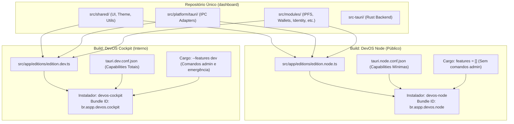
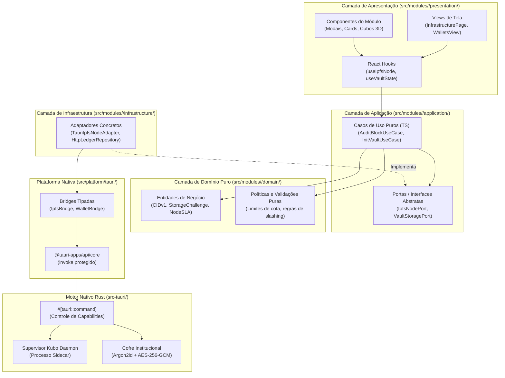
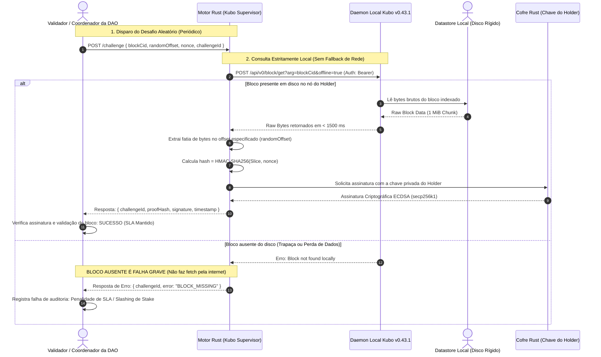
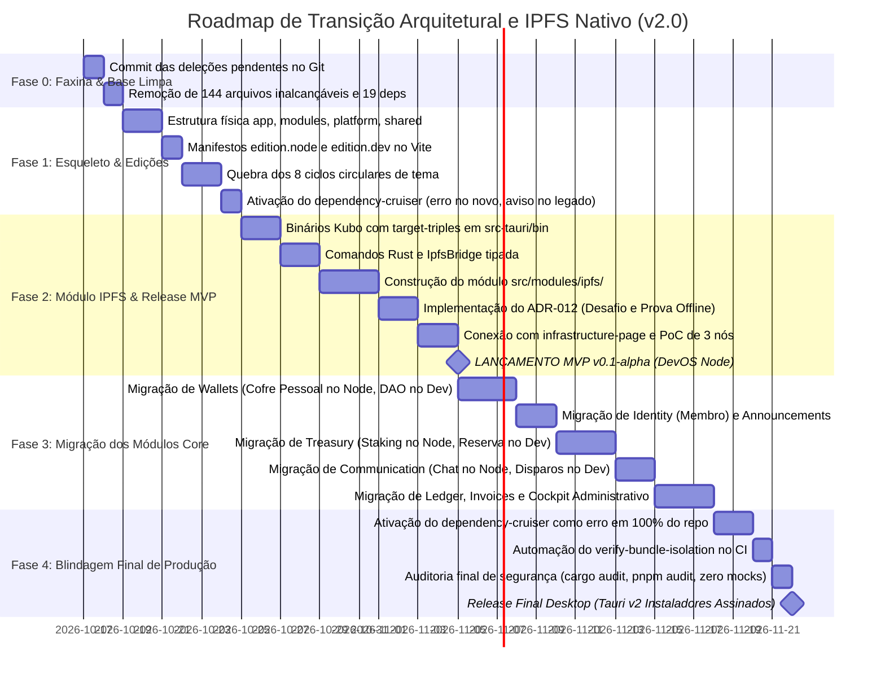

# MAPA DEFINITIVO DA ARQUITETURA E ROADMAP EM FASES (v2.0 BLINDADA)
## DevOS Desktop: Aplicação Nativa Institucional com IPFS & Rede de Pinning

**Versão:** 2.0 (Aprovada tecnicamente — Nota Alvo 9.5/10)  
**Data:** 17 de Outubro de 2026  
**Status:** PRONTO PARA EXECUÇÃO EM FASES  

---

## 1. Princípios Inegociáveis (Invariantes de Engenharia)

1. **Exclusividade Desktop Nativo (Zero Web Remanescente):** O DevOS Desktop é uma aplicação desktop nativa institucional compilada via Tauri v2. Não existem metas de deploy para navegadores públicos da web. Resíduos de deploy web (`wrangler.toml`, `public/_headers`) são sumariamente eliminados.
2. **Duas Edições, Um Repositório (Isolamento Físico de Bundles):** 
   - **DevOS Node (`br.aspp.devos.node`):** Edição pública distribuída aos Operadores de Nós e Holders da DAO. Contém estritamente o que pertence ao operador (seu nó IPFS local, seu cofre pessoal, seu stake e recompensas). Não contém código, rotas, telas ou comandos Rust administrativos.
   - **DevOS Cockpit (`br.aspp.devos.cockpit`):** Edição interna de uso restrito dos Fundadores e Desenvolvedores da DAO. Contém o controle global da rede, cofres multi-sig da DAO, livro-razão contábil, conciliação de faturas e painéis de emergência.
3. **Zero-Trust de Custódia e Segredos:** Nenhum mnemônico, seed phrase, chave privada ou senha mestre é exposto ao Webview ou persistido em `localStorage`, `sessionStorage` ou `IndexedDB`. Segredos criptográficos residem no cofre seguro em Rust (`src-tauri/`).
4. **Clean Architecture e Inversão de Dependência (Ports & Adapters):**
   - A camada `domain` é TypeScript puro (zero dependências de React, MUI, Tauri ou Axios).
   - A camada `application` define casos de uso e **Portas (Interfaces)**. Não contém hooks do React nem importa infraestrutura diretamente.
   - A camada `infrastructure` implementa os adaptadores das portas chamando a camada de plataforma ou clientes HTTP.
   - A camada `presentation` contém componentes visuais, telas e **React Hooks** que consomem os casos de uso.
5. **Encapsulamento IPC:** O frontend nunca consome `window.__TAURI_INTERNALS__` ou wrappers genéricos. Todas as invocações passam por adaptadores fortemente tipados localizados exclusivamente em `src/platform/tauri/`, invocando `@tauri-apps/api/core`.
6. **IPFS Descentralizado Nativo com Desafio Criptográfico (ADR-012):** O IPFS opera por nó nativo Kubo gerenciado como sidecar local pelo Tauri. A comprovação de armazenamento para recompensas em ASPPBR é feita por protocolo de desafio-resposta assinado criptograficamente com a chave privada do Holder, impedindo fraudes ou respostas falsas.
7. **Integridade de Compilação Contínua:** Cada commit ou mudança de fase deve manter `tsc --noEmit`, `eslint`, `vitest run`, `cargo check` e `cargo test` com 100% de aprovação.

---

## 2. Estratégia das Duas Edições: Matriz de Recursos e Isolamento



### Matriz de Classificação de Recursos por Edição

| Módulo / Ferramenta | **DevOS Node** (Holders / Operadores) | **DevOS Cockpit** (Fundadores / Devs) | Mecanismo de Isolamento Físico |
|---|:---:|:---:|---|
| **`ipfs` (Nó Local)** | ✅ | ✅ | Código compartilhado; no Node controla o daemon local |
| **`ipfs` (Visão Global da Rede)** | ❌ | ✅ | Tree-shaking no frontend; views globais excluídas do bundle Node |
| **`identity` (Sessão & Perfil)** | ✅ | ✅ | Sessão do operador no Node; gestão de membros/roles no Cockpit |
| **`wallets` (Cofre Pessoal)** | ✅ | ✅ | Criação BIP-39, assinatura do nó e guarda local segura |
| **`wallets` (DAO & Clientes)** | ❌ | ✅ | Excluído via tree-shaking do Node; comando Rust sob `#[cfg(feature = "dev")]` |
| **`governance` (Votações)** | ✅ | ✅ | Votação on-chain em propostas da DAO acessível a todos os membros |
| **`treasury` (Stake & Recompensas)** | ✅ | ✅ | View individual: cotação ASPPBR, 50.000 stake e 1.450 recompensas |
| **`treasury` (Gestão de Reserva)**| ❌ | ✅ | Controle de reservas institucionais restrito ao Cockpit |
| **`communication` (Chat P2P)** | ✅ | ✅ | Suporte à rede e salas de operadores (IndexedDB local) |
| **`communication` (Canais Externos)**| ❌ | ✅ | Disparos de SMS, WhatsApp, Email e mídias sociais restritos ao Cockpit |
| **`blog` (Comunicados da DAO)** | ✅ | ✅ | No Node: apenas leitura de comunicados; no Cockpit: editor e postagem |
| **`ledger` & `invoices`** | ❌ | ✅ | Livro-razão corporativo e emissão de faturas restritos ao Cockpit |
| **`security`, `audit`, `database`** | ❌ | ✅ | Painéis de infraestrutura corporativa restritos ao Cockpit |
| **`founder` (Emergência Nuclear)** | ❌ | ✅ | Comandos Rust sob `#[cfg(feature = "dev")]` e telas excluídas do Node |
| **`design-system` & `dev-panel`** | ❌ | ✅ | Catálogo de componentes excluído do bundle de produção do Node |
| **Mocks e Fixtures de Teste** | ❌ | ❌ | Isolados em `__fixtures__/` e excluídos de ambos os builds de release |

### Mecanismos de Garantia contra Vazamento no Node
1. **Tree-Shaking Físico via Manifesto Frontend:** O alias `@edition` é resolvido pelo Vite em tempo de build para `src/app/editions/edition.node.ts`. Como o manifesto do Node não importa as views do Cockpit, o Rollup/Vite descarta 100% desses arquivos do bundle gerado em `dist/`.
2. **Cargo Features no Rust:** Operações administrativas corporativas são isoladas por `#[cfg(feature = "dev")]`. O binário `devos-node` compila sem essa feature, tornando impossível invocar comandos inexistentes.
3. **Capabilities Tauri Separadas:** `tauri.node.conf.json` concede permissão estrita apenas aos comandos essenciais do nó e cofre pessoal.
4. **Verificação Automatizada no CI (`verify-bundle-isolation`):** Script executado antes de cada release do Node varrendo o bundle `dist/`: se houver menção a termos restritos (`emergency`, `founder`, `invoices`, etc.), a compilação falha automaticamente.

---

## 3. Esqueleto Alvo Completo do Repositório (`src/`)

```text
dashboard/
├── architecture/                     # Documentação viva e governança técnica
│   ├── adr/                          # Architectural Decision Records (ADR-009 a ADR-014)
│   ├── dependency-rules.md           # Regras formais do dependency-cruiser
│   └── arvore_completa_dashboard.md  # Relatório base de auditoria
│
├── src-tauri/                        # Backend Nativo Institucional (Rust Core)
│   ├── bin/                          # Executáveis sidecar (Kubo gerenciado com target triples)
│   │   ├── kubo-x86_64-unknown-linux-gnu
│   │   ├── kubo-x86_64-pc-windows-msvc.exe
│   │   └── kubo-aarch64-apple-darwin
│   ├── capabilities/                 # Matrizes de capacidades por edição
│   │   ├── node-operator.json        # Permissões mínimas para a edição DevOS Node
│   │   └── cockpit-admin.json        # Permissões completas para a edição DevOS Cockpit
│   ├── permissions/autogenerated/    # Manifestos granulares de comandos IPC
│   ├── src/
│   │   ├── commands/                 # #[tauri::command] fortemente tipados
│   │   │   ├── wallet_commands.rs    # Comandos de cofre e carteira pessoal
│   │   │   ├── ipfs_commands.rs      # Controle do daemon Kubo, pinning e desafio de bloco
│   │   │   ├── monitoring_commands.rs# Telemetria RPC de saldo e conectividade
│   │   │   └── admin_commands.rs     # #[cfg(feature = "dev")] Comandos restritos do Cockpit
│   │   ├── vault/                    # Argon2id, criptografia AES-256-GCM, Zeroize
│   │   ├── wallets/                  # BIP-39, derivação BIP-44, validação EIP-55
│   │   ├── ipfs/                     # Supervisor do processo Kubo e auth bearer POSIX/Windows
│   │   └── storage/                  # SQLite local criptografado
│   ├── tauri.node.conf.json          # Configuração Tauri da edição DevOS Node
│   ├── tauri.dev.conf.json           # Configuração Tauri da edição DevOS Cockpit
│   └── Cargo.toml                    # Features: default = ["node"], dev = ["node"]
│
└── src/                              # Frontend Control Plane (React 19 + TypeScript + Vite)
    │
    ├── app/                          # Orquestração do Shell Desktop e Bootstrapping
    │   ├── main.tsx                  # Ponto de entrada desktop
    │   ├── app.tsx                   # Composição raiz de provedores
    │   ├── editions/                 # Manifestos de Edição (Seleção por Build)
    │   │   ├── edition.node.ts       # Rotas e módulos da edição DevOS Node
    │   │   ├── edition.dev.ts        # Rotas e módulos completos da edição DevOS Cockpit
    │   │   └── types.ts              # Interface EditionManifest
    │   ├── router/                   # Roteamento dinâmico baseado na edição compilada
    │   └── layouts/                  # Layouts do cockpit (sidebar, barra de status do nó, header)
    │
    ├── platform/                     # Fronteira de infraestrutura nativa do sistema
    │   └── tauri/                    # Adaptadores IPC fortemente tipados
    │       ├── core/                 # Wrapper base invocando @tauri-apps/api/core
    │       ├── wallets/              # WalletBridge (VaultStatus, exportação autorizada)
    │       ├── ipfs/                 # IpfsBridge (iniciar daemon, auditar bloco, status do nó)
    │       └── system/               # SystemBridge (status do dispositivo, telemetria)
    │
    ├── modules/                      # Módulos de Negócio (Feature-First com Clean Architecture)
    │   │
    │   ├── ipfs/                     # [Módulo Piloto] Rede de Pinning & Storage Cluster
    │   │   ├── domain/               # Modelos puros: CIDv1, NodeSLA, StorageChallenge, Quota
    │   │   ├── application/          # Ports (IpfsNodePort) e Use Cases (AuditBlockUseCase)
    │   │   ├── infrastructure/       # Implementação de IpfsNodePort via platform/tauri/ipfs
    │   │   ├── presentation/         # Views (infrastructure-page, cubos 3D, cards de nó) e Hooks
    │   │   └── index.ts              # API Pública do módulo
    │   │
    │   ├── wallets/                  # [Núcleo de Custódia] Carteiras e Cofre Criptográfico
    │   │   ├── domain/               # Políticas de custódia institucional, regras de derivação
    │   │   ├── application/          # Ports (VaultStoragePort) e Use Cases de inicialização
    │   │   ├── infrastructure/       # Implementação de VaultStoragePort via platform/tauri/wallets
    │   │   ├── presentation/         # Views (wallets-page, modal efêmero, init-card) e Hooks
    │   │   └── index.ts              # API Pública do módulo
    │   │
    │   ├── identity/                 # Identidade, Membro e Sessão
    │   │   ├── domain/               # Entidades: MemberSession, OperatorCredentials, Roles
    │   │   ├── application/          # Use Cases de login por wallet e validação de sessão
    │   │   ├── infrastructure/       # Repositório de perfil e storage de sessão
    │   │   ├── presentation/         # Views: perfil de operador, configurações de conta
    │   │   └── index.ts              # API Pública do módulo
    │   │
    │   ├── treasury/                 # Tesouraria e Tokenomics ASPPBR
    │   │   ├── domain/               # Modelos de liquidez, reserva de stake (50k ASPPBR)
    │   │   ├── application/          # Casos de uso de cálculo de recompensas do nó (1.450 ASPPBR)
    │   │   ├── infrastructure/       # Cliente HTTP de cotação e pools on-chain
    │   │   ├── presentation/         # Views: painel de staking do operador e gestão DAO
    │   │   └── index.ts              # API Pública do módulo
    │   │
    │   ├── communication/            # Mensageria Institucional Offline-First
    │   │   ├── domain/               # Entidades: Channel, SignedMessage, Attachment
    │   │   ├── application/          # Fila offline de mensagens e eventos
    │   │   ├── infrastructure/       # IndexedDB wrapper (armazena apenas chats e metadados)
    │   │   ├── presentation/         # Views: chat de suporte aos operadores, canais P2P
    │   │   └── index.ts              # API Pública do módulo
    │   │
    │   ├── governance/               # Governança On-Chain da DAO
    │   │   ├── domain/               # Modelos de proposta, quórum e votos
    │   │   ├── presentation/         # Views: dao-page, votações de propostas
    │   │   └── index.ts              # API Pública do módulo
    │   │
    │   ├── announcements/            # Antigo blog: Comunicados Oficiais da DAO
    │   │   ├── domain/               # Modelos: AnnouncementItem, ReleaseNotice
    │   │   ├── presentation/         # Views: AnnouncementFeedView (leitura estática no Node)
    │   │   └── index.ts              # API Pública do módulo
    │   │
    │   ├── ledger/                   # [Exclusivo Cockpit] Livro-Razão Contábil Institucional
    │   │   ├── domain/               # Entidades contábeis e transações imutáveis
    │   │   ├── application/          # Casos de uso de macro-razão e conciliação
    │   │   ├── infrastructure/       # Cliente HTTP de sincronização contábil
    │   │   ├── presentation/         # Views: ledger-page, visualizador de extratos auditáveis
    │   │   └── index.ts              # API Pública do módulo
    │   │
    │   ├── invoices/                 # [Exclusivo Cockpit] Faturas e Liquidações em Lote
    │   │   ├── domain/               # Modelos de fatura e regras de liquidação
    │   │   ├── application/          # Casos de uso de liquidação em lote
    │   │   ├── infrastructure/       # Repositório HTTP e gerador de PDF
    │   │   ├── presentation/         # Views: invoices-page, conciliação financeira
    │   │   └── index.ts              # API Pública do módulo
    │   │
    │   └── system-cockpit/           # [Exclusivo Cockpit] Painéis Operacionais e de Emergência
    │       ├── presentation/         # Views: security, audit, database, observability, founder
    │       └── index.ts              # API Pública do módulo
    │
    └── shared/                       # Código Compartilhado Agnóstico a Negócio
        ├── components/               # UI Design System puro (botões, cards, tabelas, modais)
        │                             # Permitido: React, MUI, Emotion. Proibido: modules/*, app/*
        ├── theme/                    # Tokens institucionais (paletas, tipografia sem ciclos)
        ├── utils/                    # Utilitários puros TS (format-number, format-time, validação)
        ├── types/                    # Tipos primitivos compartilhados
        └── lib/                      # Cliente Axios base e utilitários de terceiros
```

---

## 4. Diagramas Arquiteturais e Padrão Ports & Adapters

### Diagrama 1: Clean Architecture com Inversão de Dependência (Ports & Adapters)



---

### Diagrama 2: Protocolo de Desafio Criptográfico de Armazenamento (ADR-012)



---

### Diagrama 3: Matriz de Regras de Importação (Enforcement Boundaries)

| De (Camada / Pasta) | Pode Importar | Proibido Importar (Erro Bloqueante no Linter) |
| :--- | :--- | :--- |
| **`modules/*/domain/`** | Tipos TypeScript puros | `react`, `@mui/*`, `@tauri-apps/*`, `infrastructure`, `presentation` |
| **`modules/*/application/`** | `domain`, `shared/utils`, `shared/types` | `react`, `@mui/*`, `presentation`, `infrastructure`, `src-tauri` |
| **`modules/*/infrastructure/`** | `domain`, `application` (ports), `platform/tauri`, `shared/lib` | Componentes React, hooks visuais, `@mui/*` |
| **`modules/*/presentation/`** | `domain`, `application`, `shared/components`, `shared/theme`, `shared/utils` | `infrastructure` direta, `platform/tauri` direta |
| **`platform/tauri/`** | `@tauri-apps/api/core`, `shared/types` | `modules/*`, `app/*`, componentes React, MUI |
| **`shared/components` & `theme`** | `react`, `@mui/*`, `@emotion/*`, `shared/types` | `modules/*`, `app/*`, `platform/*` |
| **`shared/utils` & `types`** | Tipos primitivos, bibliotecas puras (lodash, zod) | `react`, `@mui/*`, `modules/*`, `app/*`, `platform/*` |
| **`app/editions/edition.node`** | Módulos permitidos do Node, `platform/*`, `shared/*` | Módulos do Cockpit (`ledger`, `invoices`, `system-cockpit`) |
| **`app/editions/edition.dev`** | Todos os módulos via `index.ts`, `platform/*`, `shared/*` | Arquivos internos privados de módulos (fora do `index.ts`) |
| **Módulo A $\rightarrow$ Módulo B** | Exclusivamente via `modules/B/index.ts` | Arquivos internos privados (`modules/B/domain/...`) |

---

## 5. Resumo da Especificação Criptográfica: ADR-012

- **Título:** Protocolo de Desafio Criptográfico de Armazenamento e Auditoria DePIN
- **Problema:** Um operador desonesto poderia fingir que armazena os dados respondendo "bloco verificado" localmente, ou buscar o bloco na nuvem em tempo real caso uma auditoria permitisse tráfego online.
- **Decisão Arquitetural:**
  1. **Desafio Inesperado com Nonce:** O coordenador envia um nonce único e um offset de bytes aleatório dentro do bloco de 1 MiB.
  2. **Leitura 100% Offline (`offline=true`):** A chamada ao Kubo é executada com `--offline`. Se o nó não tiver o bloco gravado fisicamente em disco, o comando falha imediatamente.
  3. **Janela Máxima de Latência ($t < 1.500\text{ ms}$):** O nó tem no máximo 1,5 segundos para responder. Esse limite impede fisicamente que o operador faça o download de 1 MiB através da internet antes de responder.
  4. **Prova Assinada com Chave do Holder:** O hash da fatia desafiada é assinado pela chave privada do operador que está dentro do cofre Rust (`src-tauri/src/vault/`). O validador confere a assinatura on-chain contra a chave pública cadastrada no stake de 50.000 ASPPBR.
  5. **Sem Cura em Auditoria:** Em caso de bloco ausente durante a auditoria, é registrado erro de SLA. O download por Bitswap para recuperação de blocos ocorre exclusivamente em rotas separadas de sincronização e manutenção, nunca durante o desafio de prova de custódia.

---

## 6. Roadmap Estruturado em 5 Fases



---

### Detalhamento Operacional das Fases

#### **FASE 0 — Faxina Inicial e Fixação da Linha de Base**
- **Objetivo:** Limpar o ruído histórico do Git para que as métricas reflitam a realidade de forma auditável.
- **Ações:**
  1. Registrar os commits das exclusões já realizadas no working tree (`pages/dashboard/banking/*`, `sections/banking/conta/*`, `audit_files.txt`, `fix_ts*.cjs`).
  2. Eliminar os 144 arquivos inalcançáveis da árvore e as 19 dependências declaradas sem uso (`viem`, `maplibre-gl`, `@tiptap/*`).
  3. Remover resíduos de deploy web (`wrangler.toml` e `public/_headers`).
- **Critério de Saída:** `git status` limpo, `tsc --noEmit` verde, `vitest` verde e `pnpm run build` verde.

#### **FASE 1 — Implantação do Esqueleto, Manifestos de Edição e Enforcement**
- **Objetivo:** Estabelecer a estrutura física de diretórios, criar a separação física das duas edições e ativar as regras para impedir novas violações.
- **Ações:**
  1. Criar as pastas: `src/app/editions/`, `src/modules/`, `src/platform/tauri/`, `src/shared/`.
  2. Criar os manifestos `src/app/editions/edition.node.ts` e `src/app/editions/edition.dev.ts` com o alias `@edition`.
  3. Criar `src-tauri/tauri.node.conf.json` e `src-tauri/tauri.dev.conf.json`.
  4. Configurar features no `Cargo.toml` (`default = ["node"]`, `dev = ["node"]`).
  5. Resolver os 8 ciclos circulares de dependência em `src/theme/` e `src/components/`.
  6. Configurar `dependency-cruiser` em **modo erro impeditivo para diretórios novos** (`modules/`, `platform/`, `shared/`) e **aviso para legados**.
  7. Mover `src/main.tsx` e o roteador para `src/app/`.
- **Critério de Saída:** Script `pnpm run check:arch` executando sem falhas e zero ciclos no `madge --circular`.

#### **FASE 2 — Módulo Piloto IPFS Nativo, Desafio de Armazenamento e Release MVP**
- **Objetivo:** Entregar a funcionalidade de maior valor e visibilidade da DAO, já nascendo 100% aderente à Clean Architecture e liberando o primeiro executável aos Holders.
- **Ações:**
  1. Configurar os executáveis Kubo v0.43.1 em `src-tauri/bin/` com seus respectivos target triples.
  2. Implementar supervisor de daemon Kubo em Rust com token de sessão seguro (POSIX `0600` no Linux/Mac; token em memória protegida e ACL NTFS no Windows).
  3. Criar comandos IPC do IPFS e `src/platform/tauri/ipfs/ipfs-bridge.ts`.
  4. Construir `src/modules/ipfs/` com `domain/`, `application/` (ports), `infrastructure/` e `presentation/`.
  5. Implementar o protocolo de desafio-resposta do **ADR-012** com leitura offline (`block/get?offline=true`) e assinatura HMAC pelo cofre.
  6. Conectar o visualizador 3D e métricas de nós da página de infraestrutura.
  7. Validar a PoC com 3 nós em rede P2P simulada e testes de estresse de auditoria.
  8. **LANÇAMENTO HISTÓRICO: Release MVP v0.1-alpha da edição DevOS Node.**
- **Critério de Saída:** Executável `devos-node` compilado, distribuível aos Holders, com nó local operacional e auditoria criptográfica validada.

#### **FASE 3 — Migração Incremental dos Módulos Core**
- **Objetivo:** Mover os módulos existentes para dentro de `src/modules/` de forma mecânica (`git mv`), um a um, aplicando a separação por edição.
- **Ordem de Migração:**
  1. **`wallets`:** mover domínio e componentes de operador para o Node; carteiras DAO e de clientes para o Cockpit; mover `wallet-bridge.ts` para `src/platform/tauri/wallets/`.
  2. **`identity`:** absorver dados de perfil de membro e configurações de operador em `src/modules/identity/`.
  3. **`announcements`:** transformar o antigo blog em feed estático de comunicados oficiais da DAO para o Node, e editor no Cockpit.
  4. **`treasury`:** separar a visão individual de stake/recompensas (Node) da gestão de reservas institucionais (Cockpit).
  5. **`communication`:** canal de suporte e chat P2P offline-first (Node) vs disparos externos e gestão (Cockpit).
  6. **`ledger` & `invoices`:** migrar como módulos exclusivos da edição Cockpit.
  7. **`system-cockpit`:** agrupar telas de suporte (`security`, `audit`, `database`, `observability`, `founder/emergency`) como apresentação exclusiva do Cockpit.
- **Critério de Saída:** Cada módulo migrado compila individualmente sem quebrar testes anteriores.

#### **FASE 4 — Blindagem de Produção e Release Final**
- **Objetivo:** Garantir segurança estrita e paridade institucional antes da liberação final do ecossistema.
- **Ações:**
  1. Alterar a configuração do `dependency-cruiser` para **modo de erro impeditivo em 100% do repositório**.
  2. Ativar o script `verify-bundle-isolation` no pipeline de build do Node, garantindo zero bytes de código administrativo no instalador público.
  3. Assegurar que nenhuma tela visível exiba valores de mock estáticos (exibir estado explícito de dados indisponíveis onde o backend não estiver ativo).
  4. Executar bateria completa de auditoria: `pnpm audit`, `cargo audit`, `vitest run`, `cargo test`.
  5. Compilar os instaladores finais assinados: **DevOS Node** (público) e **DevOS Cockpit** (interno).
- **Critério de Saída:** Releases assinadas de ambas as edições prontas para distribuição e operação institucional.

---

## 7. Matriz de Auditoria e Decisão do Responsável

| Ponto de Decisão | Proposta Técnica do Roadmap | Decisão do Responsável |
| :--- | :--- | :--- |
| **Estratégia de Duas Edições** | Compilar `DevOS Node` (operadores de nós) e `DevOS Cockpit` (fundadores/devs) sob o mesmo repositório | `[X] APROVADO` |
| **Destino de Blog e User** | `user` absorvido por `identity`; `blog` vira feed de comunicados da DAO (leitura no Node, edição no Cockpit) | `[X] APROVADO` |
| **Destino do Chat** | Chat offline-first incluído no Node para suporte e comunicação entre operadores | `[X] APROVADO` |
| **Protocolo de Prova de Armazenamento** | Adoção do ADR-012 com desafio `(CID, Offset, Nonce)` assinado pelo cofre em $t < 1500\text{ ms}$ | `[X] APROVADO` |
| **Marco de Release do MVP** | Liberar versão MVP v0.1-alpha do `DevOS Node` imediatamente após a conclusão da Fase 2 (IPFS) | `[X] APROVADO` |
| **Aprovação Geral do Mapa v2.0** | Adotar este documento como a especificação definitiva e oficial de engenharia do DevOS Desktop | `[X] APROVADO INTEGRALMENTE` |
