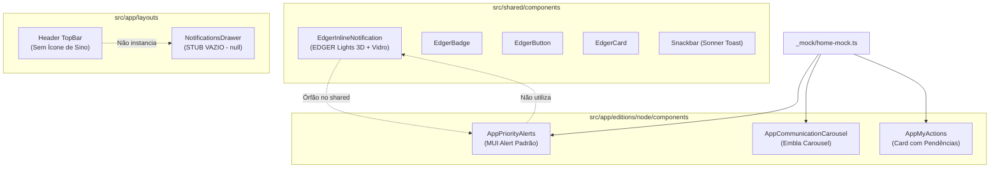
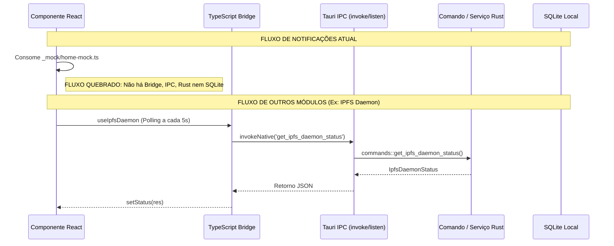

# AUDITORIA TÉCNICA INTEGRAL DO MÓDULO DE NOTIFICAÇÕES
## ASPPIBRA-DAO DevOS Desktop — React 19 + TypeScript + Tauri v2 + Rust

---

### 1. CAPA E IDENTIFICAÇÃO DA AUDITORIA

| Metadado | Detalhe |
|---|---|
| **Documento** | Relatório de Auditoria Técnica e Diagnóstico Arquitetural do Módulo de Notificações |
| **Projeto** | ASPPIBRA-DAO DevOS Desktop |
| **Edições Alvo** | DevOS Node (`br.aspp.devos.node`) & DevOS Cockpit (`br.aspp.devos.cockpit`) |
| **Stack Tecnológica** | React 19.1.1, TypeScript 6.0.2, Vite 8.0.8, Tauri v2.12.1, Rust 1.90 (Edition 2024), SQLite (Rusqlite 0.32), MUI v9, Sonner 2.0.7 |
| **Data da Auditoria** | 10/11/2026 |
| **Natureza** | Auditoria Read-Only / Diagnóstico Forense Estrito (Zero modificações no código da aplicação) |
| **Status do Relatório** | Homologado para Planejamento de Consolidação Definitiva |

---

### 2. OBJETIVO E ESCOPO

O objetivo principal desta auditoria é realizar um inventário e diagnóstico exaustivo de todos os elementos relacionados a **notificações, alertas, comunicados, avisos táticos, pendências de usuário, gavetas (drawers) e toasts** no projeto **DevOS Desktop**. 

O escopo investigativo abrangeu:
1. Todos os componentes visuais existentes no frontend React.
2. Toda a lógica de gerenciamento de estado local, global e contextual.
3. Todo o backend nativo em Rust (`src-tauri/src/`), seus comandos e modelos.
4. Os canais e contratos de IPC Tauri v2 (`invoke`, `listen`, `emit`, `Channel`).
5. A organização de diretórios e compatibilidade com os padrões de arquitetura (Clean Architecture, DDD, Dependency Cruising).
6. A persistência de dados (SQLite, armazenamento local ou em memória).
7. As fontes de eventos dos módulos do ecossistema (IPFS, Wallets/Vault, Identity, DePIN/Monitoring, Ledger, Real Estate, Documents).
8. A suíte de testes (Vitest no frontend e Cargo Test no Rust).

---

### 3. RESUMO EXECUTIVO

A auditoria revelou um cenário de **profunda assimetria** entre a camada de design visual e a infraestrutura nativa/arquitetural:

1. **Camada Visual Pronta, porém Desconectada:** O design system institucional possui componentes táteis de alto padrão no padrão **EDGER Lights** (`EdgerInlineNotification`, `EdgerBadge`, `EdgerCard`, `EdgerButton`), com efeitos de vidro líquido e bordas 3D. Contudo, esses componentes estão **isolados** em `src/shared/components/edger-lights/` e **não são consumidos** pelas telas da aplicação.
2. **Dashboard Operando sobre Dados Mockados:** No `NodeDashboardPage` (`src/app/editions/node/node-dashboard-page.tsx`), os componentes `AppPriorityAlerts`, `AppCommunicationCarousel` e `AppMyActions` são renderizados consumindo coleções estáticas de `src/app/editions/node/_mock/home-mock.ts`. Não há qualquer conexão desses alertas com o estado real do nó IPFS, com o cofre criptográfico ou com a rede DePIN.
3. **Inexistência de Motor Central de Notificações:** Não existe nenhum serviço, repositório, event bus, hook unificado ou store global para gerenciar notificações no frontend. Cada componente visual implementa seu próprio estado transitório e volátil via `useState`.
4. **Vácuo no Núcleo Nativo Rust:** No backend (`src-tauri/`), **não existe nenhum comando Tauri, struct Rust, módulo ou migration SQLite para notificações**. O Tauri não emite nenhum evento de notificação em tempo real para o frontend (`app.emit` ou `window.emit` são inexistentes para notificações).
5. **Drawer de Notificações Inoperante (Stub Vazio):** O arquivo `src/app/layouts/components/notifications-drawer.tsx` é apenas um stub que retorna `null` (`export function NotificationsDrawer({ data }: { data?: any }) { return null; }`). Além disso, o botão de sino no TopBar/Header (`src/app/layouts/devos/layout.tsx`) sequer existe.
6. **Toasts Pontuais Funcionais:** O único mecanismo de notificação atualmente em produção e conectado aos fluxos de trabalho reais são os toasts voláteis (`sonner`) disparados manualmente através de `toast.success` / `toast.error` no módulo de documentos e na autenticação.

---

### 4. NOTA TÉCNICA GERAL DE MATURIDADE

```
[ NOTA GERAL DO MÓDULO DE NOTIFICAÇÕES: 2.8 / 10.0 ]
┌──────────────────────────────┬────────┬────────────────────────────────────────────────────────┐
│ Dimensão                     │ Nota   │ Diagnóstico Sintético                                  │
├──────────────────────────────┼────────┼────────────────────────────────────────────────────────┤
│ 1. Componentes Visuais       │ 6.5/10 │ Belos componentes EDGER Lights, mas órfãos; UI usa mock│
│ 2. Lógica & Orquestração     │ 1.5/10 │ Sem central de eventos, sem desduplicação, sem regras  │
│ 3. Integração Rust / Tauri   │ 0.0/10 │ Inexistente (zero comandos, zero structs, zero eventos)│
│ 4. Persistência & Histórico  │ 0.0/10 │ Inexistente (sem SQLite, sem retenção, 100% volátil)   │
│ 5. Fontes de Eventos DevOS   │ 2.0/10 │ Módulos têm comandos próprios, mas nenhum gera alertas │
│ 6. Arquitetura & Diretórios  │ 4.0/10 │ Componentes isolados em edição node ao invés de domínio│
│ 7. Testes Automatizados      │ 2.5/10 │ Testes de tokens passam; zero testes de componentes/fluxo│
└──────────────────────────────┴────────┴────────────────────────────────────────────────────────┘
```

---

### 5. INVENTÁRIO INTEGRAL DE ARQUIVOS

A pesquisa global no repositório identificou os seguintes arquivos relacionados direta ou indiretamente ao módulo:

| Caminho Relativo | Nome do Arquivo | Camada | Responsabilidade | Status Real |
|---|---|---|---|---|
| `src/shared/components/edger-lights/edger-inline-notification.tsx` | `edger-inline-notification.tsx` | Presentation (Shared) | Componente visual tátil de notificação horizontal EDGER Lights com vidro líquido | **VISUAL PRONTO / NÃO CONECTADO** |
| `src/shared/components/edger-lights/types.ts` | `types.ts` | Domain (Shared UI) | Contratos TypeScript de propriedades e variantes EDGER Lights | **PRONTO** |
| `src/shared/components/edger-lights/edger-tokens.ts` | `edger-tokens.ts` | Infrastructure (Theme) | Tokens de cores, sombras e gradientes EDGER Lights | **PRONTO** |
| `src/shared/components/edger-lights/edger-badge.tsx` | `edger-badge.tsx` | Presentation (Shared) | Badge squircle pulsante para severidade e status | **PRONTO / NÃO UTILIZADO** |
| `src/shared/components/edger-lights/edger-card.tsx` | `edger-card.tsx` | Presentation (Shared) | Card de conteúdo estilizado com bordas táteis 3D | **PRONTO / NÃO UTILIZADO** |
| `src/shared/components/edger-lights/edger-button.tsx` | `edger-button.tsx` | Presentation (Shared) | Botão tátil 3D sincronizado com paleta de alertas | **PRONTO / NÃO UTILIZADO** |
| `src/shared/components/edger-lights/edger-lights.spec.ts` | `edger-lights.spec.ts` | Testing | Teste unitário dos design tokens do EDGER Lights | **PRONTO (4 testes OK)** |
| `src/shared/components/snackbar/snackbar.tsx` | `snackbar.tsx` | Presentation (Shared) | Container portal do Sonner Toaster customizado | **PRONTO E ATIVO** |
| `src/shared/components/snackbar/styles.tsx` | `styles.tsx` | Presentation (Shared) | Estilos Emotion do toast Sonner | **PRONTO E ATIVO** |
| `src/shared/components/snackbar/classes.ts` | `classes.ts` | Presentation (Shared) | Classes utilitárias do toast | **PRONTO E ATIVO** |
| `src/shared/components/snackbar/index.ts` | `index.ts` | Presentation (Shared) | Re-exporta `sonner` e componentes locais | **PRONTO E ATIVO** |
| `src/app/editions/node/components/app-priority-alerts.tsx` | `app-priority-alerts.tsx` | Presentation (Node App) | Lista vertical colapsável de alertas com base no MUI Alert padrão | **VISUAL / DEMONSTRATIVO** |
| `src/app/editions/node/components/app-communication-carousel.tsx` | `app-communication-carousel.tsx` | Presentation (Node App) | Carrossel Embla com filtros por prioridade e comunicados | **VISUAL / DEMONSTRATIVO** |
| `src/app/editions/node/components/app-my-actions.tsx` | `app-my-actions.tsx` | Presentation (Node App) | Lista de cartões com ações pendentes e rotas de destino | **VISUAL / DEMONSTRATIVO** |
| `src/app/editions/node/types/home.ts` | `home.ts` | Domain (Node App) | Tipos e contratos de `PriorityAlert`, `CommunicationItem`, `PendingAction` | **PARCIAL / MAL LOCALIZADO** |
| `src/app/editions/node/_mock/home-mock.ts` | `home-mock.ts` | Mock Data | Dados falsos estáticos para alertas, comunicados e ações pendentes | **DEMONSTRATIVO** |
| `src/app/editions/node/node-dashboard-page.tsx` | `node-dashboard-page.tsx` | Presentation (Page) | Montagem do painel agregador do NodeDashboard | **PARCIAL / DEMONSTRATIVO** |
| `src/app/layouts/components/notifications-drawer.tsx` | `notifications-drawer.tsx` | Presentation (Layout) | Gaveta lateral do histórico de notificações | **STUB VAZIO (`return null`)** |
| `src/app/layouts/devos/layout.tsx` | `layout.tsx` | Presentation (Layout) | Layout principal do DevOS (TopBar e Sidebar) | **INCOMPLETO (Sem botão de sino)** |
| `src/app/router/paths.ts` | `paths.ts` | Infrastructure (Router) | Mapeia rota `paths.devos.notifications.root` (`/devos/notifications`) | **PARCIAL (Rota não registrada)** |
| `src/app/router/app-router.tsx` | `app-router.tsx` | Infrastructure (Router) | Roteador principal da aplicação | **SEM ROTA DE NOTIFICAÇÕES** |
| `src-tauri/src/lib.rs` | `lib.rs` | Core (Rust) | Ponto de entrada nativo e registro de comandos Tauri | **SEM COMANDOS DE NOTIFICAÇÃO** |
| `src-tauri/capabilities/default.json` | `default.json` | Security (Tauri) | Declaração de permissões e capabilities da janela principal | **SEM PERMISSÃO DE NOTIFICAÇÃO** |

---

### 6. ÁRVORE ATUAL DE DIRETÓRIOS

A disposição atual dos arquivos envolvidos demonstra uma fragmentação arquitetural significativa:

```
DevOS-Desktop/
├── src/
│   ├── app/
│   │   ├── editions/
│   │   │   └── node/
│   │   │       ├── _mock/
│   │   │       │   └── home-mock.ts                # [DEMONSTRATIVO] Mocks de comunicados e alertas
│   │   │       ├── components/
│   │   │       │   ├── app-communication-carousel.tsx # [DEMONSTRATIVO] Carrossel de comunicados
│   │   │       │   ├── app-my-actions.tsx          # [DEMONSTRATIVO] Central de ações pendentes
│   │   │       │   └── app-priority-alerts.tsx     # [DEMONSTRATIVO] Alertas baseados em MUI Alert
│   │   │       ├── node-dashboard-page.tsx         # [PAGE] Dashboard montando os componentes
│   │   │       └── types/
│   │   │           └── home.ts                     # [TYPES] Tipos isolados no escopo node
│   │   ├── layouts/
│   │   │   ├── components/
│   │   │   │   └── notifications-drawer.tsx        # [STUB] Gaveta vazia (retorna null)
│   │   │   └── devos/
│   │   │       └── layout.tsx                      # [LAYOUT] Header sem acionador de notificações
│   │   └── router/
│   │       └── paths.ts                            # [ROUTER] Rota declarada mas não roteada
│   ├── shared/
│   │   └── components/
│   │       ├── edger-lights/                       # [DESIGN SYSTEM INSTITUCIONAL]
│   │       │   ├── edger-badge.tsx                 # Badge tátil pulsante
│   │       │   ├── edger-button.tsx                # Botão tátil 3D
│   │       │   ├── edger-card.tsx                  # Card vidro líquido 3D
│   │       │   ├── edger-inline-notification.tsx   # [ÓRFÃO] Notificação oficial EDGER Lights
│   │       │   ├── edger-tokens.ts                 # Paleta e gradientes oficiais
│   │       │   ├── edger-lights.spec.ts            # Teste de tokens
│   │       │   ├── index.ts                        # Re-exportador
│   │       │   └── types.ts                        # Tipos do design system
│   │       └── snackbar/                           # [TOAST SYSTEM]
│   │           ├── snackbar.tsx                    # Sonner Toaster ativo
│   │           └── styles.tsx                      # Customização visual
└── src-tauri/
    ├── src/
    │   ├── commands/                               # [BACKEND] Sem comandos de notificação
    │   ├── modules/                                # [BACKEND] Sem módulo de notificação
    │   └── storage/
    │       └── migrations.rs                       # [SQLITE] Sem tabelas de notificações
    └── capabilities/
        └── desktop-vault.json                      # [PERMISSÕES] Sem ACL de notificações
```

---

### 7. CATÁLOGO COMPLETO DE COMPONENTES VISUAIS



---

### 8. FICHAS TÉCNICAS INDIVIDUAIS DOS COMPONENTES

#### Ficha 8.1: AppPriorityAlerts
1. **Arquivo e localização:** `src/app/editions/node/components/app-priority-alerts.tsx` (linhas 1 a 63).
2. **Responsabilidade:** Renderizar lista colapsável de avisos de alta prioridade ("urgente" e "importante") no topo da coluna principal do dashboard.
3. **Estrutura interna:** `<Stack>` contendo mapeamento de `<Collapse>` envolvendo componentes `<Alert>` do Material UI.
4. **Props e interfaces:** `type Props = { alerts: PriorityAlert[] }`, onde `PriorityAlert` define `id`, `type`, `title`, `message`, `actionText`, `actionUrl`, `actionHandler`, `isDismissible`.
5. **Estados locais:** `useState<Record<string, boolean>>` inicializado com `{ [alert.id]: true }`.
6. **Hooks utilizados:** `useState`.
7. **Dependências:** `@mui/material` (`Box`, `Alert`, `Stack`, `Button`, `Collapse`, `AlertTitle`), `RouterLink`.
8. **Origem dos dados:** Objeto estático `_homePriorityAlerts` injetado via prop pelo `NodeDashboardPage`.
9. **Ações disponíveis:** Fechar alerta (`handleClose`), botão de ação externa/interna (`actionHandler` ou navegação `actionUrl`).
10. **Estado real de funcionamento:** **VISUAL / DEMONSTRATIVO**. Funciona na interface gráfica, mas qualquer fechamento é perdido ao recarregar a tela ou navegar entre abas.
11. **Problemas identificados:**
    - Utiliza o `<Alert>` cru do Material UI (visual plano e genérico), destoando completamente da identidade visual EDGER Lights.
    - O comentário em `edger-button.tsx:11` cita explicitamente `"Modelo Oficial sincronizado com AppPriorityAlerts"`, mas o `AppPriorityAlerts` nunca foi atualizado para usar os componentes EDGER.
    - Descarte não persistente (volátil em memória local).
12. **Melhorias recomendadas:**
    - Substituir a renderização de `<Alert>` por `<EdgerInlineNotification>`.
    - Integrar o descarte a um repositório persistente (banco local SQLite / estado central).

#### Ficha 8.2: AppCommunicationCarousel
1. **Arquivo e localização:** `src/app/editions/node/components/app-communication-carousel.tsx` (linhas 1 a 206).
2. **Responsabilidade:** Exibir carrossel rotativo de comunicados institucionais com barra superior de filtros e autoplay.
3. **Estrutura interna:** `<Card>` contendo barra de `<Chip>` para filtros, botões de paginação manual, viewport Embla (`embla-carousel-react`), slide individual `CarouselItem` e barra inferior de indicadores dot/pill.
4. **Props e interfaces:** `CardProps & { list: CommunicationItem[] }`.
5. **Estados locais:** `filter: string` ('todos', 'urgente', 'importante', 'novidade', 'destaque'), `selectedIndex: number`.
6. **Hooks utilizados:** `useEmblaCarousel`, `useState`, `useEffect`, `useCallback`, `useTheme`.
7. **Dependências:** `embla-carousel-react`, `@mui/material`, `src/shared/components/image`, `src/shared/components/iconify`, `RouterLink`.
8. **Origem dos dados:** Mock `_homeCommunications` em `src/app/editions/node/_mock/home-mock.ts`.
9. **Ações disponíveis:** Filtrar por categoria, avançar/retroceder slide, clicar no indicador dot, clicar no botão de CTA do comunicado (`linkUrl`).
10. **Estado real de funcionamento:** **VISUAL / DEMONSTRATIVO**. O carrossel roda visualmente de forma perfeita (autoplay a cada 5s e transição fluida), mas os dados são totalmente fictícios.
11. **Problemas identificados:**
    - As imagens de capa utilizam URLs externas do Unsplash (`https://images.unsplash.com/...`). Em ambiente desktop offline ou sem acesso externo, as imagens quebram.
    - O carrossel não se comunica com nenhum feed de comunicados da DAO ou broadcast P2P.
12. **Melhorias recomendadas:**
    - Criar serviço de sincronização de comunicados institucionais via IPFS ou canal assinado da DAO.
    - Incluir cache de imagens locais ou placeholders vetoriais temáticos.

#### Ficha 8.3: EdgerInlineNotification
1. **Arquivo e localização:** `src/shared/components/edger-lights/edger-inline-notification.tsx` (linhas 1 a 219).
2. **Responsabilidade:** Notificação horizontal tátil de alta fidelidade visual, com suporte a vidro líquido translúcido, bordas 3D (`lateral` e `bottom`), ações primárias/secundárias e descarte.
3. **Estrutura interna:** `<Box>` com gradientes compostos, `backdropFilter: blur(16px)`, pseudo-elemento `::before` para lâmina de brilho especular superior, elevação e sombras direcionais com cor de acento.
4. **Props e interfaces:** `EdgerInlineNotificationProps` (em `types.ts` linhas 47 a 62): `title`, `description`, `variant` ('rose', 'amber', 'emerald', 'sky', 'purple', 'slate'), `edgeStyle` ('lateral', 'bottom'), `timestamp`, `icon`, `actionText`, `onAction`, `secondaryActionText`, `onSecondaryAction`, `onClose`, `unread`, `pulse`, `elevation3D`, `sx`.
5. **Estados locais:** Nenhum (componente puramente controlado/apresentacional).
6. **Hooks utilizados:** `useTheme`.
7. **Dependências:** `@mui/material` (`Box`, `Typography`, `IconButton`, `alpha`, `useTheme`), `src/shared/components/iconify`, `EdgerButton`, `EDGER_TOKENS`.
8. **Origem dos dados:** Informados via props pelo consumidor.
9. **Ações disponíveis:** Callback `onAction`, `onSecondaryAction`, `onClose`.
10. **Estado real de funcionamento:** **PRONTO, MAS ÓRFÃO / NÃO CONECTADO**. O código visual está 100% completo e validado por design tokens, porém não é importado em nenhuma tela da aplicação.
11. **Problemas identificados:**
    - Inutilizado: nenhum componente consome esta implementação.
12. **Melhorias recomendadas:**
    - Promover a componente padrão para renderizar alertas de prioridade, notificações do drawer e avisos táticos de módulos.

#### Ficha 8.4: AppMyActions
1. **Arquivo e localização:** `src/app/editions/node/components/app-my-actions.tsx` (linhas 1 a 85).
2. **Responsabilidade:** Listar pendências operacionais críticas do usuário no ecossistema (e.g., votações, sincronização de nó, backup de cofre).
3. **Estrutura interna:** `<Card>` com `<CardHeader>` e `<Stack>` contendo linhas com ícone em badge, textos e botão de ação para navegação.
4. **Props e interfaces:** `type Props = { actions: PendingAction[] }`, com `id`, `title`, `description`, `actionText`, `actionUrl`, `priority`.
5. **Estados locais:** Nenhum.
6. **Hooks utilizados:** Nenhum.
7. **Dependências:** `@mui/material`, `RouterLink`, `Iconify`.
8. **Origem dos dados:** Mock `_homePendingActions` em `src/app/editions/node/_mock/home-mock.ts`.
9. **Ações disponíveis:** Botão de ação que redireciona via `RouterLink` para o destino (`actionUrl`).
10. **Estado real de funcionamento:** **VISUAL / DEMONSTRATIVO**.
11. **Problemas identificados:**
    - Resolução de ícone heurística por substring em string minúscula (`title.toLowerCase().includes('votação')`), o que é extremamente frágil e quebra caso o título mude.
    - Ausência de mecanismo para marcar ação como concluída ou ocultar ação resolvida.
    - Sem integração com o cofre para verificar se a chave mnemônica realmente necessita de backup.
12. **Melhorias recomendadas:**
    - Tipar explicitamente o tipo de ação (`action_type: 'governance_vote' | 'node_sync' | 'vault_backup'`).
    - Conectar aos serviços reais dos módulos correspondentes para avaliar pendências reais.

#### Ficha 8.5: NotificationsDrawer
1. **Arquivo e localização:** `src/app/layouts/components/notifications-drawer.tsx` (linhas 1 a 3).
2. **Responsabilidade:** Deveria ser o painel deslizante (Drawer) para histórico de notificações recebidas, leitura, arquivamento e limpeza.
3. **Estrutura interna:** `export function NotificationsDrawer({ data }: { data?: any }) { return null; }`
4. **Props e interfaces:** `{ data?: any }` (sem tipagem de contrato).
5. **Estados locais:** Inexistente.
6. **Hooks utilizados:** Nenhum.
7. **Dependências:** Nenhuma.
8. **Origem dos dados:** Inexistente.
9. **Ações disponíveis:** Nenhuma.
10. **Estado real de funcionamento:** **STUB VAZIO / NÃO IMPLEMENTADO**.
11. **Problemas identificados:** O arquivo existe apenas como placeholder esquecido desde a criação do layout.
12. **Melhorias recomendadas:**
    - Implementar a gaveta lateral com Material UI `<Drawer>`, listando itens com `<EdgerInlineNotification>` ou cartões EDGER compactos, abas "Não lidas" / "Todas", e botão de "Marcar todas como lidas".

#### Ficha 8.6: Snackbar (Sonner Toast)
1. **Arquivo e localização:** `src/shared/components/snackbar/snackbar.tsx` (linhas 1 a 48) e `styles.tsx`.
2. **Responsabilidade:** Renderizar alertas voláteis flutuantes no canto superior direito para confirmação imediata de operações (sucesso, erro, loading).
3. **Estrutura interna:** `<Portal>` envolvendo `<SnackbarRoot>` (`styled(Toaster)` do pacote `sonner`).
4. **Props e interfaces:** Encapsula a API padrão do `sonner` (`toast.success()`, `toast.error()`, `toast.info()`).
5. **Estados locais:** Gerenciado internamente pela biblioteca Sonner.
6. **Hooks utilizados:** Nenhum no componente wrapper.
7. **Dependências:** `sonner`, `@mui/material/Portal`, `@mui/material/styles`, `Iconify`.
8. **Origem dos dados:** Disparos imperativos nos controladores e views (e.g. `CessaoPosseView.tsx`, `CitizenLedgerView.tsx`, `jwt-verify-view.tsx`).
9. **Ações disponíveis:** Fechamento automático por temporizador e botão manual de fechar.
10. **Estado real de funcionamento:** **PRONTO E ATIVO**. É a única parte de feedback dinâmico 100% operacional no sistema hoje.
11. **Problemas identificados:** Toasts são voláteis; quando o usuário perde a mensagem flutuante, não há histórico persistido onde ele possa consultar a falha ou o hash gerado.
12. **Melhorias recomendadas:**
    - Conectar os disparos de toast a um canal de eventos que também registre a notificação no histórico da Central / Drawer.

---

### 9. ARQUITETURA ATUAL DE FRONTEND

A análise do fluxo de dados e estado no frontend comprova a **ausência de um subsistema de notificações**:

1. **Inexistência de Contexto de Notificações:** Em `src/app/providers/app-providers.tsx`, os únicos provedores globais instalados são:
   - `ThemeProvider`
   - `AppBootstrapProvider` (ciclo de vida do cofre nativo)
   - `Snackbar` (Sonner)
2. **Ausência de Store / Redutor:** Não existe biblioteca de estado global como Zustand ou Redux no projeto. Os módulos que necessitam de estado compartilhado utilizam React Context ou SWR. Não existe nenhum `NotificationContext` ou `useNotifications`.
3. **Distribuição de Alertas via Props Locais:**
   ```
   home-mock.ts (_homePriorityAlerts)
        ↓
   NodeDashboardPage
        ↓
   AppPriorityAlerts (alerts={_homePriorityAlerts})
        ↓
   useState local (openAlerts: Record<string, boolean>)
   ```
   Esse fluxo demonstra que qualquer alteração de estado fica confinada estritamente ao componente local. Se o usuário navegar para a tela de IPFS e voltar, o estado dos alertas é reiniciado.

---

### 10. ARQUITETURA ATUAL DO NÚCLEO NATIVO RUST

A inspeção detalhada de `src-tauri/src/` revelou:

1. **Catálogo de Comandos Registrados:** Em `src-tauri/src/lib.rs` (linhas 45 a 76), há 31 comandos registrados para a edição Node e mais 7 para a edição Cockpit. **Nenhum comando pertence ao domínio de notificações**.
2. **Módulos Nativos Existentes:**
   - `modules/vault`: Sessão do cofre, criptografia AES-256-GCM, PBKDF2/Argon2.
   - `modules/wallets`: Criação de carteiras BIP39/BIP32/BIP44.
   - `modules/ipfs`: Daemon Kubo, pinning, integridade, storage proof.
   - `modules/documents`: Compilação de PDF Typst, contratos, faturas, extratos.
   - `modules/reports`: Geração de relatórios analíticos.
   - `modules/monitoring`: Cliente RPC multichain para saldo de carteiras.
   - `modules/real_estate`: Normalização e importação de planilhas territoriais.
   - `storage`: SQLite local para o cofre e cadastro imobiliário.
3. **Ausência de Módulo Nativo:** Não existe a pasta `src-tauri/src/modules/notifications/`.
4. **Ausência de Emissão de Eventos Tauri:**
   - Uma pesquisa por `app.emit`, `app_handle.emit` ou `window.emit` em `src-tauri/src/` retornou **zero ocorrências**.
   - O backend opera exclusivamente no padrão **Request-Response (RPC síncrono/assíncrono)** através de comandos Tauri. Não existe nenhum fluxo de **Push / Broadcast** implementado do Rust para o React.

---

### 11. MAPA DE INTEGRAÇÕES TAURI IPC

O rastreamento da ponte nativa evidencia a quebra completa do fluxo para notificações:



| Camada | Elemento Esperado | Estado Encontrado |
|---|---|---|
| **Evento Nativo Rust** | Emissão de evento de falha ou transação | **NÃO IMPLEMENTADO** |
| **Comando Tauri** | `list_notifications`, `mark_as_read`, `dismiss_notification` | **NÃO IMPLEMENTADO** |
| **Tauri IPC** | Canal de eventos `listen('devos://notification')` | **NÃO IMPLEMENTADO** |
| **Bridge TypeScript** | `src/platform/tauri/notifications/notification-bridge.ts` | **NÃO IMPLEMENTADO** |
| **Contratos IPC** | `src/platform/tauri/contracts/notification-contracts.ts` | **NÃO IMPLEMENTADO** |
| **React Hook** | `useNotifications()` | **NÃO IMPLEMENTADO** |
| **Componente UI** | `NotificationsDrawer`, `AppPriorityAlerts` | **DESCONECTADO / MOCK** |

---

### 12. MAPA DAS FONTES DE EVENTOS DO DEVOS

Investigação sobre a capacidade dos módulos do DevOS de gerarem alertas e eventos:

| Módulo | Eventos Potenciais Identificados | Situação da Integração com Notificações | Classificação |
|---|---|---|---|
| **IPFS** | Queda do daemon Kubo, perda de peers, falha de pinning, sucesso de upload/download | O hook `useIpfsDaemon` faz polling a cada 5s e salva erro localmente. Não emite alerta global. | **IMPLEMENTADA PARCIALMENTE / NÃO CONECTADA** |
| **Wallets / Cofre** | Trancamento por inatividade, chave exportada, backup pendente, saldo alterado | O cofre opera via `VaultSession` em memória. Não gera notificação quando bloqueado ou desbloqueado. | **IMPLEMENTADA PARCIALMENTE / NÃO CONECTADA** |
| **Identity / Host** | Integridade do dispositivo comprometida, host não autenticado | Comando `get_device_status` existe, exibido no `HostIntegrityCard`. Não emite alertas. | **IMPLEMENTADA PARCIALMENTE / NÃO CONECTADA** |
| **DePIN / Monitoring** | Verificação de SLA do nó, latência de rede, bloco validado | `monitoring_commands.rs` possui RPC para saldos multichain. Não possui daemon de monitoramento contínuo. | **PREPARADA, MAS NÃO CONECTADA** |
| **Tesouraria / Ledger** | Transação financeira confirmada, exportação de extrato, divergência contábil | Geração de PDF dispara `toast.success` ou `toast.error`. Não gera notificação persistida no histórico. | **IMPLEMENTADA PARCIALMENTE (TOAST APENAS)** |
| **DAO / Governança** | Nova proposta de votação, prazo expirando, quórum atingido | Módulo DAO não existe em Rust. Dados na UI vêm de `_homeGovernanceHighlight` (mock estático). | **NÃO IMPLEMENTADO (DEMONSTRATIVO)** |
| **Cadastro Imobiliário** | Lote com divergência, importação finalizada, inconsistência cadastral | Importador processa planilhas e registra `audit_events` no SQLite do Cockpit. Não emite notificação para a UI. | **IMPLEMENTADA PARCIALMENTE / NÃO CONECTADA** |
| **Documentos** | Compilação de Cessão de Posse, expiração de preview no cache | Operações disparam `toast.success` e `toast.error`. Não gravam no histórico de notificações. | **IMPLEMENTADA PARCIALMENTE (TOAST APENAS)** |

---

### 13. FLUXO COMPLETO DE PROCESSAMENTO (ESTADO REAL VS. ALVO)

```mermaid
flowchart TD
    subgraph Estado_Atual_Falho [ESTADO ATUAL DO PROJETO]
        E1[Evento de Sistema Ex: Queda do IPFS] -.->|Não gera notificação| E2[Nenhum Listener]
        MockData[_mock/home-mock.ts] -->|Dados estáticos| UI1[AppPriorityAlerts / Carousel]
        UI1 -->|Descarte| State1[useState local - Perde ao recarregar]
        ViewAction[Ação em View Ex: Exportar PDF] -->|toast.success| ToastUI[Sonner Toast Flutuante]
        ToastUI -->|Some em 4 segundos| LostHistory[Sem histórico]
    end

    subgraph Arquitetura_Alvo_Consolidada [ARQUITETURA RECOMENDADA]
        R1[Módulos Nacionais Rust IPFS / Vault / Ledger / DePIN] -->|Eventos ou IPC| Engine[Rust Notification Engine]
        Engine -->|Grava com integridade| SQLite[(SQLite devos_vault.sqlite)]
        Engine -->|app.emit| TauriEvent[Tauri Event: devos://notification]
        TauriEvent -->|listen| TSBridge[NotificationBridge / Hook]
        TSBridge -->|Atualiza estado global| NotifStore[Notification Center / Store]
        NotifStore -->|Exibe na TopBar| BellBadge[Badge de Sino no Header]
        NotifStore -->|Abre histórico| Drawer[NotificationsDrawer com EDGER Lights]
        NotifStore -->|Alertas urgentes| PriorityBanner[AppPriorityAlerts com EDGER Lights]
        NotifStore -->|Feedback imediato| Toast[Sonner Toast]
    end
```



---

### 14. MODELO DE DADOS E CONTRATOS

#### Modelos Atuais no Frontend (Fragmentados e Parciais)
Em `src/app/editions/node/types/home.ts`:
```typescript
// Alertas do topo do dashboard
export type PriorityAlert = {
  id: string;
  type: 'urgente' | 'importante';
  title: string;
  message: string;
  actionText?: string;
  actionUrl?: string;
  actionHandler?: () => void;
  isDismissible?: boolean;
};

// Comunicados do carrossel
export type CommunicationItem = {
  id: string;
  title: string;
  description: string;
  coverUrl: string;
  linkText?: string;
  linkUrl?: string;
  priority: 'urgente' | 'importante' | 'novidade' | 'destaque';
  channel: 'noticias' | 'avisos' | 'comunicados' | 'novidades';
  createdAt: string;
};

// Pendências
export type PendingAction = {
  id: string;
  title: string;
  description: string;
  actionText: string;
  actionUrl: string;
  priority: 'high' | 'medium' | 'low';
};
```

Em `src/shared/components/edger-lights/types.ts`:
```typescript
// Propriedades do componente EDGER Lights
export type EdgerInlineNotificationProps = {
  title: string;
  description: React.ReactNode;
  variant?: 'rose' | 'amber' | 'emerald' | 'sky' | 'purple' | 'slate';
  edgeStyle?: 'lateral' | 'bottom';
  timestamp?: string;
  icon?: string | React.ReactNode;
  actionText?: string;
  onAction?: () => void;
  secondaryActionText?: string;
  onSecondaryAction?: () => void;
  onClose?: () => void;
  unread?: boolean;
  pulse?: boolean;
  elevation3D?: boolean;
  sx?: SxProps<Theme>;
};
```

#### Modelo no Backend Rust
**INEXISTENTE**. Não há nenhuma struct correspondente em todo o código Rust.

#### Inconsistências Identificadas entre os Modelos:
1. `PriorityAlert.type` usa `'urgente' | 'importante'`, enquanto `EdgerInlineNotificationProps.variant` usa cores conceituais (`'rose' | 'amber' | ...`). Não existe função de mapeamento canônica.
2. `CommunicationItem.priority` mistura severidade com editorial (`'urgente' | 'importante' | 'novidade' | 'destaque'`).
3. `PendingAction.priority` usa inglês (`'high' | 'medium' | 'low'`), enquanto os demais usam português.
4. Nenhum dos modelos possui campos obrigatórios para rastreamento de ciclo de vida: `source_module`, `read_at`, `dismissed_at`, `expires_at`, `payload_sha256`.

---

### 15. ESTRATÉGIA DE PERSISTÊNCIA

1. **Persistência em Banco SQLite Local:**
   - O arquivo `src-tauri/src/storage/migrations.rs` gerencia as migrações do `devos_vault.sqlite`. As tabelas existentes são: `schema_migrations`, `vault_header`, `wallets` e `vault_secrets`.
   - **Não existe tabela de notificações**.
2. **Persistência no Navegador/Frontend:**
   - Não há chamadas a `localStorage`, `sessionStorage` ou `indexedDB` no código fonte da aplicação.
   - Todo o estado visual das notificações reside em memória volátil de componentes React (`useState`).
3. **Consequência Técnica:**
   - Reinicializações da aplicação, trocas de tela ou atualizações de página apagam completamente qualquer interação do usuário com os alertas (como alertas fechados ou lidos).

---

### 16. SEGURANÇA E CONFIABILIDADE

Aspectos críticos de segurança investigados:

1. **Permissões Tauri e Capabilities:**
   - No arquivo `src-tauri/capabilities/desktop-vault.json`, há permissões estritas para cofre, IPFS e documentos.
   - Não há capability aberta ou necessária para notificações no momento.
2. **Execução de Ações a partir de Notificações:**
   - Um princípio de segurança essencial para o DevOS Desktop: **Uma notificação ou comunicado JAMAIS deve autorizar diretamente operações financeiras ou comandos privilegiados do cofre criptográfico**.
   - As ações disparadas por botões de notificações (`actionUrl`) no modelo atual apenas navegam para rotas internas seguras (como `/devos/infrastructure`), onde as operações sensíveis continuam protegidas pelo `VaultSession` e pela senha mestre do cofre. Esse isolamento é positivo e deve ser estritamente preservado.
3. **Ausência de Autenticação de Mensagens:**
   - Se o carrossel de comunicação for alimentado por rede externa no futuro, ele exigirá validação de assinatura digital da DAO para evitar injeção de comunicados falsos (phishing interno ou ataques de engenharia social).

---

### 17. TESTES E VALIDAÇÕES

Auditoria dos testes existentes em todo o repositório:

#### A. Backend Rust (`cargo test`)
- **Total de testes executados:** 191 testes.
- **Testes aprovados:** 186 testes.
- **Testes com falha:** 1 teste (`test_resolve_ipfs_binary_finds_kubo_executable`, por ausência da instalação física do binário `ipfs` no ambiente de teste).
- **Testes ignorados:** 4 testes (benchmarks pesados de concorrência e carga do Mapa5).
- **Testes do domínio de notificações:** **0 (ZERO)**.

#### B. Frontend React (`vitest run`)
- **Total de arquivos de teste:** 17 arquivos.
- **Total de testes executados:** 127 testes (100% aprovados).
- **Testes relacionados a notificações:**
  - `src/shared/components/edger-lights/edger-lights.spec.ts`: 4 testes aprovados. Testa unicamente se as 6 variantes (`rose`, `amber`, `emerald`, `sky`, `purple`, `slate`) estão presentes em `EDGER_TOKENS` e possuem contraste.
  - **Zero testes de renderização ou comportamento de componentes** para `EdgerInlineNotification`, `AppPriorityAlerts`, `AppCommunicationCarousel` ou `AppMyActions`.
  - **Zero testes de integração IPC** para eventos de notificação.

---

### 18. MATRIZ DE MATURIDADE CONSOLIDADA

Classificação oficial dos elementos investigados:

| Elemento Auditado | Tipo | Localização | Classificação Oficial | Evidência Técnica |
|---|---|---|---|---|
| `EdgerInlineNotification` | Componente Visual | `src/shared/components/edger-lights/` | **VISUAL APENAS** | Componente tátil 3D completo, porém não importado nem utilizado na aplicação |
| `EDGER_TOKENS` | Tokens de Design | `src/shared/components/edger-lights/` | **PRONTO** | Paleta completa, contrastes validados e 4 testes unitários aprovados |
| `EdgerBadge` | Componente Visual | `src/shared/components/edger-lights/` | **PRONTO** | Componente tátil funcional, exportado no index, mas não utilizado |
| `EdgerButton` | Componente Visual | `src/shared/components/edger-lights/` | **PRONTO** | Utilizado internamente pelo `EdgerInlineNotification` |
| `AppPriorityAlerts` | Componente Visual | `src/app/editions/node/components/` | **DEMONSTRATIVO** | Renderiza MUI Alert cru alimentado por `_homePriorityAlerts` (mock); estado volátil |
| `AppCommunicationCarousel` | Componente Visual | `src/app/editions/node/components/` | **DEMONSTRATIVO** | Carrossel Embla funcional na tela, mas consome dados fictícios e fotos remotas |
| `AppMyActions` | Componente Visual | `src/app/editions/node/components/` | **DEMONSTRATIVO** | Cartões de ações mockados; heurística frágil de ícones por texto; sem conclusão |
| `NotificationsDrawer` | Componente Layout | `src/app/layouts/components/` | **NÃO IMPLEMENTADO** | Stub vazio (`return null;`) sem nenhuma lógica ou interface |
| `Header Notifications Bell` | Gatilho Visual | `src/app/layouts/devos/layout.tsx` | **NÃO IMPLEMENTADO** | Não existe ícone de sino nem badge de contagem no TopBar |
| `Snackbar` (Sonner Toast) | Sistema de Toasts | `src/shared/components/snackbar/` | **PRONTO** | Integrado em `AppProviders`, estilizado e utilizado ativamente em módulos |
| Motor de Notificações Frontend | Serviço / Store | - | **NÃO IMPLEMENTADO** | Não existe Context, Store, Event Bus ou gerenciador de notificações |
| Bridge Tauri de Notificações | IPC Bridge | `src/platform/tauri/` | **NÃO IMPLEMENTADO** | Não existe `notification-bridge.ts` nem `notification-contracts.ts` |
| Comandos Tauri Rust | Backend Rust | `src-tauri/src/commands/` | **NÃO IMPLEMENTADO** | Não há comandos nativos para gerenciar ou listar notificações |
| Emissor de Eventos Rust | Backend Rust | `src-tauri/src/` | **NÃO IMPLEMENTADO** | Nenhuma emissão de evento Tauri (`app.emit`) implementada no backend |
| Persistência SQLite | Banco Local | `src-tauri/src/storage/` | **NÃO IMPLEMENTADO** | Nenhuma tabela de notificações no banco SQLite nativo |
| Rota `/devos/notifications` | Roteamento | `src/app/router/` | **NÃO CONECTADO** | Caminho declarado em `paths.ts`, mas omitido do roteador e das edições |
| Integração IPFS → Alertas | Integração | `src/modules/ipfs/` | **NÃO CONECTADO** | Falhas do daemon são capturadas no hook local, sem emitir alertas globais |
| Integração Cofre → Alertas | Integração | `src/modules/wallets/` | **NÃO CONECTADO** | Operações do cofre não disparam notificações de auditoria |
| Integração Documentos → Toast | Integração | `src/modules/documents/` | **PRONTO** | Dispara `toast.success` e `toast.error` ao exportar ou compilar PDF |

---

### 19. AVALIAÇÃO DA ORGANIZAÇÃO DOS DIRETÓRIOS E NOMENCLATURA

#### Problemas de Arquitetura Identificados:
1. **Acoplamento Indevido com a Edição Node:**
   Os componentes `AppPriorityAlerts`, `AppCommunicationCarousel` e `AppMyActions` estão alocados em `src/app/editions/node/components/`. Contudo, alertas de prioridade, comunicados institucionais e ações pendentes são recursos universais que também pertencem à edição Cockpit (ou a qualquer futuro modo institucional). A sua permanência no diretório de edição viola o princípio de reutilização e cria duplicação futura.
2. **Violação de DDD / Domínio Próprio:**
   Diferente dos domínios `ipfs`, `wallets`, `ledger` e `real-estate`, as notificações **não possuem um módulo dedicado em `src/modules/notifications/`**. Suas definições de tipo estão espalhadas entre `src/app/editions/node/types/home.ts` e `src/shared/components/edger-lights/types.ts`.
3. **Inconsistência de Nomenclatura:**
   - Severidade é chamada de `type: 'urgente' | 'importante'` em alertas, de `priority: 'urgente' | 'importante' | 'novidade' | 'destaque'` em comunicados, de `priority: 'high' | 'medium' | 'low'` em ações pendentes, e de `variant: 'rose' | 'amber' | ...` no EDGER Lights.
   - Há uma mistura prejudicial entre português e inglês nos contratos de dados.

---

### 20. PROPOSTA DE ARQUITETURA RECOMENDADA

Para consolidar definitivamente o módulo sem ferir as regras do `.dependency-cruiser.cjs` nem os padrões do DevOS Desktop, propõe-se a seguinte estrutura:

```
DevOS-Desktop/
├── src/
│   ├── modules/
│   │   └── notifications/                           # [NOVO MÓDULO DE DOMÍNIO]
│   │       ├── domain/
│   │       │   ├── notification-models.ts           # Interfaces canônicas (Notification, Priority, Category)
│   │       │   └── notification-events.ts           # Definição dos tipos de eventos do DevOS
│   │       ├── application/
│   │       │   └── notification-service.ts          # Regras de desduplicação, descarte, retenção
│   │       ├── infrastructure/
│   │       │   └── notification-storage.ts          # Adaptador de persistência (IPC Rust / Cache)
│   │       └── presentation/
│   │           ├── context/
│   │           │   ├── notification-context.tsx     # Provedor React de notificações globais
│   │           │   └── use-notifications.ts         # Hook de acesso aos alertas e contadores
│   │           ├── components/
│   │           │   ├── priority-alerts-panel.tsx    # Alertas de alta prioridade (usando EDGER Lights)
│   │           │   ├── communication-carousel.tsx   # Carrossel migrado e compartilhado
│   │           │   ├── actions-center-card.tsx      # Central de ações pendentes unificada
│   │           │   └── notifications-drawer.tsx     # Implementação real da gaveta com histórico
│   │           └── index.ts                         # Facade pública do módulo
│   ├── platform/
│   │   └── tauri/
│   │       ├── contracts/
│   │       │   └── notification-contracts.ts        # Contratos TypeScript sincronizados com Rust
│   │       └── notifications/
│   │           └── notification-bridge.ts           # Bridge Tauri invokeNative & listenEvents
└── src-tauri/
    └── src/
        ├── modules/
        │   └── notifications/                       # [BACKEND NATIVO]
        │       ├── models.rs                        # Struct NotificationRecord, Severity, SourceModule
        │       ├── service.rs                       # Motor de broadcast e classificação
        │       └── mod.rs
        ├── commands/
        │   └── notification_commands.rs             # list_notifications, mark_as_read, dismiss
        └── storage/
            └── migrations.rs                        # Migração 2: Tabela `system_notifications`
```

---

### 21. PLANO DE CONSOLIDAÇÃO PRIORIZADO (P0 A P4)

A finalização definitiva do módulo deve obedecer a uma ordem sequencial rigorosa, separando o trabalho nativo, estrutural e visual:

#### P0 — Correções Críticas (Segurança e Integridade)
- **Ação:** Blindar as ações de notificações contra execução privilegiada automática. Toda ação sensível (ex: assinatura, backup, exportação de cofre) deve passar exclusivamente pelas rotas autenticadas e pelo `VaultSession`.
- **Arquivos:** `src/app/editions/node/components/app-my-actions.tsx`.
- **Critério de conclusão:** Zero chamadas privilegiadas diretas a partir de cliques em notificações.

#### P1 — Consolidação Estrutural e Arquitetural (Contratos e Diretórios)
- **Ação:** Criar o módulo `src/modules/notifications/` e unificar os tipos (`PriorityAlert`, `PendingAction`, `CommunicationItem`) sob uma interface canônica `SystemNotification`.
- **Ação:** Criar `notification-contracts.ts` e `notification-bridge.ts` em `src/platform/tauri/`.
- **Ação:** Criar `NotificationContext` e `useNotifications` para gerenciar estado compartilhado e contadores.
- **Arquivos:** `src/modules/notifications/*`, `src/platform/tauri/*`.
- **Critério de conclusão:** Validação de arquitetura aprovada no `depcruise src --config .dependency-cruiser.cjs`.

#### P2 — Finalização Nativa (Rust + Tauri IPC + SQLite)
- **Ação:** Adicionar migração no SQLite (`devos_vault.sqlite`) criando a tabela `system_notifications` com campos `id`, `source_module`, `severity`, `title`, `message`, `action_url`, `read_at`, `dismissed_at`, `created_at`.
- **Ação:** Implementar comandos Tauri em `src-tauri/src/commands/notification_commands.rs`: `list_notifications`, `mark_as_read`, `dismiss_notification`.
- **Ação:** Implementar emissão de eventos nativos Tauri (`app.emit("devos://notification", ...)`) quando houver queda do daemon IPFS ou alertas críticos de sistema.
- **Arquivos:** `src-tauri/src/storage/migrations.rs`, `src-tauri/src/commands/notification_commands.rs`, `src-tauri/src/lib.rs`.
- **Critério de conclusão:** Comandos registrados no `app_invoke_handler!` e cobertos por testes unitários no `cargo test`.

#### P3 — Finalização Visual e Integração EDGER Lights
- **Ação:** Substituir o `<Alert>` do MUI em `AppPriorityAlerts` pelo componente `<EdgerInlineNotification>` do EDGER Lights, aproveitando seu vidro líquido e bordas 3D.
- **Ação:** Implementar a gaveta real em `notifications-drawer.tsx` com lista paginada, filtro por "Não lidas" e ação "Marcar todas como lidas".
- **Ação:** Adicionar o ícone de sino com badge dinâmico no TopBar em `src/app/layouts/devos/layout.tsx`.
- **Ação:** Conectar os disparos do `Snackbar` (Sonner Toast) ao feed histórico de notificações.
- **Arquivos:** `src/app/layouts/components/notifications-drawer.tsx`, `src/app/layouts/devos/layout.tsx`, `src/shared/components/edger-lights/edger-inline-notification.tsx`.
- **Critério de conclusão:** Gaveta abrindo e fechando com fluidez, badge de sino refletindo a contagem real de não lidas e alertas de topo renderizados com o padrão oficial EDGER Lights.

#### P4 — Evolução e Fontes Avançadas de Eventos
- **Ação:** Integrar os feeds de governança e comunicados a um canal assinado da DAO ou broadcast via IPFS.
- **Ação:** Implementar telemetria contínua de monitoramento DePIN emitindo alertas em caso de SLA degradado.
- **Arquivos:** `src/modules/monitoring/`, `src/modules/ipfs/`.
- **Critério de conclusão:** Notificações em tempo real sendo disparadas autonomamente na alteração de status do hardware ou da rede.

---

### 22. CONCLUSÃO TÉCNICA

A auditoria comprovou que o módulo de notificações do DevOS Desktop **não está pronto, mas possui bases visuais notáveis já desenvolvidas**. 

O design system institucional **EDGER Lights** fornece componentes modernos, táteis e elegantes, mas que até o momento foram deixados como ilhas isoladas. A interface do dashboard apoia-se em dados fictícios, enquanto o backend nativo em Rust não possui qualquer código ou tabela para lidar com notificações.

A consolidação do módulo não exigirá descartar o que foi feito no frontend, mas sim **conectar o componente EDGER Lights à interface, remover os mocks, criar o motor de notificações com seu contexto React e implementar a camada correspondente em Rust com persistência SQLite e Tauri IPC**. Com o plano de consolidação priorizado (P0 a P4), o DevOS Desktop disporá de um sistema de notificações coeso, resiliente e fiel à sua arquitetura institucional.

