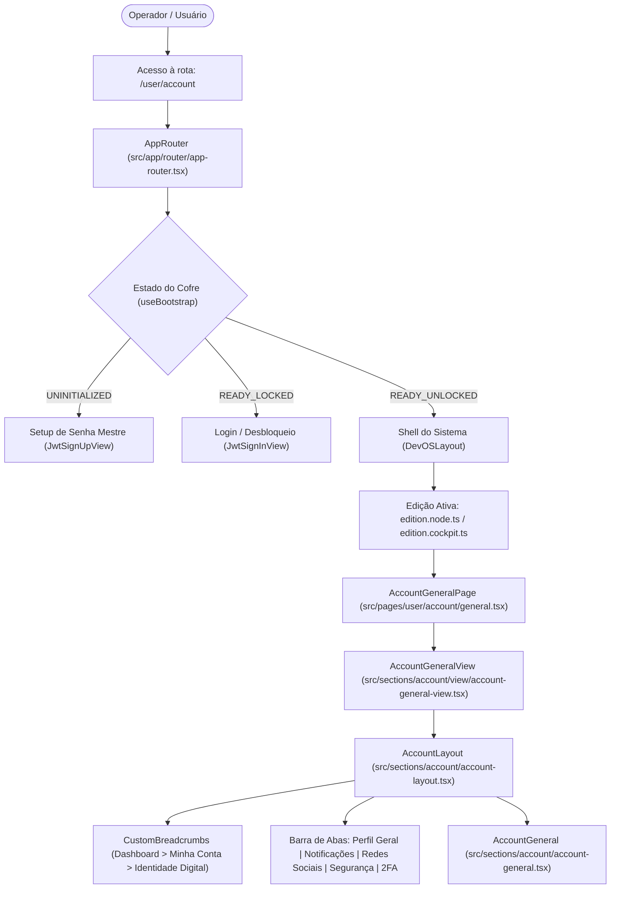

# MAPEAMENTO DE ROTAS E LAYOUTS — ABA 1: PERFIL GERAL
**Projeto:** ASPPIBRA DAO — DevOS Desktop  
**Data:** 2026-11-18  

---

## 1. REGISTRO DE ROTAS NO ROTEADOR DA APLICAÇÃO

O DevOS Desktop utiliza uma arquitetura baseada em edições dinâmicas (`@edition`), onde o arquivo de composição `src/app/router/app-router.tsx` delega o catálogo de rotas ativas para a edição em execução (`edition.node.ts` ou `edition.cockpit.ts`).

### Tabela de Roteamento

| Propriedade | Configuração Oficial |
|---|---|
| **Caminho da Rota** | `/user/account` |
| **Constante de Rota** | `paths.dashboard.user.account` (`src/app/router/paths.ts`) |
| **Ponto de Entrada da Rota** | `src/pages/user/account/general.tsx` (re-exportado por `src/pages/user/account/index.tsx`) |
| **Componente de Página** | `AccountGeneralPage` |
| **View Principal** | `AccountGeneralView` (`src/sections/account/view/account-general-view.tsx`) |
| **Componente de Formulário** | `AccountGeneral` (`src/sections/account/account-general.tsx`) |
| **Layout Contextual** | `AccountLayout` (`src/sections/account/account-layout.tsx`) |
| **Layout Global de Casca** | `DevOSLayout` (`src/app/layouts/devos/layout.tsx`) |
| **Registro na Edição Cockpit** | `src/app/editions/edition.cockpit.ts` (linhas 188-192) |
| **Registro na Edição Node** | `src/app/editions/edition.node.ts` (linhas 91-95) |
| **Visualização Secundária** | `src/sections/user/view/user-profile-view.tsx` (aba `identity`) |

---

## 2. GUARDS E CONTROLE DE ACESSO

O acesso à ABA 1 passa por três níveis de controle defensivo:

1. **Bootstrap State Guard (`AppRouter`):**
   - Se o hardware for inicializado pela primeira vez (`state === 'UNINITIALIZED'`), o sistema força o fluxo para a tela de inicialização do cofre mestre (`JwtSignUpView isInitVault`).
   - Se o cofre estiver trancado (`state === 'READY_LOCKED'`), o roteador barra a renderização das rotas internas e exibe a tela de desbloqueio com senha mestre (`JwtSignInView`).
   - Se o cofre estiver liberado (`state === 'READY_UNLOCKED'`), as rotas de usuário são montadas dentro do layout operacional `DevOSLayout`.

2. **In-Component Vault Lock Protection (`AccountGeneral`):**
   - Caso a sessão do cofre seja bloqueada ou expire em runtime (`isVaultLocked === true`), o componente `AccountGeneral` desmonta o formulário de edição e apresenta uma tela de bloqueio com ícone de escudo e botão de recarregar.
   - Isso impede vazamento de dados na interface ou tentativa de submissão com cofre trancado.

3. **Backend Fail-Closed Protection (`IdentityCommands`):**
   - Mesmo que um invasor tente invocar o comando IPC diretamente via DevTools ou script, o backend Rust `src-tauri/src/commands/identity_commands.rs` verifica `session.is_unlocked()`. Se trancado, aborta imediatamente com erro `IdentityError::VaultLocked`.

---

## 3. DIAGRAMA DE NAVEGAÇÃO E ROTAS

