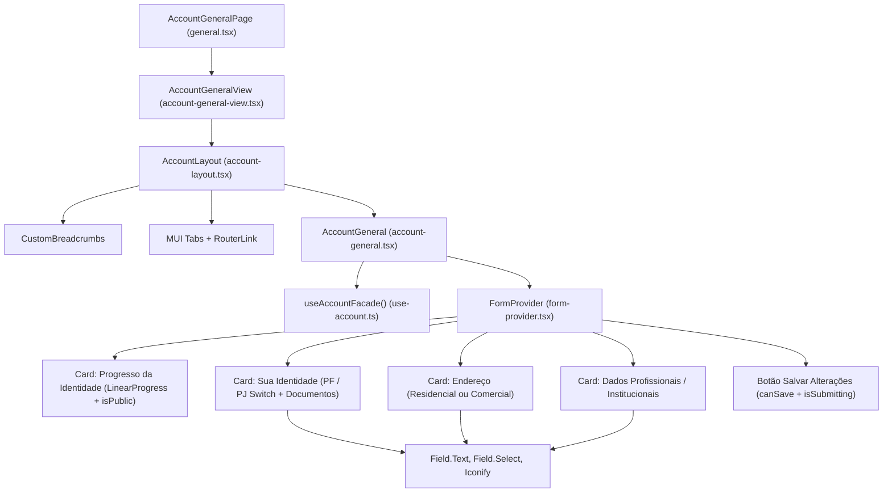

# INVENTÁRIO DE COMPONENTES — ABA 1: PERFIL GERAL
**Projeto:** ASPPIBRA DAO — DevOS Desktop  
**Data:** 2026-11-18  

---

## 1. CATÁLOGO HIERÁRQUICO DE COMPONENTES

| Nº | Componente | Arquivo de Origem | Responsabilidade Arquitetural |
|:--:|---|---|---|
| 1 | `AccountGeneralPage` | `src/pages/user/account/general.tsx` | Ponto de entrada da rota `/user/account`. Monta a View principal. |
| 2 | `AccountGeneralView` | `src/sections/account/view/account-general-view.tsx` | Container orquestrador da aba de Perfil Geral. Envolve o formulário com o `AccountLayout`. |
| 3 | `AccountLayout` | `src/sections/account/account-layout.tsx` | Moldura de navegação horizontal com MUI Tabs e Breadcrumbs da Central de Identidade. |
| 4 | `AccountGeneral` | `src/sections/account/account-general.tsx` | Componente central do formulário civil/empresarial (1.027 linhas). Gerencia validação, completude, renderização condicional PF/PJ e sincronização com o cofre. |
| 5 | `Form` (`FormProvider`) | `src/shared/components/hook-form/form-provider.tsx` | Provider de contexto do React Hook Form repassando métodos para os campos controlados. |
| 6 | `Field.Text` (`RHFTextField`) | `src/shared/components/hook-form/rhf-text-field.tsx` | Campo de texto controlado com suporte a máscara, trim, blur handler, mensagens de erro e dirty tracking. |
| 7 | `Field.Select` (`RHFSelect`) | `src/shared/components/hook-form/rhf-select.tsx` | Dropdown controlado para seleção de Tipo de Titularidade (PF/PJ), Estado Civil e Categoria CNH. |
| 8 | `Field.Switch` (`RHFSwitch`) | `src/shared/components/hook-form/rhf-switch.tsx` | Chave de alternância booleana controlada para a flag `isPublic` (Perfil Público). |
| 9 | `Iconify` | `src/shared/components/iconify/iconify.tsx` | Renderizador otimizado de ícones SVG (`@iconify/react`) com suporte a ícones solares do design system. |
| 10 | `CustomBreadcrumbs` | `src/shared/components/custom-breadcrumbs/custom-breadcrumbs.tsx` | Trilha de navegação estruturada (`Dashboard > Minha Conta > Identidade Digital`). |
| 11 | `RouterLink` | `src/app/router/components/router-link.tsx` | Adaptador customizado de navegação SPA compatível com React Router v7 para componentes Material UI. |
| 12 | `ProfileCover` | `src/sections/user/profile-cover.tsx` | Componente de cabeçalho do perfil de usuário com avatar, capa e botões de seleção de mídia. |

---

## 2. DETALHAMENTO DOS CARDS VISUAIS DE `AccountGeneral`

O componente `AccountGeneral` organiza os dados em 4 cartões visuais lógicos:

### Card 1: Progresso da Identidade & Visibilidade do Perfil
- **Objetivo:** Exibir visualmente o cálculo determinístico de completude cadastral (0% a 100%).
- **Componentes:** `LinearProgress` com gradiente dinâmico (`primary` <= 75%, `success` > 75%), Chip indicador de pontuação, switch `isPublic` e lista dinâmica de pesos dos campos preenchidos.
- **Diferenciação PF / PJ:** A legenda de pesos se ajusta automaticamente entre campos civis (Nome, CPF, Nascimento, Filiação) e campos corporativos (Razão Social, CNPJ, Representante Legal, CPF Rep.).

### Card 2: Sua Identidade (Dados Pessoais e Empresariais)
- **Seletor de Titularidade:** `Field.Select` com opções "Pessoa Física (PF)" e "Pessoa Jurídica (PJ)".
- **Campos PF:** Nome (`firstName`), Sobrenome (`lastName`), CPF (`cpf`), Data de Nascimento (`birthDate`), Estado Civil (`maritalStatus`), Nacionalidade (`nationality`), RG (`rg`), Órgão Emissor (`rgIssuer`), CNH (`cnh`), Categoria CNH (`cnhCategory`), Nome da Mãe (`motherName`), Nome do Pai (`fatherName`).
- **Campos PJ:** Razão Social (`companyName`), CNPJ (`cnpj`), Nome do Representante Legal (`legalRepresentative`), CPF do Representante (`legalRepresentativeCpf`).
- **Campos Globais:** Email de Acesso (`email`, desabilitado com aviso de segurança), Username (`username`), Telefone / WhatsApp (`phoneNumber`).

### Card 3: Endereço (Residencial ou Comercial / Sede)
- **Campos:** País (`country`), CEP (`zipCode`), Estado (`state`), Cidade (`city`), Bairro (`neighborhood`), Número/Km (`addressNumber`), Logradouro (`address`), Complemento (`complement`).
- **Título Dinâmico:** "Endereço Comercial / Sede" quando PJ; "Endereço Residencial" quando PF.

### Card 4: Perfil Profissional / Dados Institucionais
- **Campos:** Ocupação / Ramo CNAE (`occupation`), Empresa Atual / Grupo Econômico (`company`), Website Institucional (`website`), Biografia Resumida / Apresentação Institucional (`about`).
- **Apresentação:** Suporte a 4 linhas multiline para `about` com limite estrito de 2.000 caracteres.

---

## 3. DIAGRAMA HIERÁRQUICO DE COMPONENTES

