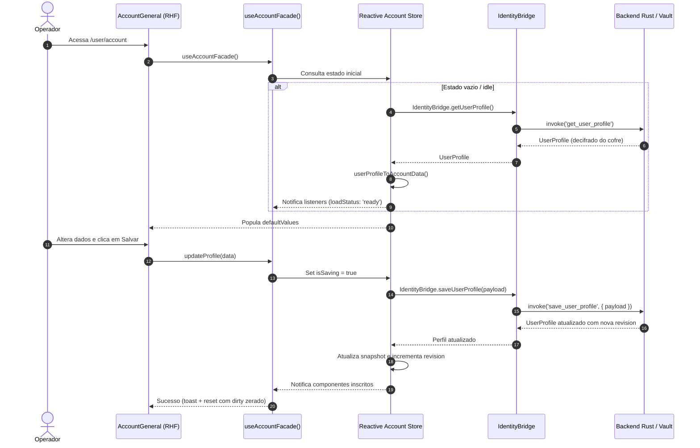

# GERENCIAMENTO DE ESTADO, HOOKS E FACADES — ABA 1: PERFIL GERAL
**Projeto:** ASPPIBRA DAO — DevOS Desktop  
**Data:** 2026-11-18  

---

## 1. ARQUITETURA DO HOOK `useAccountFacade`

O arquivo `src/sections/account/use-account.ts` (1.117 linhas) centraliza todo o gerenciamento de estado da Central de Identidade Digital.

Ele implementa o padrão **Facade** sobre uma store reativa baseada em `useSyncExternalStore` nativo do React 18/19, eliminando re-renderizações desnecessárias e garantindo sincronização consistente entre abas.

### Assinatura do Retorno da Facade

```typescript
export function useAccountFacade() {
  // Retorna:
  // - user: UserAccountData (estado reativo imutável)
  // - loadStatus: 'idle' | 'loading' | 'ready' | 'error'
  // - isLoading: boolean
  // - isSaving: boolean
  // - isVaultLocked: boolean
  // - error: string | null
  // - hasLoadedInitially: boolean
  // - migrationStatus: 'idle' | 'migrated' | 'conflict' | 'error'
  // - updateProfile: (data: Partial<UserAccountData>) => Promise<UserAccountData>
  // - refreshProfile: () => Promise<void>
  // - retryMigration: () => Promise<void>
  // - resolveMigrationConflict: (resolution: 'keep_vault' | 'merge_legacy') => Promise<void>
}
```

---

## 2. STORE REATIVA E CONCORRÊNCIA OTIMISTA

### A. Estrutura do Store Reativo
A store mantém uma instância única em memória com padrão pub/sub:
- `listeners: Set<() => void>`: Conjunto de observadores notificados a cada atualização.
- `state: AccountState`: Estado imutável congelado.
- `getSnapshot()`: Retorna a referência atual do estado para `useSyncExternalStore`.

### B. Controle de Revisão e Bloqueio Otimista
Para impedir sobrescrita acidental em ambientes concorrentes:
1. Ao carregar o perfil do cofre, a entidade armazena o número de `revision` (iniciando em 1).
2. Na submissão via `updateProfile`, o payload repassa `expectedRevision: current.revision`.
3. O comando Rust `save_user_profile` valida se `expected_revision == record.revision`. Se divergir, rejeita a operação com erro de concorrência (`IdentityError::ConcurrencyConflict`), impedindo perda de dados (Lost Update Problem).

---

## 3. MIGRAÇÃO RESILIENTE DE DADOS LEGADOS

O DevOS possui um subsistema dedicado a migrar dados anteriores gravados em `localStorage` para o cofre seguro SQLite:

1. **Constante e Limite:** Chave `devos_user_account_profile` com teto de segurança de 64 KB (`MAX_LEGACY_LENGTH`) para mitigar DoS de memória.
2. **Leitura Sanitizada (`readLegacyProfile`):** Valida se o conteúdo é JSON legítimo e se todos os campos correspondem a `LEGACY_STRING_FIELDS`.
3. **Detecção de Conflitos (`detectMigrationConflict`):**
   - Se o cofre estiver vazio e o storage legado tiver dados -> migra automaticamente (`status: 'migrated'`).
   - Se ambos tiverem dados com valores divergentes -> sinaliza `migrationStatus: 'conflict'`.
   - A interface renderiza botões de ação para o usuário: "Mesclar Dados" ou "Manter Cofre".
   - Enquanto houver conflito não resolvido, a gravação de novos dados permanece bloqueada para proteção do histórico civil.

---

## 4. FLUXO DE SINCRONIZAÇÃO COM FORMULÁRIOS


