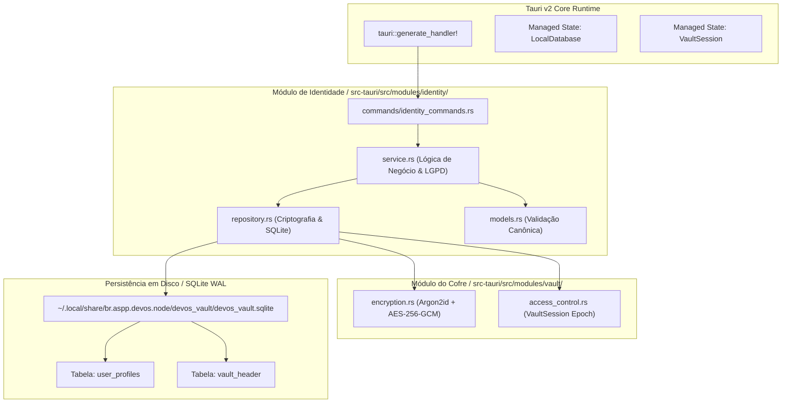

# 06 — Mapa do Backend Nativo (Rust/Tauri) e Mecanismos de Persistência

## 1. Arquitetura do Backend Nativo Rust

O backend do DevOS Desktop é construído em Rust 2024 / 1.92 encapsulado no framework Tauri v2 (`app_lib`). Ele atua como uma fortaleza de isolamento criptográfico e custódia segura de dados confidenciais do usuário.



---

## 2. Comandos Tauri IPC Registrados para a Seção Conta

Arquivo de registro: [src-tauri/src/commands/identity_commands.rs](file:///home/sandro/Área%20de%20trabalho/App%20Desktop/DevOS-Desktop/src-tauri/src/commands/identity_commands.rs)

### 2.1 `get_user_profile`
* **Assinatura:** `pub fn get_user_profile(db: State<'_, LocalDatabase>, session: State<'_, VaultSession>) -> Result<Option<UserProfileDto>, String>`
* **Comportamento:**
  1. Verifica se a sessão ativa do cofre possui chave decifrada em memória (`session.get_session_key()`). Se o cofre estiver trancado, aborta imediatamente (*fail-closed*).
  2. Consulta a tabela `user_profiles` no SQLite.
  3. Decifra o payload serializado usando **AES-256-GCM** com a chave da sessão.
  4. Retorna `Option<UserProfileDto>`.

### 2.2 `save_user_profile`
* **Assinatura:** `pub fn save_user_profile(db: State<'_, LocalDatabase>, session: State<'_, VaultSession>, profile: SaveUserProfileRequest) -> Result<UserProfileDto, String>`
* **Comportamento:**
  1. Aplica validações canônicas de Módulo 11 para CPF e CNPJ (numérico e alfanumérico RFB 2.229/2024), sanitização de datas (anos bissextos e teto de data futura), validação estrita de URLs de redes sociais (`sanitize_social_url` para Facebook, Instagram, LinkedIn, X/Twitter) e cálculo do `completeness_score`.
  2. Incrementa de forma atômica o número de `revision`.
  3. Cifra o payload completo em formato JSON usando AES-256-GCM com nonce criptográfico seguro (`rand::rngs::OsRng`).
  4. Grava na tabela `user_profiles` no registro fixo `id = 1` dentro de transação SQLite.

### 2.3 `import_legacy_profile`
* **Assinatura:** `pub fn import_legacy_profile(db: State<'_, LocalDatabase>, session: State<'_, VaultSession>, legacy_json: String) -> Result<UserProfileDto, String>`
* **Comportamento:**
  1. Deserializa o documento JSON legado de até 64 KB.
  2. Rejeita envelopes corrompidos ou com chaves maliciosas.
  3. Executa sanitização estrita e preserva as credenciais importadas gravando diretamente no cofre cifrado.

---

## 3. Estrutura do Banco de Dados e Migrações

* **Engine:** SQLite com modo WAL (`PRAGMA journal_mode = WAL;`) e `PRAGMA synchronous = NORMAL;`.
* **Gerenciador de Migrações:** [src-tauri/src/storage/migrations.rs](file:///home/sandro/Área%20de%20trabalho/App%20Desktop/DevOS-Desktop/src-tauri/src/storage/migrations.rs).
* **Tabela `user_profiles` (Migração Versão 2):**
  ```sql
  CREATE TABLE IF NOT EXISTS user_profiles (
      id INTEGER PRIMARY KEY CHECK (id = 1),
      encrypted_envelope TEXT NOT NULL,
      payload_version INTEGER NOT NULL DEFAULT 1,
      revision INTEGER NOT NULL DEFAULT 1,
      created_at TEXT NOT NULL,
      updated_at TEXT NOT NULL
  );
  ```

---

## 4. Matriz de Persistência das Cinco Abas

| Aba | Entidade Manipulada | Tabela / Arquivo Físico | Operação Suportada | Nível de Persistência Real |
|---|---|---|---|---|
| **Aba 1: Perfil Geral** | `UserProfileDto` (PF/PJ, documentos, endereços, contatos) | Tabela `user_profiles` no `devos_vault.sqlite` | **CRUD Completo** (Create, Read, Update via `save_user_profile` e `get_user_profile`) | **PERSISTÊNCIA REAL CIFRADA (AES-256-GCM)** |
| **Aba 2: Notificações** | Preferências de canais e eventos | Nenhuma tabela criada no SQLite | Nenhuma | **NENHUMA (Apenas memória do componente)** |
| **Aba 3: Redes Sociais** | `SocialLinksDto` (LinkedIn, X, Instagram, Facebook) | Tabela `user_profiles` no `devos_vault.sqlite` (campo `social_links` dentro do envelope) | **CRUD Completo** (Update/Read via `save_user_profile` e `get_user_profile`) | **PERSISTÊNCIA REAL CIFRADA (AES-256-GCM)** |
| **Aba 4: Segurança** | Credenciais da conta, sessões e biometria | O cofre armazena apenas a senha mestre (`vault_header`). A senha da conta de usuário não tem tabela no SQLite local | Reautenticação e revogação | **CONTRATO DEFINIDO / DESCONECTADO (Sem comando Rust para troca de senha)** |
| **Aba 5: 2FA** | `linkedProviders` (Wallet, Google, GitHub, Strict Auth) e TOTP | Gravado como lista em `user_profiles.linked_providers`, mas sem validação de prova criptográfica | Create / Update no DTO de identidade | **PERSISTÊNCIA PARCIAL (Dados no DTO, sem validação criptográfica)** |
