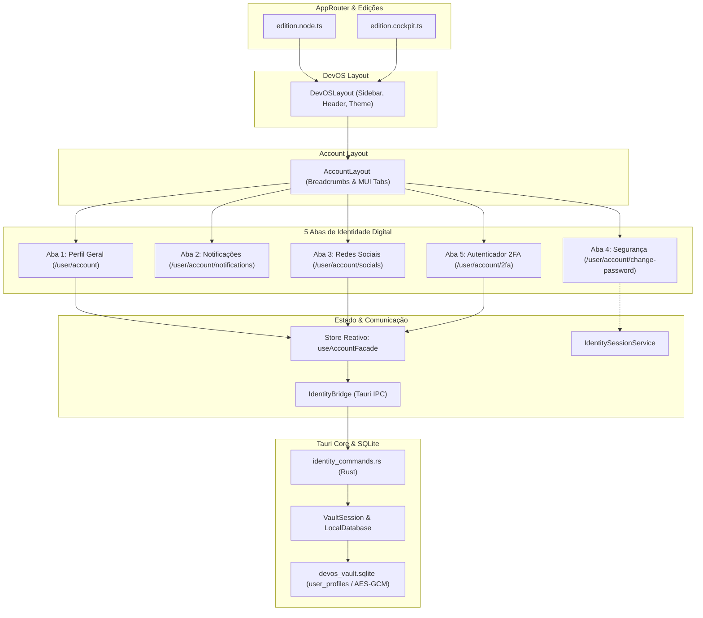
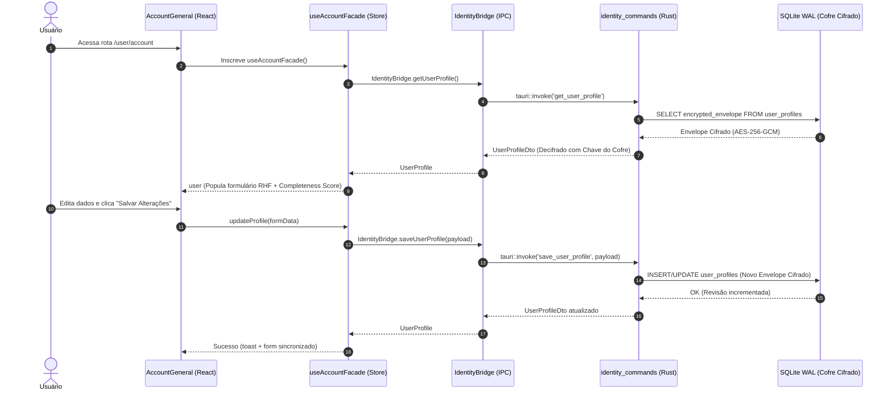
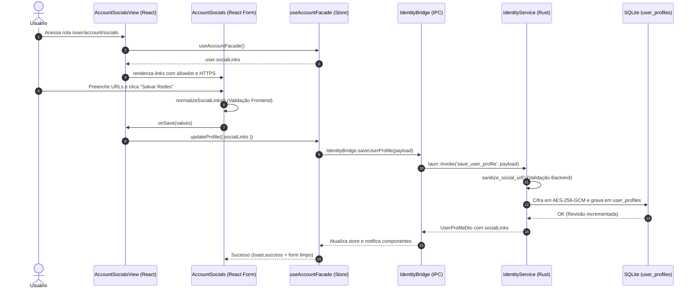
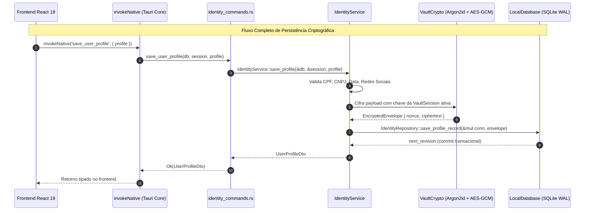
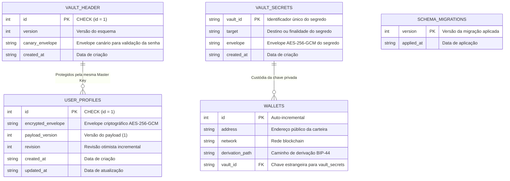

# 04 — Árvore de Dependências e Diagramas Arquiteturais

## 1. Diagrama Arquitetural Geral das 5 Abas



---

## 2. Diagramas Individuais por Aba

### 2.1 Aba 1 — Perfil Geral / Identidade Civil


### 2.2 Aba 2 — Notificações
```mermaid
flowchart LR
    Page[AccountNotificationsPage] --> View[AccountNotificationsView]
    View --> Layout[AccountLayout]
    View --> Component[AccountNotifications]
    Component --> RHF[useForm (Memória Local)]
    Component --> Toast[toast.success (Sem Persistência)]
```

### 2.3 Aba 3 — Redes Sociais


### 2.4 Aba 4 — Segurança
```mermaid
flowchart TD
    Page[AccountChangePasswordPage] --> View[AccountChangePasswordView]
    View --> Layout[AccountLayout]
    View --> Comp[AccountChangePassword]
    Comp --> Zod[ChangePasswordSchema - NIST SP 800-63B]
    Comp --> Field1[PasswordField (Senha Atual)]
    Comp --> Field2[PasswordField (Nova Senha)]
    Comp --> Field3[PasswordField (Confirmação)]
    Comp --> CardBio[Card Biometria / onConfigureBiometrics]
    Comp --> CardSess[Card Dispositivos / onRevokeSession]
    Comp --> AuthCall[onChangePassword Callback - Desconectado]
```

### 2.5 Aba 5 — Autenticador 2FA
```mermaid
flowchart TD
    Page[AccountTwoFAPage] --> View[AccountTwoFAView]
    View --> Layout[AccountLayout]
    View --> Comp[AccountTwoFA]
    Comp --> Store[useAccountFacade]
    Comp --> SwitchStrict[Modo Restrito (Strict Auth)]
    Comp --> SwitchTotp[TOTP 2FA (QR Code Estático & Chave Fixa)]
    Comp --> Modal[Modal Vincular Provedor]
    Modal --> Wallet[Carteira Web3 (Sem Prova EIP-712)]
    Modal --> Google[Google SSO (Sem OAuth)]
    Modal --> Github[GitHub Operador (Sem OAuth)]
    SwitchStrict --> UpdateStore[updateProfile linkedProviders]
```

---

## 3. Diagrama de Comunicação Frontend / Backend



---

## 4. Diagrama de Persistência e Tabelas do Banco de Dados


