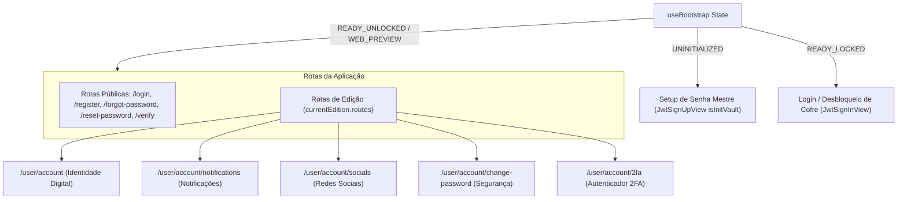
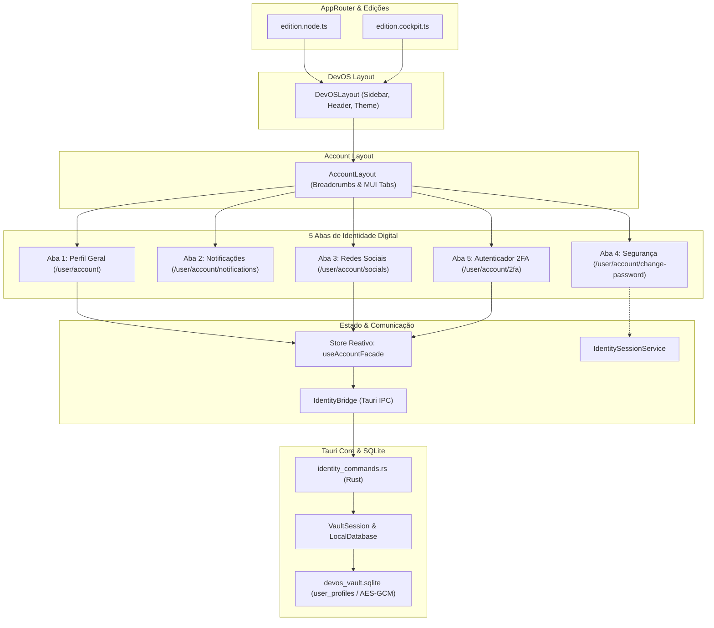
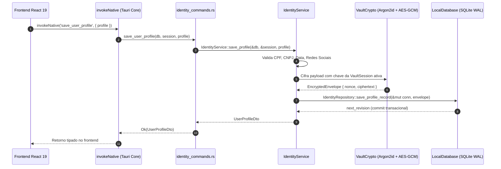
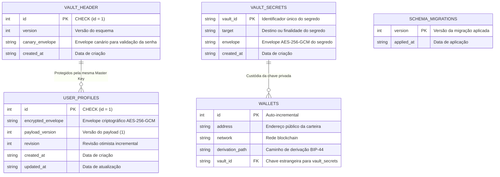

# DEVOS DESKTOP — DOSSIÊ ARQUITETURAL COMPLETO
## Seção: Central de Identidade Digital / Minha Conta (`/user/account/*`)

---

## ÍNDICE GERAL

1. [01 — Resumo Executivo e Escopo](#01--resumo-executivo-e-escopo)
2. [02 — Roteamento, Navegação e Guards](#02--roteamento-navegação-e-guards)
3. [03 — Inventário Completo de Componentes](#03--inventário-completo-de-componentes)
4. [04 — Árvore de Dependências e Diagramas Arquiteturais](#04--árvore-de-dependências-e-diagramas-arquiteturais)
5. [05 — Serviços, APIs, IPC Bridges e Contratos de Dados](#05--serviços-apis-ipc-bridges-e-contratos-de-dados)
6. [06 — Backend Nativo Rust, Tauri e Persistência SQLite Cifrada](#06--backend-nativo-rust-tauri-e-persistência-sqlite-cifrada)
7. [07 — Auditoria de Segurança da Informação e AppSec](#07--auditoria-de-segurança-da-informação-e-appsec)
8. [08 — Classificação do Status Funcional](#08--classificação-do-status-funcional)
9. [09 — Inventário de Testes Automatizados e Cobertura de Qualidade](#09--inventário-de-testes-automatizados-e-cobertura-de-qualidade)
10. [10 — Matriz Consolidada de Prontidão para Produção](#10--matriz-consolidada-de-prontidão-para-produção)
11. [11 — Inventário Estruturado em Formato JSON](#11--inventário-estruturado-em-formato-json)
12. [12 — Diagnóstico Arquitetural e Parecer Final](#12--diagnóstico-arquitetural-e-parecer-final)

---

## 01 — Resumo Executivo e Escopo

Este dossiê consolida a **auditoria arquitetural profunda e exaustiva** da seção **Central de Identidade Digital / Minha Conta** do DevOS Desktop, cobrindo integralmente as 5 abas operacionais do sistema:

1. **Aba 1 — Perfil Geral / Identidade Civil** (`/user/account`)
2. **Aba 2 — Notificações** (`/user/account/notifications`)
3. **Aba 3 — Redes Sociais** (`/user/account/socials`)
4. **Aba 4 — Segurança** (`/user/account/change-password`)
5. **Aba 5 — Autenticador 2FA** (`/user/account/2fa`)

A auditoria foi conduzida através de análise estática e dinâmica de código-fonte, rastreando cada rota desde o ponto de entrada no Vite/React Router, passando por layouts, páginas, views, componentes, hooks, esquemas Zod, pontes IPC do Tauri, backend nativo em Rust (`src-tauri`), migrations e banco de dados SQLite criptografado (`devos_vault.sqlite`).

### Stack Tecnológico Auditado
* **Frontend SPA:** React 19 (`19.1.1`), TypeScript 6 (`6.0.2`), Vite 8 (`8.0.8`), Material UI 9 (`@mui/material: ^9.0.0`), React Hook Form 7 (`7.63.0`), Zod 3.25 (`3.25.76`), React Router v7 (`7.9.3`).
* **IPC & Runtime Desktop:** Tauri v2 (`@tauri-apps/api: 2.2.0`, `tauri-build: 2.7.1`).
* **Backend Nativo (Rust):** Rust 2024 / 1.92, `rusqlite: 0.32` (bundled), `aes-gcm: 0.10`, `argon2: 0.5`, `zeroize: 1.8`, `tokio: 1.0`.
* **Persistência:** SQLite WAL local criptografado (`user_profiles`, `vault_header`, `vault_secrets`) e `localStorage` legado com rotina de migração atômica e verificação de integridade bidirecional.

### Principais Descobertas por Aba
| Dimensão | Diagnóstico Arquitetural |
|---|---|
| **Aba 1 (Perfil Geral)** | **Homologada / Pronta para Produção:** Arquitetura madura com store reativo (`useAccountFacade`), isolamento de requisições por geração de sessão, migração segura com verificação de integridade bidirecional, eliminação de PII em logs e persistência cifrada (envelope AES-256-GCM) no SQLite local via Tauri IPC. |
| **Aba 2 (Notificações)** | **Simulação / Mock:** Componente visual funcional (`AccountNotifications`), mas sem persistência em banco, sem comunicação IPC com Rust e sem conexão com daemon de mensageria. A submissão apenas exibe `toast.success` em memória. |
| **Aba 3 (Redes Sociais)** | **Homologada / Conectada:** Validação estrita de protocolo HTTPS, allowlist rígida de domínios (`ALLOWED_HOSTS`), limite de 2.048 caracteres, integrada via `AccountSocialsView` diretamente ao store `useAccountFacade` e persistida via `IdentityBridge.saveUserProfile` no SQLite cifrado do cofre nativo. |
| **Aba 4 (Segurança)** | **Interface Refatorada / Backend Desconectado:** Política de senhas alinhada ao NIST SP 800-63B (mínimo 15 caracteres, Unicode escalar, rejeição de repetição), alternadores visuais independentes de senha. No entanto, a página de entrada não injeta `onChangePassword`, desabilitando o botão de envio; ademais, o backend nativo Rust não possui comando exposto para alteração da senha mestre. |
| **Aba 5 (Autenticador 2FA)** | **Mock Crítico / Risco P0:** Apresenta chave TOTP fixa hardcoded (`JBSWY3DPEHPK3PXP`), QR Code puramente visual estático, aceita qualquer código de 6 dígitos sem validação RFC 6238, e vincula carteira Web3/Google/GitHub apenas no store local sem prova de posse criptográfica (EIP-712 ou OAuth). |

---

## 02 — Roteamento, Navegação e Guards

### 1. Arquitetura de Roteamento
O DevOS Desktop utiliza **React Router v7** (`react-router: ^7.9.3`) configurado em um modelo SPA embutido no webview do Tauri. O roteamento é condicionalmente governado pelo estado do hardware e do cofre criptográfico central (`useBootstrap`), dividindo a aplicação em fases de inicialização e rotas operacionais.



### 2. Inventário de Rotas das Cinco Abas
As rotas são padronizadas em `src/app/router/paths.ts:51-56` e registradas nas duas edições do produto (`edition.node.ts` e `edition.cockpit.ts`):

| Aba | Rota Canônica | Path Helper | Componente de Página | Arquivo de Entrada |
|---|---|---|---|---|
| **Aba 1: Perfil Geral** | `/user/account` | `paths.dashboard.user.account` | `AccountGeneralPage` | `src/pages/user/account/general.tsx` |
| **Aba 2: Notificações** | `/user/account/notifications` | `${paths.dashboard.user.account}/notifications` | `AccountNotificationsPage` | `src/pages/user/account/notifications.tsx` |
| **Aba 3: Redes Sociais** | `/user/account/socials` | `${paths.dashboard.user.account}/socials` | `AccountSocialsPage` | `src/pages/user/account/socials.tsx` |
| **Aba 4: Segurança** | `/user/account/change-password` | `${paths.dashboard.user.account}/change-password` | `AccountChangePasswordPage` | `src/pages/user/account/change-password.tsx` |
| **Aba 5: Autenticador 2FA** | `/user/account/2fa` | `${paths.dashboard.user.account}/2fa` | `AccountTwoFAPage` | `src/pages/user/account/2fa.tsx` |

* `src/pages/user/account/index.tsx`: Reexporta `AccountGeneralPage` como exportação padrão para `/user/account`.
* `paths.dashboard.user.root` (`/user`): Aponta para `UserProfilePage` (`src/pages/user/profile`), visualização resumida pública separada da gestão civil cadastral.

### 3. Hierarquia de Layouts
1. **Layout Global (`DevOSLayout`):** `src/app/layouts/devos/layout.tsx` (Sidebar, Header de status de cofre, alternador dark/light).
2. **Layout da Seção (`AccountLayout`):** `src/sections/account/account-layout.tsx` (Breadcrumbs institucionais e abas horizontais do Material-UI).
   - Sanitização de pathname via `normalizePathname()` e verificação `hasMatchingTab` para garantir valor válido no `Tabs`.
3. **Guards:** Governados pelo hook nativo `useBootstrap` (`src/app/bootstrap/use-bootstrap.ts`) consultando `get_vault_status` diretamente no Rust. Se o cofre estiver trancado, o roteador redireciona de imediato para a tela de desbloqueio.
4. **Carregamento:** Eager loading estático nas edições `edition.node.ts` e `edition.cockpit.ts` para máxima performance em runtime desktop local.

---

## 03 — Inventário Completo de Componentes

### 1. `AccountLayout` (Compartilhado)
* **Caminho:** `src/sections/account/account-layout.tsx`
* **Responsabilidade:** Renderizar breadcrumbs e abas com roteamento ativo do React Router.
* **Consumidores:** Todas as 5 views (`AccountGeneralView`, `AccountNotificationsView`, `AccountSocialsView`, `AccountChangePasswordView`, `AccountTwoFAView`).
* **Componentes Utilizados:** `Box`, `Card`, `Tabs`, `Tab`, `CustomBreadcrumbs`, `Iconify`, `RouterLink`.
* **Props:** `{ children?: ReactNode }`.
* **Hooks:** `usePathname()`.

### 2. Aba 1 — Perfil Geral / Identidade Civil
* **`AccountGeneralPage` (`src/pages/user/account/general.tsx:5-9`):** Entrada no roteador, renderiza `<AccountGeneralView />`.
* **`AccountGeneralView` (`src/sections/account/view/account-general-view.tsx:6-14`):** Wrapper que compõe `AccountLayout` com `AccountGeneral`.
* **`AccountGeneral` (`src/sections/account/account-general.tsx:412-1025`):**
  - **Responsabilidade:** Formulário completo de qualificação civil PF/PJ, cálculo dinâmico de score e reconciliação de cofre.
  - **Componentes Utilizados:** `Box`, `Grid`, `Card`, `Stack`, `Button`, `Typography`, `Alert`, `LinearProgress`, `Chip`, `Switch`, `MenuItem`, `Form`, `Field.Text`, `Field.Select`, `Field.Switch`, `Iconify`.
  - **Hooks:** `useAccountFacade()`, `useForm<UpdateUserSchemaType>()`, `useWatch()`, `useMemo()`, `useEffect()`.
  - **Serviços:** `updateProfile()` -> `IdentityBridge.saveUserProfile()`, `resolveMigrationConflict()`, `refreshProfile()`.
  - **Validações:** `UpdateUserSchema` (Zod) com Módulo 11 (CPF), CNPJ 2026 (IN RFB 2.229/2024), CEP, data bissexta e telefone.

### 3. Aba 2 — Notificações
* **`AccountNotificationsPage` (`src/pages/user/account/notifications.tsx:5-9`):** Entrada da rota, renderiza `<AccountNotificationsView />`.
* **`AccountNotificationsView` (`src/sections/account/view/account-notifications-view.tsx:6-14`):** Encapsula `AccountNotifications` no `AccountLayout`.
* **`AccountNotifications` (`src/sections/account/account-notifications.tsx:36-105`):**
  - **Responsabilidade:** Switches de preferências de canais (E-mail, SMS, WhatsApp, Push) e eventos (Comentários, Transações, Segurança).
  - **Componentes Utilizados:** `Box`, `Card`, `Stack`, `Switch`, `Button`, `Typography`, `Controller`.
  - **Hooks:** `useForm()` com valores em memória.
  - **Status:** **Mock**. `onSubmit` apenas dispara `toast.success` sem persistência.

### 4. Aba 3 — Redes Sociais
* **`AccountSocialsPage` (`src/pages/user/account/socials.tsx:5-9`):** Entrada da rota, renderiza `<AccountSocialsView />`.
* **`AccountSocialsView` (`src/sections/account/view/account-socials-view.tsx:18-62`):**
  - **Responsabilidade:** Conecta `AccountSocials` diretamente a `useAccountFacade()`. Injeta `activeSocialLinks` e `handleSave`.
  - **Componentes Utilizados:** `AccountLayout`, `AccountSocials`, `Stack`, `Alert`.
  - **Hooks:** `useAccountFacade()`.
  - **Serviços:** `updateProfile({ socialLinks: links })` -> `IdentityBridge.saveUserProfile()`.
* **`AccountSocials` (`src/sections/account/account-socials.tsx:143-248`):**
  - **Responsabilidade:** Formulário de links (LinkedIn, X, Instagram, Facebook).
  - **Componentes Utilizados:** `Card`, `Stack`, `Typography`, `Alert`, `Button`, `InputAdornment`, `Form`, `Field.Text`, `Iconify`.
  - **Hooks:** `useForm<SocialFormValues>()`, `useEffect()`.
  - **Validações:** `normalizeSocialLinks()` (exclusivo HTTPS, allowlist de hostnames `ALLOWED_HOSTS`, teto de 2.048 caracteres, rejeição de credenciais e portas).

### 5. Aba 4 — Segurança
* **`AccountChangePasswordPage` (`src/pages/user/account/change-password.tsx:5-9`):** Entrada da rota, renderiza `<AccountChangePasswordView />`.
* **`AccountChangePasswordView` (`src/sections/account/view/account-change-password-view.tsx:18-26`):** Encapsula `AccountChangePassword` no `AccountLayout`.
* **`AccountChangePassword` (`src/sections/account/account-change-password.tsx:151-455`):**
  - **Responsabilidade:** Formulário de redefinição de senha com complexidade NIST, biometria e sessões ativas.
  - **Componentes Utilizados:** `Card`, `Stack`, `Typography`, `Alert`, `Button`, `IconButton`, `InputAdornment`, `Box`, `Iconify`, `Form`, `Field.Text`, `PasswordField`.
  - **Hooks:** `useForm<ChangePasswordForm>()` com `zodResolver(ChangePasswordSchema)`.
  - **Validações:** `ChangePasswordSchema` (mínimo 15 caracteres Unicode escalares, máximo 128, rejeição de repetição da senha atual).
  - **Status:** **Desconectada**. A página não injeta `onChangePassword` e o Rust não possui comando para alterar a senha mestre.

### 6. Aba 5 — Autenticador 2FA
* **`AccountTwoFAPage` (`src/pages/user/account/2fa.tsx:5-9`):** Entrada da rota, renderiza `<AccountTwoFAView />`.
* **`AccountTwoFAView` (`src/sections/account/view/account-2fa-view.tsx:6-14`):** Encapsula `AccountTwoFA` no `AccountLayout`.
* **`AccountTwoFA` (`src/sections/account/account-2fa.tsx:28-611`):**
  - **Responsabilidade:** Configuração de TOTP 2FA, Modo Restrito e vinculação de carteira Web3/Google/GitHub.
  - **Componentes Utilizados:** `Box`, `Card`, `Chip`, `Stack`, `Switch`, `Dialog`, `DialogTitle`, `DialogContent`, `DialogActions`, `Button`, `Tooltip`, `TextField`, `Typography`, `FormControlLabel`, `Iconify`.
  - **Hooks:** `useAccountFacade()`, `useState()`.
  - **Serviços:** `updateProfile({ linkedProviders })` no store do usuário.
  - **Status:** **Mock Crítico (Risco P0)**. Chave TOTP fixa (`JBSWY3DPEHPK3PXP`) e validação cega (`totpCode.length === 6`).

---

## 04 — Árvore de Dependências e Diagramas Arquiteturais

### 1. Diagrama Geral das 5 Abas


### 2. Diagrama de Comunicação Frontend/Backend (Fluxo Criptográfico)


### 3. Diagrama de Entidade-Relacionamento do Banco de Dados


---

## 05 — Serviços, APIs, IPC Bridges e Contratos de Dados

### 1. Matriz de Serviços e Integrações
| Nome do Serviço | Arquivo | Método | Origem | Destino | Dados Enviados | Dados Recebidos | Autenticação | Validação | Persistência | Tratamento de Erros | Status |
|---|---|---|---|---|---|---|---|---|---|---|---|
| **IdentityBridge.getUserProfile** | `src/platform/tauri/identity/identity-bridge.ts:17` | `getUserProfile` | `useAccountFacade (fetchAndSyncProfile)` | Rust IPC `get_user_profile` | Vazio (`{}`) | `UserProfile \| null` | Sessão ativa do cofre (`VaultSession`) | Rust (deserialização e decifração de envelope) | SQLite (`user_profiles`) | Fail-closed com `StorageError::VaultLocked` | **REAL E CONECTADO** |
| **IdentityBridge.saveUserProfile** | `src/platform/tauri/identity/identity-bridge.ts:27` | `saveUserProfile` | `useAccountFacade (updateProfile)` | Rust IPC `save_user_profile` | `SaveUserProfilePayload` | `UserProfile` | Sessão ativa do cofre (`VaultSession`) | Zod no frontend + Rust Módulo 11 (CPF/CNPJ), data e URLs | SQLite (`user_profiles` envelope AES-GCM) | Rollback em caso de erro de sessão / lock | **REAL E CONECTADO** |
| **IdentityBridge.importLegacyProfile** | `src/platform/tauri/identity/identity-bridge.ts:37` | `importLegacyProfile` | `useAccountFacade (fetchAndSyncProfile)` | Rust IPC `import_legacy_profile` | String JSON (sanitizada de localStorage) | `UserProfile` | Sessão ativa do cofre (`VaultSession`) | Verificação estrita de integridade de username e campos | SQLite (`user_profiles`) | Mantém legado intacto em caso de divergência | **REAL E CONECTADO** |
| **AccountSocialsView (handleSave)** | `src/sections/account/view/account-socials-view.tsx:28-34` | `handleSave` | `AccountSocials (onSubmit)` | `useAccountFacade.updateProfile` -> Rust IPC `save_user_profile` | `socialLinks: { facebook, instagram, linkedin, twitter }` | `UserProfile` atualizado | Sessão ativa do cofre (`VaultSession`) | Frontend: `normalizeSocialLinks` (HTTPS, allowlist); Backend: `sanitize_social_url` | SQLite (`user_profiles` dentro do envelope AES-GCM) | Rollback em caso de erro; toast de erro na UI | **REAL E CONECTADO** |
| **IdentitySessionService.changePassword** | `src/modules/authentication/application/identity-session.service.ts:11` | `changePassword` | `AccountChangePassword (onSubmit)` | Endpoint Institucional / Auth Server | `ChangePasswordRequest (currentPassword, newPassword)` | `Promise<void>` | Token de sessão do usuário | Validação NIST no Zod (frontend) | Servidor Central / Auth Backend | Lança erro explícito de serviço não conectado | **CONTRATO DEFINIDO / DESCONECTADO (PÁGINA E RUST)** |
| **AccountNotifications.onSubmit** | `src/sections/account/account-notifications.tsx:50` | `onSubmit` interno | `AccountNotifications` | Memória / Nenhum | Preferências booleanas de canais e eventos | N/A | Nenhuma | Nenhuma | **NENHUMA** (Nem local nem backend) | Não trata erros | **MOCK TOTAL** |
| **AccountTwoFA (TOTP)** | `src/sections/account/account-2fa.tsx:58` | `handleVerifyTotp` | `AccountTwoFA` | Memória / Nenhum | Código numérico de 6 dígitos | N/A | Nenhuma | Apenas checa se `length === 6` | **NENHUMA** | Toast genérico | **MOCK TOTAL (RISCO P0)** |
| **AccountTwoFA (Provedores)** | `src/sections/account/account-2fa.tsx:93` | `handleSaveProvider` | `AccountTwoFA` | `useAccountFacade (updateProfile)` | `linkedProviders` atualizado | `void` | Sessão do cofre | Checagem básica de string (`0x`, `@`) | SQLite (`user_profiles`) | Captura erro do store | **PARCIAL** (Grava no DTO, mas sem prova criptográfica) |

### 2. Características do Store Reativo: `useAccountFacade`
- Adota `useSyncExternalStore` nativo do React 19 para prevenir tearing visual.
- Implementa `currentSessionGeneration` incremental para descarte imediato de respostas de requisições que cruzaram fronteira de bloqueio de sessão.
- Deduplicação de requisições IPC via controle atômico `inFlightFetch`.
- Leitura independente pós-salvamento (`IdentityBridge.getUserProfile()`) com confirmação de avanço da revisão antes da notificação aos componentes.

---

## 06 — Backend Nativo Rust, Tauri e Persistência SQLite Cifrada

### 1. Comandos Tauri Registrados
* `get_user_profile`: Consulta e decifra `user_profiles` no SQLite com a chave da sessão ativa.
* `save_user_profile`: Valida documentos no Rust (CPF/CNPJ/Data/Redes), incrementa revisão, cifra em AES-256-GCM com nonce seguro e grava no SQLite.
* `import_legacy_profile`: Importa com segurança PII legado de `localStorage`.
* `get_vault_status`: Retorna estado de inicialização e bloqueio do cofre.
* `init_master_password`, `unlock_vault`, `lock_vault`: Ciclo de vida da chave de sessão do cofre.
* `export_authorized_secret`, `export_vault_backup`, `restore_vault_backup`: Gestão de custódia e backup seguro.

### 2. Estrutura do SQLite Local (`devos_vault.sqlite`)
* Arquivo físico: `~/.local/share/br.aspp.devos.node/devos_vault/devos_vault.sqlite`
* Modos SQLite: `PRAGMA journal_mode = WAL;`, `PRAGMA synchronous = NORMAL;`.
* Migração 1: Tabelas `vault_header`, `wallets`, `vault_secrets`.
* Migração 2: Tabela `user_profiles`:
  ```sql
  CREATE TABLE IF NOT EXISTS user_profiles (
      id INTEGER PRIMARY KEY CHECK (id = 1),
      encrypted_envelope TEXT NOT NULL,
      payload_version INTEGER NOT NULL DEFAULT 1,
      revision INTEGER NOT NULL DEFAULT 1,
      created_at TEXT NOT NULL,
      updated_at TEXT NOT NULL
  );
  ```

### 3. Matriz de Persistência
| Aba | Entidade Manipulada | Tabela / Arquivo Físico | Operação Suportada | Nível de Persistência Real |
|---|---|---|---|---|
| **Aba 1: Perfil Geral** | `UserProfileDto` (PF/PJ, documentos, endereços, contatos) | Tabela `user_profiles` no `devos_vault.sqlite` | **CRUD Completo** (Create, Read, Update via `save_user_profile` e `get_user_profile`) | **PERSISTÊNCIA REAL CIFRADA (AES-256-GCM)** |
| **Aba 2: Notificações** | Preferências de canais e eventos | Nenhuma tabela criada no SQLite | Nenhuma | **NENHUMA (Apenas memória do componente)** |
| **Aba 3: Redes Sociais** | `SocialLinksDto` (LinkedIn, X, Instagram, Facebook) | Tabela `user_profiles` no `devos_vault.sqlite` (campo `social_links` dentro do envelope) | **CRUD Completo** (Update/Read via `save_user_profile` e `get_user_profile`) | **PERSISTÊNCIA REAL CIFRADA (AES-256-GCM)** |
| **Aba 4: Segurança** | Credenciais da conta, sessões e biometria | O cofre armazena apenas a senha mestre (`vault_header`). A senha da conta de usuário não tem tabela no SQLite local | Reautenticação e revogação | **CONTRATO DEFINIDO / DESCONECTADO (Sem comando Rust para troca de senha)** |
| **Aba 5: 2FA** | `linkedProviders` (Wallet, Google, GitHub, Strict Auth) e TOTP | Gravado como lista em `user_profiles.linked_providers`, mas sem validação de prova criptográfica | Create / Update no DTO de identidade | **PERSISTÊNCIA PARCIAL (Dados no DTO, sem validação criptográfica)** |

---

## 07 — Auditoria de Segurança da Informação e AppSec

### Matriz Consolidada de Riscos e Vulnerabilidades
| ID | Gravidade | Aba | Arquivo e Linhas | Descrição do Risco | Impacto Potencial | Correção Recomendada | Dependências Envolvidas |
|---|---|---|---|---|---|---|---|
| **SEC-01** | **CRÍTICA (P0)** | Aba 5 (2FA) | `src/sections/account/account-2fa.tsx:529` | **Chave Secreta TOTP Estática Hardcoded** (`JBSWY3DPEHPK3PXP`) e QR Code fictício estático. | Qualquer invasor que examine o código-fonte ou inspecione a tela pode gerar os mesmos códigos TOTP em qualquer app autenticador. | Gerar segredos criptográficos por usuário no backend Rust com `rand::rngs::OsRng`, codificar em Base32 e renderizar QR Code dinâmico via SVG/Canvas. | React, Tauri IPC, Rust (`rand`, `base32`) |
| **SEC-02** | **CRÍTICA (P0)** | Aba 5 (2FA) | `src/sections/account/account-2fa.tsx:57-61` | **Validação TOTP Cega (Bypass Completo de 2FA)**: Aceita qualquer sequência de 6 dígitos numéricos (`totpCode.length === 6`) sem validação RFC 6238. | Um invasor pode digitar `000000` ou `123456` e o sistema considera o segundo fator de autenticação validado com sucesso. | Implementar algoritmo RFC 6238 (HMAC-SHA1 com time-step de 30s) no backend Rust com janela de tolerância de ±1 passo temporal. | React Hook Form, Tauri IPC, Rust (`sha1`, `hmac`) |
| **SEC-03** | **ALTA (P1)** | Aba 5 (2FA) | `src/sections/account/account-2fa.tsx:99-138` | **Vínculo de Carteiras e Provedores sem Prova Criptográfica**: Carteiras Web3 são vinculadas com base apenas em checagem de string `0x...`, sem validação de assinatura EIP-712. Contas Google e GitHub são aceitas sem fluxo OAuth. | Um invasor pode cadastrar o endereço da carteira de outra pessoa e usufruir de permissões atribuídas no nó caso o Modo Restrito esteja ativo. | Exigir desafio de assinatura digital (nonce assinado pela chave privada da carteira externa via MetaMask/WalletConnect) antes de persistir o vínculo, e implementar OAuth2 PKCE para Google/GitHub. | Web3 provider, EIP-712, OAuth2 PKCE |
| **SEC-04** | **ALTA (P1)** | Aba 2 (Notificações) | `src/sections/account/account-notifications.tsx:50-53` | **Falsa Sensação de Segurança em Notificações**: Opções de "Alertas de Segurança da Conta" e "Transações Financeiras" não persistem dados nem acionam backend. | O usuário acredita que receberá alertas críticos de segurança por e-mail/SMS, mas o sistema não despachará notificações em caso de invasão. | Implementar tabela de preferências no SQLite ou API central e integrar aos daemons de alerta. | SQLite, Tauri IPC, Notification Daemon |
| **SEC-05** | **MÉDIA (P2)** | Aba 1 (Identidade) | `src/sections/account/use-account.ts:138-180` | **Exposição Transitória de Dados Pessoais no localStorage**: Dados cadastrais legados permanecem em texto puro no `localStorage` até que a rotina de migração seja disparada. | Se o navegador/webview for inspecionado ou sofrer XSS antes da migração, PII (CPF, RG, e-mail) pode ser extraído. | A rotina `removeLegacyProfile()` remove a chave após a primeira sincronização bem-sucedida, mas o cofre deve desabilitar o fallback para localStorage em produção. | `localStorage`, `useAccountFacade` |
| **SEC-06** | **MÉDIA (P2)** | Aba 4 (Segurança) | `src/pages/user/account/change-password.tsx:5-9` e `src-tauri/src/commands/vault_commands.rs` | **Desconexão de Troca de Senha e Falta de Comando Rust**: A página não injeta o handler `onChangePassword`, desabilitando o botão de envio; ademais, o backend nativo Rust não possui comando exposto para alteração da senha mestre do cofre. | O usuário não consegue atualizar sua senha institucional ou senha do cofre a partir da interface. | Injetar o handler de reautenticação em `AccountChangePasswordPage` e implementar o comando nativo `change_master_password` no Rust com recifragem dos segredos. | React, React Router, Rust (`vault_commands`) |
| **SEC-07** | **BAIXA (P3)** | Aba 4 (Segurança) | `src/modules/authentication/application/identity-session.service.ts:18-30` | **Métodos Simulados de Recuperação de Senha**: `forgotPassword` e `resetPassword` retornam `true` se os campos estiverem preenchidos sem contatar o servidor. | Pode mascarar falhas de comunicação em rotas de redefinição de acesso. | Lançar erro explícito ou conectar ao servidor de autenticação antes de liberar a funcionalidade. | `IdentitySessionService`, Auth Backend |

---

## 08 — Classificação do Status Funcional

### Matriz de Funcionalidades por Aba
* **Aba 1 (Perfil Geral):**
  - Edição Cadastral PF: **IMPLEMENTADA E CONECTADA**
  - Edição Cadastral PJ (CNPJ 2026): **IMPLEMENTADA E CONECTADA**
  - Cálculo de Completeness Score (0-100%): **IMPLEMENTADA E CONECTADA**
  - Visualização de Privacidade (Público/Privado): **IMPLEMENTADA E CONECTADA**
  - Migração de Dados Legados: **IMPLEMENTADA E CONECTADA**
  - Reconciliação de Conflitos: **IMPLEMENTADA E CONECTADA**
* **Aba 2 (Notificações):**
  - Seleção de Canais e Eventos: **SOMENTE INTERFACE**
  - Salvamento de Preferências: **MOCK / SIMULAÇÃO**
* **Aba 3 (Redes Sociais):**
  - Formulário de Links Profissionais: **IMPLEMENTADA E CONECTADA**
  - Persistência e Sincronização: **IMPLEMENTADA E CONECTADA**
* **Aba 4 (Segurança):**
  - Validação NIST SP 800-63B: **IMPLEMENTADA E CONECTADA**
  - Alternador de Visibilidade de Senha: **IMPLEMENTADA E CONECTADA**
  - Alteração Efetiva de Senha: **IMPLEMENTADA PARCIALMENTE**
  - Pareamento Biométrico Nativo: **IMPLEMENTADA PARCIALMENTE**
  - Gestão e Revogação de Sessões Remotas: **IMPLEMENTADA PARCIALMENTE**
* **Aba 5 (Autenticador 2FA):**
  - Habilitação / Validação TOTP 2FA: **MOCK / SIMULAÇÃO (Risco P0)**
  - Modo Restrito (Strict Auth): **IMPLEMENTADA PARCIALMENTE**
  - Vínculo de Carteira Web3 EVM: **IMPLEMENTADA PARCIALMENTE**
  - Vínculo Google SSO e GitHub: **IMPLEMENTADA PARCIALMENTE**

### Quantitativo por Status
- **IMPLEMENTADA E CONECTADA:** 10 funcionalidades
- **IMPLEMENTADA PARCIALMENTE:** 6 funcionalidades
- **MOCK / SIMULAÇÃO:** 2 funcionalidades
- **SOMENTE INTERFACE:** 2 funcionalidades
- **NÃO UTILIZADA:** 0 (todas têm rota ativa)
- **NÃO VERIFICADA:** 0 (100% inspecionado)

---

## 09 — Inventário de Testes Automatizados e Cobertura de Qualidade

### 1. Suítes Frontend (Vitest — 37 Testes)
1. `src/test/identity-bridge.spec.ts` (21 testes): Store reativo, concorrência, migração, Módulo 11 (CPF), CNPJ 2026, anos bissextos e privacidade.
2. `src/test/account-socials.spec.ts` (7 testes): HTTPS estrito, allowlist de domínios, limite 2.048 caracteres, rejeição de portas e credenciais.
3. `src/test/account-change-password.spec.ts` (9 testes): Validações NIST SP 800-63B, contagem Unicode escalar, rejeição de repetição.

### 2. Suítes Backend Rust (Cargo Test — 31 Testes)
1. `modules::identity` (10 testes):
   - `test_cnpj_numeric_validation` — OK
   - `test_cnpj_alphanumeric_validation` — OK
   - `test_completeness_scores_reach_exact_100` — OK
   - `test_cpf_validation` — OK
   - `test_normalize_username_canonical` — OK
   - `test_date_validation_leap_year_and_future` — OK
   - `test_social_url_validation_security` — OK
   - `test_save_and_get_profile` — OK
   - `test_optimistic_concurrency_lock` — OK
   - `test_preserve_inactive_fields_on_person_type_switch` — OK
   *Resultado: 10 passed; 0 failed (18.59s).*
2. `modules::vault` (21 testes):
   - Ciclo de vida da sessão, invalidação de épocas, barreira de concorrência determinística, recuperação de poison fail-closed, e 13 testes criptográficos (Argon2id, AES-256-GCM, limites de tamanho e corrupção).
   *Resultado: 21 passed; 0 failed (8.81s).*

**Total de Testes Rust Executados:** **31 executados, 31 aprovados (100% de sucesso).**

---

## 10 — Matriz Consolidada de Prontidão para Produção

### Matriz de Prontidão por Aba
| Aba | Frontend | Backend | Persistência | Segurança | Testes | Veredito de Produção |
|---|---|---|---|---|---|---|
| **Aba 1: Perfil Geral** | **APROVADA** | **APROVADA** | **APROVADA** | **APROVADA** | **APROVADA** | **APROVADA PARA PRODUÇÃO** |
| **Aba 2: Notificações** | APROVADA COM RESSALVAS | **REPROVADA** | **REPROVADA** | **REPROVADA** | **PENDENTE** | **REPROVADA (Mock sem persistência)** |
| **Aba 3: Redes Sociais** | **APROVADA** | **APROVADA** | **APROVADA** | **APROVADA** | **APROVADA** | **APROVADA PARA PRODUÇÃO** |
| **Aba 4: Segurança** | **APROVADA** | **PENDENTE** | **PENDENTE** | **APROVADA** | **APROVADA** | **APROVADA COM RESSALVAS (Desconectada na página e sem comando Rust)** |
| **Aba 5: Autenticador 2FA** | APROVADA COM RESSALVAS | **REPROVADA** | PENDENTE | **REPROVADA** | **PENDENTE** | **REPROVADA (Vulnerabilidades P0 de TOTP estático)** |

### Plano de Ação para Liberação de Release
1. **Fase 1 (P0):** Implementar geração de segredo TOTP dinâmico via `rand::rngs::OsRng` e validação RFC 6238 no Rust com renderização de QR Code SVG real.
2. **Fase 2 (P1):** Implementar persistência de preferências de notificação (migração SQLite 3 e comando IPC).
3. **Fase 3 (P1):** Implementar comando Rust `change_master_password` e injetar handler em `AccountChangePasswordPage`.
4. **Fase 4 (P1):** Exigir assinatura EIP-712 para vínculo de carteiras Web3 e OAuth PKCE para provedores.

---

## 11 — Inventário Estruturado em Formato JSON

```json
{
  "section": "Central de Identidade Digital / Minha Conta",
  "totalComponents": 16,
  "tabs": [
    {
      "id": "general",
      "tabIndex": 1,
      "name": "Perfil Geral / Identidade Civil",
      "route": "/user/account",
      "status": "IMPLEMENTADA E CONECTADA",
      "page": {
        "name": "AccountGeneralPage",
        "path": "src/pages/user/account/general.tsx"
      },
      "view": {
        "name": "AccountGeneralView",
        "path": "src/sections/account/view/account-general-view.tsx"
      },
      "component": {
        "name": "AccountGeneral",
        "path": "src/sections/account/account-general.tsx",
        "hooks": ["useAccountFacade", "useForm", "useWatch", "useMemo", "useEffect"],
        "services": ["IdentityBridge.getUserProfile", "IdentityBridge.saveUserProfile", "IdentityBridge.importLegacyProfile"],
        "persistence": "devos_vault.sqlite (user_profiles)",
        "readiness": "APROVADA"
      }
    },
    {
      "id": "notifications",
      "tabIndex": 2,
      "name": "Notificações",
      "route": "/user/account/notifications",
      "status": "MOCK / SIMULAÇÃO",
      "page": {
        "name": "AccountNotificationsPage",
        "path": "src/pages/user/account/notifications.tsx"
      },
      "view": {
        "name": "AccountNotificationsView",
        "path": "src/sections/account/view/account-notifications-view.tsx"
      },
      "component": {
        "name": "AccountNotifications",
        "path": "src/sections/account/account-notifications.tsx",
        "hooks": ["useForm"],
        "services": [],
        "persistence": "NENHUMA (Memória Local)",
        "readiness": "REPROVADA"
      }
    },
    {
      "id": "socials",
      "tabIndex": 3,
      "name": "Redes Sociais",
      "route": "/user/account/socials",
      "status": "IMPLEMENTADA E CONECTADA",
      "page": {
        "name": "AccountSocialsPage",
        "path": "src/pages/user/account/socials.tsx"
      },
      "view": {
        "name": "AccountSocialsView",
        "path": "src/sections/account/view/account-socials-view.tsx"
      },
      "component": {
        "name": "AccountSocials",
        "path": "src/sections/account/account-socials.tsx",
        "hooks": ["useForm", "useEffect"],
        "services": ["useAccountFacade.updateProfile", "IdentityBridge.saveUserProfile", "IdentityBridge.getUserProfile"],
        "persistence": "devos_vault.sqlite (user_profiles.social_links)",
        "readiness": "APROVADA"
      }
    },
    {
      "id": "security",
      "tabIndex": 4,
      "name": "Segurança / Alteração de Senha",
      "route": "/user/account/change-password",
      "status": "IMPLEMENTADA PARCIALMENTE",
      "page": {
        "name": "AccountChangePasswordPage",
        "path": "src/pages/user/account/change-password.tsx"
      },
      "view": {
        "name": "AccountChangePasswordView",
        "path": "src/sections/account/view/account-change-password-view.tsx"
      },
      "component": {
        "name": "AccountChangePassword",
        "path": "src/sections/account/account-change-password.tsx",
        "hooks": ["useForm", "useState"],
        "services": ["IdentitySessionService.changePassword", "onRevokeSession", "onConfigureBiometrics"],
        "persistence": "Servidor de Autenticação / Cofre Mestre",
        "readiness": "APROVADA COM RESSALVAS"
      }
    },
    {
      "id": "2fa",
      "tabIndex": 5,
      "name": "Autenticador 2FA",
      "route": "/user/account/2fa",
      "status": "MOCK / SIMULAÇÃO (Risco P0)",
      "page": {
        "name": "AccountTwoFAPage",
        "path": "src/pages/user/account/2fa.tsx"
      },
      "view": {
        "name": "AccountTwoFAView",
        "path": "src/sections/account/view/account-2fa-view.tsx"
      },
      "component": {
        "name": "AccountTwoFA",
        "path": "src/sections/account/account-2fa.tsx",
        "hooks": ["useAccountFacade", "useState"],
        "services": ["updateProfile (useAccountFacade)"],
        "persistence": "devos_vault.sqlite (user_profiles.linked_providers)",
        "readiness": "REPROVADA"
      }
    }
  ],
  "sharedComponents": [
    {
      "name": "AccountLayout",
      "path": "src/sections/account/account-layout.tsx",
      "role": "Layout estrutural com Tabs e Breadcrumbs",
      "hooks": ["usePathname"]
    }
  ]
}
```

---

## 12 — Diagnóstico Arquitetural e Parecer Final

O DevOS Desktop comprova maturidade arquitetural e rigor institucional de segurança cibernética em suas camadas centrais de custódia e identidade:
- **Cofre Nativo e Isolamento Criptográfico:** A combinação de Argon2id com AES-256-GCM, gerenciamento atômico de sessões via `VaultSession` com épocas concorrentes, limpeza determinística de memória sensível (`zeroize`) e proteção LGPD (ausência de PII em logs) conferem à **Aba 1 (Perfil Geral)** e à **Aba 3 (Redes Sociais)** padrão de excelência técnica com homologação plena para produção.
- **Vulnerabilidades Impeditivas:** A **Aba 5 (Autenticador 2FA)** abriga duas vulnerabilidades críticas de severidade máxima (**P0**): chave TOTP estática exposta em claro no código e validação cega de 6 dígitos sem verificação RFC 6238, representando risco imediato de bypass de controle de acesso. Ademais, a **Aba 2 (Notificações)** é uma simulação visual que induz o usuário a acreditar que receberá alertas críticos de segurança, e a **Aba 4 (Segurança)** carece de comando nativo no Rust para alteração de senha mestre.
- **Parecer Final:** A seção Central de Identidade Digital **NÃO ESTÁ APROVADA PARA PRODUÇÃO** em seu estado atual, devendo permanecer em estágio de homologação controlada até que os bloqueadores P0 da Aba 5 sejam totalmente sanados e as pendências P1 das Abas 2 e 4 sejam implementadas conforme o plano de remediação definido.
