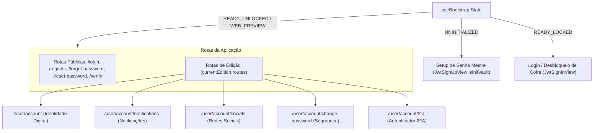

# 02 — Mapeamento Completo de Rotas, Navegação e Roteamento

## 1. Arquitetura de Roteamento

O DevOS Desktop utiliza **React Router v7** (`react-router: ^7.9.3`) configurado em um modelo SPA embutido no webview do Tauri. O roteamento é condicionalmente governado pelo estado do hardware e do cofre criptográfico central (`useBootstrap`), dividindo a aplicação em fases de inicialização e rotas operacionais.

### 1.1 Ciclo de Vida do Roteador (`src/app/router/app-router.tsx:18-100`)



---

## 2. Inventário de Rotas das Cinco Abas

As rotas são padronizadas em `src/app/router/paths.ts:51-56` e registradas nas duas edições do produto (`edition.node.ts` e `edition.cockpit.ts`):

| Aba | Rota Canônica | Path Helper | Componente de Página | Arquivo de Entrada |
|---|---|---|---|---|
| **Aba 1: Perfil Geral** | `/user/account` | `paths.dashboard.user.account` | `AccountGeneralPage` | `src/pages/user/account/general.tsx` |
| **Aba 2: Notificações** | `/user/account/notifications` | `${paths.dashboard.user.account}/notifications` | `AccountNotificationsPage` | `src/pages/user/account/notifications.tsx` |
| **Aba 3: Redes Sociais** | `/user/account/socials` | `${paths.dashboard.user.account}/socials` | `AccountSocialsPage` | `src/pages/user/account/socials.tsx` |
| **Aba 4: Segurança** | `/user/account/change-password` | `${paths.dashboard.user.account}/change-password` | `AccountChangePasswordPage` | `src/pages/user/account/change-password.tsx` |
| **Aba 5: Autenticador 2FA** | `/user/account/2fa` | `${paths.dashboard.user.account}/2fa` | `AccountTwoFAPage` | `src/pages/user/account/2fa.tsx` |

### 2.1 Aliases e Redirecionamentos Identificados
* `src/pages/user/account/index.tsx`: Reexporta `AccountGeneralPage` como exportação padrão para `/user/account`.
* `paths.dashboard.user.root` (`/user`): Aponta para `UserProfilePage` (`src/pages/user/profile`), que é uma visualização pública/resumida do perfil de usuário, separada do módulo de gestão cadastral civil (`/user/account`).

---

## 3. Hierarquia de Layouts e Navegação

Cada uma das 5 abas é encapsulada em dois níveis de layout:

1. **Nível 1 — Layout Global da Aplicação (`DevOSLayout`):**
   - Arquivo: `src/app/layouts/devos/layout.tsx`
   - Responsabilidade: Barra de navegação lateral (Sidebar institucional), Header com status do cofre/rede, alternador de temas (Dark/Light) e rodapé.
2. **Nível 2 — Layout da Seção Conta (`AccountLayout`):**
   - Arquivo: `src/sections/account/account-layout.tsx`
   - Responsabilidade: Breadcrumbs institucionais (`Dashboard > Minha Conta > Identidade Digital`) e abas horizontais do Material-UI (`Tabs` e `Tab`).
   - Proteção de roteamento implementada:
     ```tsx
     // src/sections/account/account-layout.tsx:49-61
     function normalizePathname(pathname: string): string {
       return pathname.replace(/\/+$/, '') || '/';
     }
     const currentTab = hasMatchingTab ? pathname : false;
     ```
     Evita warnings de valor inválido no MUI `Tabs` quando uma subrota ou trailing slash é acessada.

---

## 4. Guards e Controle de Acesso

1. **Guard de Hardware / Cofre Nativo:**
   - O guard não utiliza cookies ou localStorage, mas sim o hook nativo `useBootstrap` (`src/app/bootstrap/use-bootstrap.ts`), que consulta `get_vault_status` diretamente no Rust via Tauri IPC.
   - Se o cofre estiver trancado, todas as rotas de `/user/account/*` tornam-se inalcançáveis na árvore de renderização do React Router, retornando para `JwtSignInView`.
2. **Lazy Loading:**
   - Nas edições atuais (`edition.node.ts` e `edition.cockpit.ts`), as páginas são importadas de forma **estática** (eager loading), garantindo disponibilidade imediata no ambiente desktop local e eliminando latência de chunk downloading durante a navegação entre abas.
