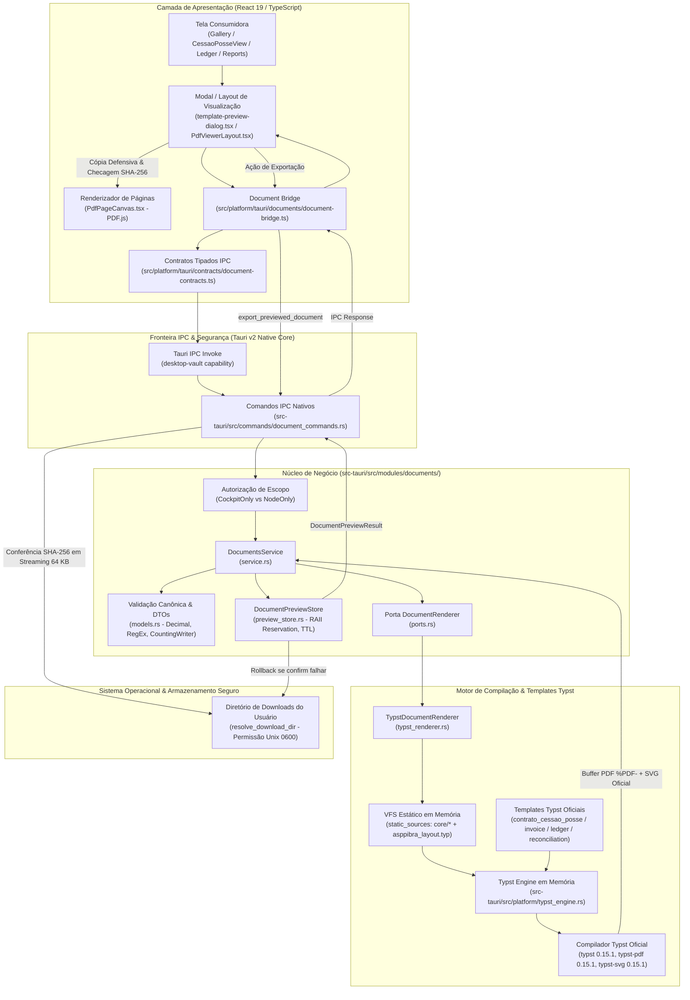

# Mapeamento Arquitetural e Fluxo de Dados — Módulo Documents (DevOS Desktop)

Data de Emissão: 15 de Novembro de 2026  
Escopo: Ecossistema de Geração, Pré-Visualização e Exportação de Documentos Oficiais  
Repositório: DevOS-Desktop (`main` @ `f2d78b0`)

---

## 1. Topologia da Arquitetura

O ecossistema documental do DevOS Desktop adota arquitetura em camadas orientada a portas e adaptadores (Hexagonal / Clean Architecture), isolando completamente o motor de compilação Typst das regras de negócio institucionais e da interface gráfica em React.

---

## 2. Rastreamento Detalhado do Ciclo de Vida (Passo a Passo)

### Ciclo A: Pré-Visualização Documental (`preview_document`)

1. **Disparo no Frontend:**
   - O usuário seleciona um modelo na `DocumentTemplatesGalleryView.tsx` ou clica em "Emitir Documento" na `CessaoPosseView.tsx`.
   - O componente invoca `previewDocument(payload)` via [document-bridge.ts](file:///home/sandro/Área%20de%20trabalho/App%20Desktop/DevOS-Desktop/src/platform/tauri/documents/document-bridge.ts).
2. **Serialização IPC:**
   - O payload é serializado no padrão [document-contracts.ts](file:///home/sandro/Área%20de%20trabalho/App%20Desktop/DevOS-Desktop/src/platform/tauri/contracts/document-contracts.ts) sob a tagged union `DocumentRequest` (`kind: "cessao_posse" | "citizen_ledger" | "invoice_bill" | "real_estate_reconciliation"`).
   - Invocado via IPC Tauri com autorização validada pela capability `desktop-vault.json` (`allow-preview-document`).
3. **Recepção e Autorização de Escopo no Backend:**
   - O comando `preview_document` em [document_commands.rs](file:///home/sandro/Área%20de%20trabalho/App%20Desktop/DevOS-Desktop/src-tauri/src/commands/document_commands.rs) obtém a edição ativa da aplicação (`ApplicationEdition`, configurada imutavelmente no boot da aplicação).
   - Verifica se a edição possui permissão para gerar a família documental requisitada (ex: `CessaoPosse` é restrito a `CockpitOnly`; se requisitado em `NodeOnly`, é rejeitado fail-closed imediatamente com mensagem amigável sem vazar detalhes internos).
4. **Validação Rigorosa de Payload (`models.rs`):**
   - Os dados são validados antes de qualquer processamento pesado de compilação:
     - `CountingWriter` com limite de profundidade JSON (máximo 32 níveis) para evitar DoS por exaustão de pilha.
     - Limite de comprimento máximo de strings (nomes de partes, identificadores, metadados).
     - Formatação estrita de datas (`YYYY-MM-DD`) e períodos de referência (`YYYY-MM`).
     - Decimais monetários com precisão exata de 2 casas (`scale_exceeds(2)`), rejeitando números fracionários imprecisos e prevenindo overflow aritmético em totais.
5. **Compilação e Renderização Typst:**
   - O [service.rs](file:///home/sandro/Área%20de%20trabalho/App%20Desktop/DevOS-Desktop/src-tauri/src/modules/documents/service.rs) delega para [typst_renderer.rs](file:///home/sandro/Área%20de%20trabalho/App%20Desktop/DevOS-Desktop/src-tauri/src/modules/documents/typst_renderer.rs).
   - Os módulos de suporte (`core/branding.typ`, `core/data_tags.typ`, `core/header_footer.typ`, `core/page_abnt.typ`, `core/typography.typ` e `asppibra_layout.typ`) são injetados em um VFS virtual inteiramente em memória via `with_static_source_file_resolver`. Nenhum arquivo temporário é escrito no disco físico.
   - O motor [typst_engine.rs](file:///home/sandro/Área%20de%20trabalho/App%20Desktop/DevOS-Desktop/src-tauri/src/platform/typst_engine.rs) compila o documento com fontes Roboto embutidas.
   - O PDF é gerado via `typst_pdf::pdf(&document)` e validado contra marcadores estruturais (`%PDF-` e `%%EOF`).
   - As páginas são renderizadas para visualização usando o exportador vetorial oficial `typst_svg::svg(&page)` e codificadas em Base64 acelerado por hardware (SIMD/AVX2).
6. **Armazenamento Seguro em Memória (`preview_store.rs`):**
   - O `DocumentPreviewStore` aloca o resultado compilado associado a um UUID v4 criptográfico (`preview_id`).
   - É gravado o timestamp de criação, timestamp de expiração (TTL determinístico de 600 segundos) e o SHA-256 exato dos bytes gerados.
   - Limite global de capacidade em memória (capacidade máxima de entradas e bytes protegendo contra DoS).
7. **Exibição Confiável no Frontend (`PdfViewerLayout.tsx`):**
   - O frontend recebe `DocumentPreviewResult`.
   - Antes de exibir, o [PdfViewerLayout.tsx](file:///home/sandro/Área%20de%20trabalho/App%20Desktop/DevOS-Desktop/src/shared/components/pdf-viewer/PdfViewerLayout.tsx) decodifica os bytes e **recalcula o SHA-256 no cliente** via Web Cryptography API (`crypto.subtle.digest('SHA-256')`).
   - Se houver divergência de 1 bit sequer, o modal bloqueia com alerta de integridade violada.
   - Uma cópia defensiva imutável (`bytes.slice()`) é fornecida ao PDF.js para renderização em `<canvas>` de alta resolução.

---

### Ciclo B: Exportação Criptograficamente Verificada (`export_previewed_document`)

1. **Solicitação do Usuário:**
   - O usuário clica em "Exportar PDF" ou "Salvar".
   - O frontend envia `ExportPreviewPayload`: `{ preview_id, expected_sha256, target_file_name, open_after_export }`.
2. **Reserva Transacional RAII no Backend (`preview_store.rs`):**
   - O store busca a sessão pelo `preview_id`.
   - Verifica se a sessão expirou pelo relógio monotônico.
   - Compara o `expected_sha256` recebido com o hash da sessão em memória.
   - Inicia uma reserva RAII (`ExportReservation`), que bloqueia a remoção da sessão durante o processo de escrita. Se a operação sofrer pânico ou for abortada, o destrutor RAII libera o lock e purga o estado.
3. **Validação do Destino e Prevenção de Path Traversal:**
   - O nome do arquivo passa por `normalize_pdf_file_name`:
     - Proibidos separadores de caminho (`/`, `\`), dois pontos (`:`), caracteres inválidos do Windows (`<`, `>`, `"`, `|`, `?`, `*`).
     - Rejeição estrita de nomes reservados de sistema (`CON`, `PRN`, `AUX`, `NUL`, `COM1..9`, `LPT1..9`).
     - Rejeição de ponto ou espaço no final do nome.
     - Forçada a extensão única `.pdf`.
   - Se o nome não for informado, `default_file_name` gera um identificador único contendo timestamp UTC com microssegundos e entropia UUID de 6 caracteres (`{timestamp}_{entropy}.pdf`), impossibilitando colisões.
4. **Gravação Segura sem Sobrescrita:**
   - O arquivo é aberto com `create_new(true)`, impedindo sobrescrita de documentos existentes.
   - Em sistemas Unix, as permissões são forçadas para `0o600` (`-rw-------`), acessíveis apenas pelo proprietário do processo.
   - Chamada síncrona `file.flush()` garante a persistência física dos blocos antes da verificação.
5. **Auditoria Criptográfica Pós-Gravação via Streaming:**
   - O comando lê o arquivo recém-gravado do disco via streaming de blocos de 64 KB (`compute_file_sha256`), evitando carregar o arquivo inteiro de volta na memória RAM.
   - O hash calculado sobre os bytes físicos do disco é comparado com o hash original do preview.
   - Se houver divergência: o arquivo físico é imediatamente apagado (`fs::remove_file`), a reserva é abortada e um erro de integridade é retornado.
6. **Conclusão Transacional:**
   - O método `reservation.confirm()` consolida a exportação. Se o confirm falhar, o arquivo é deletado do disco em rollback imediato.
   - O usuário recebe `GenerateDocumentResult` contendo o caminho final do arquivo, o nome sanitizado e os metadados canônicos verificados.

