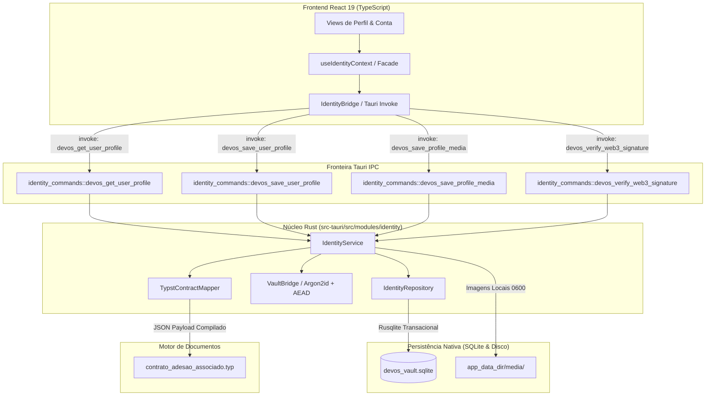

# GUIA DE INTEGRAÇÃO TÉCNICA E BACKEND NATIVO: USUÁRIO, IDENTIDADE E COFRE LOCAL
## ASPPIBRA DevOS Desktop — Tauri v2 + Rust 1.92 + SQLite (Rusqlite) + Typst 0.15

---

### 1. VISÃO GERAL DA INTEGRAÇÃO

Este documento estabelece o roteiro técnico, os esquemas de banco de dados, os contratos IPC e as assinaturas de funções Rust necessárias para transformar o módulo de Usuário e Identidade Digital — atualmente operando sobre simulações em memória e `localStorage` — em um subsistema soberano, persistente e criptograficamente seguro no **DevOS Desktop**.



---

### 2. COMANDOS TAURI IPC NECESSÁRIOS (ESPECIFICAÇÃO TÉCNICA)

Atualmente, **nenhum** comando de perfil de usuário está implementado ou registrado no Tauri (`lib.rs`). Os seguintes comandos devem ser criados e registrados em `src-tauri/src/commands/identity_commands.rs`:

#### 2.1. `devos_get_user_profile`
- **Finalidade:** Carrega a identidade civil e as configurações do usuário autenticado no cofre local.
- **Assinatura Rust:**
  ```rust
  #[tauri::command]
  pub async fn devos_get_user_profile(
      state: tauri::State<'_, AppState>,
  ) -> Result<UserProfileDto, IpcErrorResponse>
  ```
- **Parâmetros Frontend:** `{}` (Sessão validada pelo estado de desbloqueio do cofre).
- **Retorno Frontend:** `UserProfileDto` (Interface TypeScript idêntica ao contrato).

#### 2.2. `devos_save_user_profile`
- **Finalidade:** Persiste de forma transacional e atômica todas as alterações cadastrais do associado/operador.
- **Assinatura Rust:**
  ```rust
  #[tauri::command]
  pub async fn devos_save_user_profile(
      payload: SaveUserProfileRequest,
      state: tauri::State<'_, AppState>,
  ) -> Result<UserProfileDto, IpcErrorResponse>
  ```
- **Validações no Backend:**
  - Formato estrito de CPF/CNPJ (módulo de validação com cálculo de dígitos verificadores).
  - Sanitização de strings para prevenção de injeção e estouro de buffer (máximo 255 caracteres para campos textuais, 4000 para biografia).
  - Normalização de telefones, CEP e e-mail.

#### 2.3. `devos_save_profile_media`
- **Finalidade:** Recebe os bytes brutos (ou Base64) do avatar ou foto de capa, salva no disco local em pasta privada da aplicação (`app_data_dir/media/profile_media/`) com hash SHA-256 no nome e permissões `0600`, retornando a URI segura acessível pelo webview (`convertFileSrc`).
- **Assinatura Rust:**
  ```rust
  #[tauri::command]
  pub async fn devos_save_profile_media(
      media_type: String, // "avatar" | "cover"
      image_bytes: Vec<u8>,
      state: tauri::State<'_, AppState>,
  ) -> Result<ProfileMediaResult, IpcErrorResponse>
  ```

#### 2.4. `devos_verify_web3_signature`
- **Finalidade:** Validar matematicamente a titularidade da carteira EVM antes de vinculá-la à identidade do usuário (resolvendo o problema `SEC-02`).
- **Fluxo:**
  1. Frontend solicita desafio com `devos_request_web3_challenge(address)`.
  2. Rust gera nonce criptográfico temporário (TTL 5 minutos) assinado com HMAC do cofre.
  3. Frontend solicita assinatura da mensagem EIP-712 ou EIP-191 via MetaMask.
  4. Rust recupera a chave pública da assinatura (`k256::ecdsa::recoverable::Signature`) e confirma se o endereço derivado corresponde ao declarado.
- **Assinatura Rust:**
  ```rust
  #[tauri::command]
  pub async fn devos_verify_web3_signature(
      address: String,
      nonce: String,
      signature: String,
      state: tauri::State<'_, AppState>,
  ) -> Result<bool, IpcErrorResponse>
  ```

#### 2.5. `devos_change_master_password`
- **Finalidade:** Permitir a rotação legítima da senha mestre do cofre (resolvendo `SEC-03`).
- **Comportamento:**
  1. Valida a senha antiga contra o `VaultHeader` (Argon2id).
  2. Descriptografa a chave mestra em memória com Zeroize.
  3. Reencripta os envelopes do cofre (`vault_secrets`) com a nova derivação de chave.
  4. Atualiza atomicamente a tabela `vault_header` em transação SQLite.

---

### 3. ESQUEMA DE BANCO DE DADOS SQLITE (MIGRAÇÃO VERSIONADA)

Arquivo alvo: `src-tauri/src/storage/migrations.rs` (Migração 2 do banco `devos_vault.sqlite`).

```sql
-- ============================================================================
-- MIGRAÇÃO 2: TABELAS DE IDENTIDADE CIVIL, CONTA E PREFERÊNCIAS DE USUÁRIO
-- ============================================================================

-- 1. Perfil canônico de identidade civil do associado/operador
CREATE TABLE IF NOT EXISTS user_profiles (
    id INTEGER PRIMARY KEY CHECK (id = 1), -- Registro único por instância de cofre
    person_type TEXT NOT NULL DEFAULT 'PF' CHECK (person_type IN ('PF', 'PJ')),
    first_name TEXT NOT NULL,
    last_name TEXT NOT NULL,
    username TEXT NOT NULL UNIQUE,
    email TEXT NOT NULL UNIQUE,
    phone_number TEXT,
    cpf TEXT,
    rg TEXT,
    rg_issuer TEXT,
    cnh TEXT,
    cnh_category TEXT,
    mother_name TEXT,
    father_name TEXT,
    birth_date TEXT,
    nationality TEXT NOT NULL DEFAULT 'Brasileira',
    marital_status TEXT DEFAULT 'Solteiro(a)',
    country TEXT NOT NULL DEFAULT 'Brasil',
    zip_code TEXT NOT NULL,
    state TEXT NOT NULL,
    city TEXT NOT NULL,
    neighborhood TEXT,
    address TEXT NOT NULL,
    address_number TEXT,
    complement TEXT,
    occupation TEXT,
    company TEXT,
    website TEXT,
    about TEXT,
    is_public BOOLEAN NOT NULL DEFAULT 1,
    avatar_rel_path TEXT,
    cover_rel_path TEXT,
    legal_representative TEXT,
    legal_representative_cpf TEXT,
    completeness_score INTEGER NOT NULL DEFAULT 0,
    created_at TEXT NOT NULL DEFAULT (datetime('now')),
    updated_at TEXT NOT NULL DEFAULT (datetime('now'))
);

-- 2. Identidades e provedores vinculados (Web3 Wallets, SSO, OAuth)
CREATE TABLE IF NOT EXISTS user_linked_identities (
    id INTEGER PRIMARY KEY AUTOINCREMENT,
    provider_type TEXT NOT NULL CHECK (provider_type IN ('WALLET_EVM', 'GOOGLE', 'GITHUB')),
    identifier_value TEXT NOT NULL,
    is_verified BOOLEAN NOT NULL DEFAULT 0,
    verification_proof TEXT, -- Assinatura criptográfica ou token hash
    verified_at TEXT,
    strict_auth_required BOOLEAN NOT NULL DEFAULT 1,
    created_at TEXT NOT NULL DEFAULT (datetime('now')),
    UNIQUE(provider_type, identifier_value)
);

-- 3. Preferências e canais de notificação
CREATE TABLE IF NOT EXISTS user_notification_settings (
    id INTEGER PRIMARY KEY CHECK (id = 1),
    email_enabled BOOLEAN NOT NULL DEFAULT 1,
    sms_enabled BOOLEAN NOT NULL DEFAULT 0,
    whatsapp_enabled BOOLEAN NOT NULL DEFAULT 1,
    push_enabled BOOLEAN NOT NULL DEFAULT 1,
    notify_comments BOOLEAN NOT NULL DEFAULT 1,
    notify_transactions BOOLEAN NOT NULL DEFAULT 1,
    notify_security BOOLEAN NOT NULL DEFAULT 1,
    updated_at TEXT NOT NULL DEFAULT (datetime('now'))
);

-- 4. Redes sociais e presença digital
CREATE TABLE IF NOT EXISTS user_social_profiles (
    id INTEGER PRIMARY KEY CHECK (id = 1),
    facebook_url TEXT,
    instagram_url TEXT,
    linkedin_url TEXT,
    twitter_url TEXT,
    updated_at TEXT NOT NULL DEFAULT (datetime('now'))
);

-- Índices de consulta rápida
CREATE INDEX IF NOT EXISTS idx_user_profiles_cpf ON user_profiles(cpf);
CREATE INDEX IF NOT EXISTS idx_user_linked_provider ON user_linked_identities(provider_type, identifier_value);
```

---

### 4. DTOs RUST E MAPPER PARA O MOTOR TYPST

#### 4.1. Estruturas Rust (`src-tauri/src/modules/identity/models.rs`)

```rust
use serde::{Deserialize, Serialize};

#[derive(Debug, Clone, Serialize, Deserialize)]
pub struct UserProfileDto {
    pub person_type: String,
    pub first_name: String,
    pub last_name: String,
    pub username: String,
    pub email: String,
    pub phone_number: Option<String>,
    pub cpf: Option<String>,
    pub rg: Option<String>,
    pub rg_issuer: Option<String>,
    pub cnh: Option<String>,
    pub cnh_category: Option<String>,
    pub mother_name: Option<String>,
    pub father_name: Option<String>,
    pub birth_date: Option<String>,
    pub nationality: String,
    pub marital_status: Option<String>,
    pub country: String,
    pub zip_code: String,
    pub state: String,
    pub city: String,
    pub neighborhood: Option<String>,
    pub address: String,
    pub address_number: Option<String>,
    pub complement: Option<String>,
    pub occupation: Option<String>,
    pub company: Option<String>,
    pub website: Option<String>,
    pub about: Option<String>,
    pub is_public: bool,
    pub avatar_url: Option<String>,
    pub cover_url: Option<String>,
    pub completeness_score: u32,
}
```

#### 4.2. Mapeamento Direto para o Template Typst (`contrato_adesao_associado.typ`)

Abaixo a função em Rust que transforma o perfil do usuário diretamente nas variáveis esperadas pelo template Typst:

```rust
pub fn build_typst_contrato_associado_payload(
    user: &UserProfileDto,
    document_number: &str,
    auth_code: &str,
    valor_mensalidade: &str,
    data_extenso: &str,
) -> serde_json::Value {
    let full_name = format!("{} {}", user.first_name, user.last_name).trim().to_uppercase();
    let endereco_completo = format!(
        "{}, {} {} - {}, {}/{}, CEP: {}",
        user.address,
        user.address_number.as_deref().unwrap_or("S/N"),
        user.complement.as_deref().unwrap_or(""),
        user.neighborhood.as_deref().unwrap_or(""),
        user.city,
        user.state,
        user.zip_code
    );

    let rg_completo = match (&user.rg, &user.rg_issuer) {
        (Some(rg), Some(issuer)) => format!("{} {}", rg, issuer),
        (Some(rg), None) => rg.clone(),
        _ => "Não informado".to_string(),
    };

    serde_json::json!({
        "document_number": document_number,
        "auth_code": auth_code,
        "data": {
            "associado_nome": full_name,
            "associado_cpf_cnpj": user.cpf.as_deref().unwrap_or("000.000.000-00"),
            "associado_rg": rg_completo,
            "associado_nacionalidade": user.nationality,
            "associado_estado_civil": user.marital_status.as_deref().unwrap_or("Solteiro(a)"),
            "associado_profissao": user.occupation.as_deref().unwrap_or("Não informada"),
            "associado_nascimento": user.birth_date.as_deref().unwrap_or(""),
            "associado_endereco": endereco_completo,
            "associado_municipio": user.city,
            "associado_uf": user.state,
            "associado_cep": user.zip_code,
            "associado_telefone": user.phone_number.as_deref().unwrap_or(""),
            "associado_email": user.email,
            "associado_categoria": "Associado Titular Efetivo",
            "contribuicao_valor": valor_mensalidade,
            "contribuicao_periodicidade": "Mensal",
            "contribuicao_vencimento": "10",
            "contribuicao_forma_pagamento": "Pix / Débito em Conta / Criptoativo",
            "cidade_emissao": format!("{}/{}", user.city, user.state),
            "data_extenso": data_extenso
        }
    })
}
```

---

### 5. ESPECIFICAÇÃO DO CONTRATO FRONTEND (`IdentityBridge`)

Localização: `src/platform/tauri/identity/identity-bridge.ts`

```typescript
import { invoke } from '../core/invoke';
import type { UserAccountData, LinkedProviders } from 'src/sections/account/use-account';

export const IdentityBridge = {
  async getProfile(): Promise<UserAccountData> {
    return invoke<UserAccountData>('devos_get_user_profile');
  },

  async saveProfile(data: Partial<UserAccountData>): Promise<UserAccountData> {
    return invoke<UserAccountData>('devos_save_user_profile', { payload: data });
  },

  async saveProfileMedia(type: 'avatar' | 'cover', file: File): Promise<{ localPath: string; webviewUrl: string }> {
    const buffer = await file.arrayBuffer();
    const bytes = Array.from(new Uint8Array(buffer));
    return invoke('devos_save_profile_media', { mediaType: type, imageBytes: bytes });
  },

  async changeMasterPassword(oldPass: string, newPass: string): Promise<boolean> {
    return invoke<boolean>('devos_change_master_password', { oldPassword: oldPass, newPassword: newPass });
  },

  async requestWeb3Challenge(address: string): Promise<string> {
    return invoke<string>('devos_request_web3_challenge', { address });
  },

  async verifyAndLinkWallet(address: string, signature: string, challenge: string): Promise<boolean> {
    return invoke<boolean>('devos_verify_web3_signature', { address, signature, nonce: challenge });
  }
};
```

---

### 6. PLANO DE MIGRAÇÃO DO LOCALSTORAGE PARA SQLITE

Para garantir transição suave aos usuários em teste:
1. No boot do app (`AppBootstrapProvider`), checar se o SQLite já possui o registro de perfil (`user_profiles.id = 1`).
2. Se a tabela SQLite estiver vazia, ler o item `devos_user_account_profile` do `localStorage`.
3. Caso existam dados no `localStorage`, invocar automaticamente `IdentityBridge.saveProfile(dadosLocais)` para migrá-los para o SQLite nativo.
4. Após confirmação de persistência pelo SQLite, remover com segurança a chave do `localStorage` (`localStorage.removeItem('devos_user_account_profile')`).
