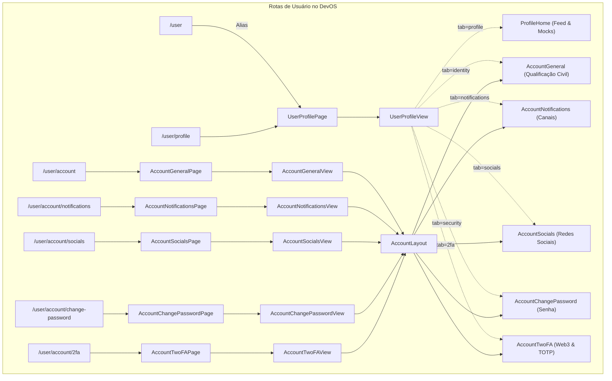
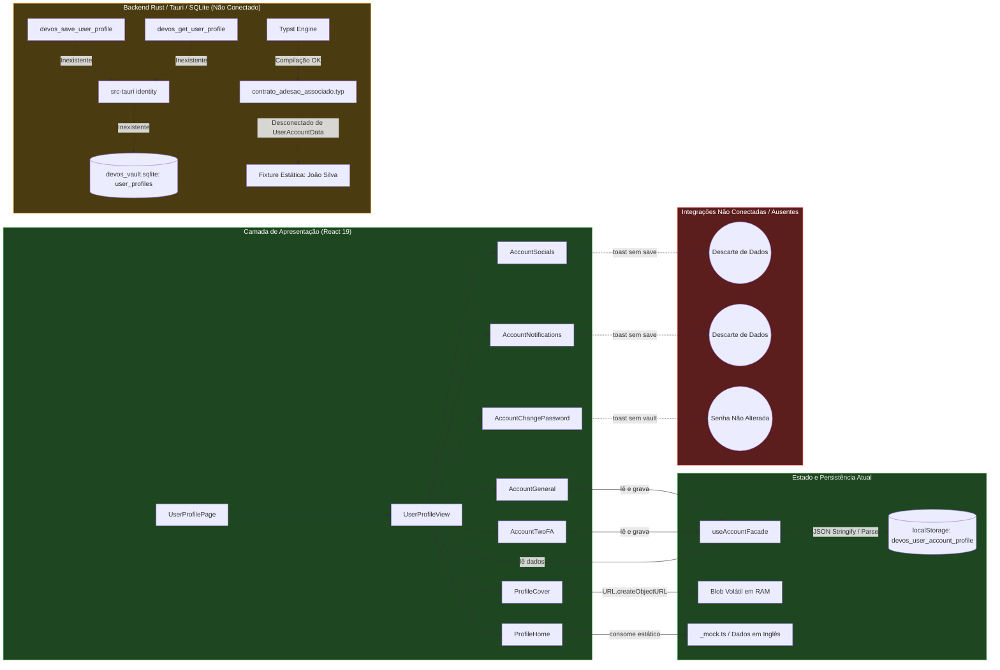
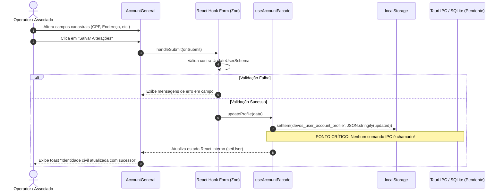
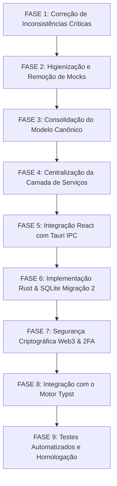

# AUDITORIA ARQUITETURAL COMPLETA: MÓDULO DE USUÁRIO, CONTA E IDENTIDADE DIGITAL
## ASPPIBRA-DAO DevOS Desktop — React 19 + TypeScript + Tauri v2 + Rust + SQLite + Typst

---

### METADADOS DA AUDITORIA

| Metadado | Detalhe |
|---|---|
| **Documento** | Relatório de Auditoria Arquitetural e Diagnóstico Forense de Identidade Digital |
| **Projeto** | ASPPIBRA-DAO DevOS Desktop |
| **Edições Alvo** | DevOS Node (`br.aspp.devos.node`) & DevOS Cockpit (`br.aspp.devos.cockpit`) |
| **Stack Frontend** | React 19.1.1, TypeScript 6.0.2, Vite 8.0.8, React Router 7.9.3, MUI v9, Zod 3.25.76, React Hook Form 7.63.0, Sonner 2.0.7 |
| **Stack Backend** | Tauri v2.12.1, Rust 1.92 (Edition 2024), Rusqlite 0.32 (SQLite), Typst 0.15, Argon2id + AES-256-GCM |
| **Data da Auditoria** | 16/11/2026 |
| **Natureza** | Auditoria Read-Only / Diagnóstico Forense Estrito (Zero modificações no código da aplicação) |
| **Status do Relatório** | Homologado para Planejamento de Higienização e Integração Definitiva |

---

## 1. RESUMO EXECUTIVO

A auditoria arquitetural profunda realizada no módulo de **Usuário, Perfil, Conta e Identidade Digital** do projeto DevOS Desktop revelou um cenário de **forte assimetria entre a sofisticação da interface gráfica e a maturidade de sua infraestrutura de persistência e segurança**.

### Principais Constatações Técnicas:
1. **Ausência Total de Backend para o Módulo de Usuário:** Os comandos IPC citados em documentos conceituais (`devos_save_user_profile` e `devos_get_user_profile`) **não existem** no código Rust (`src-tauri/src/`). O backend Tauri possui 32 comandos registrados para cofres (`vault`), carteiras (`wallets`), documentos (`documents`), IPFS (`ipfs`) e monitoramento (`monitoring`), mas **zero comandos** dedicados a dados cadastrais do associado ou identidade civil.
2. **Armazenamento em `localStorage` de Dados Civis Sensíveis:** A totalidade dos dados pessoais (CPF, RG, CNH, data de nascimento, nome da mãe, filiação, endereço residencial completo, estado civil e chaves de provedores) é persistida em texto plano no `localStorage` do navegador sob a chave `devos_user_account_profile` (`src/sections/account/use-account.ts#L105`), sem qualquer criptografia em repouso.
3. **Simulação Completa de Segurança e Autenticação:**
   - **Autenticador TOTP 2FA:** Apresenta um ícone estático de QR code com segredo estático codificado (`JBSWY3DPEHPK3PXP`) e valida qualquer código digitado que possua 6 dígitos (`length === 6`), sem verificação algorítmica TOTP real (`src/sections/account/account-2fa.tsx#L55`).
   - **Vínculo Web3:** O usuário digita qualquer endereço hexadecimal `0x...` e o sistema marca a flag `walletVerified: true` sem solicitar assinatura de desafio (EIP-712 / EIP-191) nem interagir com MetaMask ou chave privada (`account-2fa.tsx#L115`).
   - **Alteração de Senha:** O formulário de alteração de senha valida as regras Zod, mas na submissão apenas executa `reset()` e emite um toast de sucesso, sem acionar o cofre criptográfico (`VaultBridge`) ou alterar a senha mestre (`account-change-password.tsx#L48`).
4. **Perda de Dados em Formulários Críticos:**
   - As telas de **Redes Sociais** (`account-socials.tsx`) e **Canais de Notificação** (`account-notifications.tsx`) possuem formulários funcionais, mas seus manipuladores `onSubmit` apenas chamam `toast.success()`, descartando os dados submetidos sem salvá-los nem mesmo no `localStorage`.
   - O upload de **Avatar** e **Foto de Capa** (`profile-cover.tsx#L46`) gera links voláteis com `URL.createObjectURL(file)`. Ao fechar ou recarregar a aplicação, esses links `blob:` expiram, gerando imagens quebradas permanentemente no perfil.
5. **Desconexão com o Motor Jurídico Typst:** O compilador nativo Typst possui o template `contrato_adesao_associado.typ` totalmente pronto e aderente à norma ABNT NBR 14724, esperando mais de 30 variáveis de qualificação civil. No entanto, este template é alimentado por uma fixture estática (`JOÃO SILVA DOS SANTOS`) e o catálogo de documentos (`document-templates-registry.ts#L236`) redireciona a emissão para a página de `/devos/cessao-posse`, estando 100% desconectado do formulário de perfil do usuário.
6. **Múltiplos Modelos de Usuário Divergentes:** Foram identificadas 4 definições incompatíveis de usuário convivendo no frontend: `UserAccountData` (`use-account.ts`), `UserProfile` (`sections/user/types.ts`), `UserProfile` (`edition/node/hooks/use-user-profile.ts`) e `AuthUser` (`modules/authentication/application/hooks.ts`).
7. **Cobertura de Testes Nula:** Não existe nenhum teste unitário, de integração ou E2E cobrindo as páginas, componentes ou formulários do módulo de usuário.

---

## 2. ESCOPO DA AUDITORIA

A investigação cobriu exaustivamente todas as camadas e diretórios da aplicação:
- **Páginas de Usuário:** `src/pages/user/` e subpastas.
- **Seções Visuais:** `src/sections/user/` e `src/sections/account/`.
- **Módulos de Domínio:** `src/modules/identity/` e `src/modules/authentication/`.
- **Pontes de Comunicação:** `src/platform/tauri/` e contratos IPC.
- **Backend Nativo Rust:** `src-tauri/src/commands/`, `src-tauri/src/modules/`, `src-tauri/src/storage/`.
- **Templates Documentais:** `src-tauri/templates/contrato_adesao_associado.typ` e bases ABNT.
- **Roteamento e Edições:** `src/app/router/`, `src/app/editions/node/`, `src/app/editions/cockpit/`.
- **Infraestrutura de Testes:** `src/test/` e `src-tauri/src/tests/`.

---

## 3. ÁRVORE COMPLETA DE ARQUIVOS DO MÓDULO

```
DevOS-Desktop/
├── src/
│   ├── app/
│   │   ├── editions/
│   │   │   ├── edition.node.ts                       # Rotas de usuário registradas no Node
│   │   │   ├── edition.cockpit.ts                    # Rotas de usuário registradas no Cockpit
│   │   │   └── node/
│   │   │       └── hooks/
│   │   │           └── use-user-profile.ts           # Mock hook de perfil de operador do nó
│   │   └── router/
│   │       ├── paths.ts                              # Definições canônicas de paths (/user/*)
│   │       └── app-router.tsx                        # Roteador mestre e chaveamento de cofre
│   ├── modules/
│   │   ├── authentication/
│   │   │   ├── application/
│   │   │   │   ├── facades.ts                        # useUserProfile() mock da auth
│   │   │   │   ├── hooks.ts                          # AuthUser / DEFAULT_OPERATOR_USER estático
│   │   │   │   └── identity-session.service.ts       # Simulação de recuperação de senha
│   │   │   ├── context/
│   │   │   │   └── jwt.ts                            # Integração com VaultBridge e bloqueio Web3
│   │   │   └── presentation/
│   │   │       ├── components/
│   │   │       │   └── identity-avatar.tsx           # Avatar simples de operador
│   │   │       └── views/
│   │   │           └── jwt-sign-in-view.tsx          # Tela de login e tentativa Web3/OAuth
│   │   └── identity/
│   │       ├── index.ts                              # Reexportação pública do módulo
│   │       └── presentation/
│   │           └── components/
│   │               └── host-integrity-card.tsx       # Card de telemetria de isolamento de hardware
│   ├── pages/
│   │   └── user/
│   │       ├── profile.tsx                           # Rota /user/profile
│   │       └── account/
│   │           ├── index.tsx                         # Reexportação (desnecessária)
│   │           ├── general.tsx                       # Rota /user/account
│   │           ├── 2fa.tsx                           # Rota /user/account/2fa
│   │           ├── change-password.tsx               # Rota /user/account/change-password
│   │           ├── socials.tsx                       # Rota /user/account/socials
│   │           └── notifications.tsx                 # Rota /user/account/notifications
│   ├── sections/
│   │   ├── user/
│   │   │   ├── index.ts                              # Barrel export da seção user
│   │   │   ├── types.ts                              # Tipos do perfil social do template
│   │   │   ├── _mock.ts                              # Fixture com posts e bio em inglês
│   │   │   ├── profile-cover.tsx                     # Banner panorâmico, uploads de capa e avatar
│   │   │   ├── profile-home.tsx                      # Feed de publicações e cards mockados
│   │   │   ├── profile-about.tsx                     # Card de bio em inglês
│   │   │   ├── profile-follow-info.tsx               # Contadores de seguidores com decimais
│   │   │   ├── profile-social-info.tsx               # Lista de redes sociais públicas
│   │   │   ├── profile-post-input.tsx                # Input para postar no feed (simulado)
│   │   │   ├── profile-post-item.tsx                 # Card de post com likes e comentários voláteis
│   │   │   └── view/
│   │   │       └── user-profile-view.tsx             # Orquestrador de abas do perfil panorâmico
│   │   └── account/
│   │       ├── index.ts                              # Barrel export da seção account
│   │       ├── use-account.ts                        # useAccountFacade & UserAccountData (localStorage)
│   │       ├── account-layout.tsx                    # Abas horizontais secundárias de navegação
│   │       ├── account-general.tsx                   # Formulário de qualificação civil (Zod)
│   │       ├── account-2fa.tsx                       # Painel de TOTP, Web3 e SSO (simulados)
│   │       ├── account-change-password.tsx           # Alteração de senha e biometria (simulados)
│   │       ├── account-socials.tsx                   # Formulário de redes sociais (sem persistência)
│   │       ├── account-notifications.tsx             # Formulário de canais de notificação (sem persistência)
│   │       └── view/
│   │           ├── index.ts                          # Barrel export das views de account
│   │           ├── account-general-view.tsx          # Wrapper AccountLayout + AccountGeneral
│   │           ├── account-2fa-view.tsx              # Wrapper AccountLayout + AccountTwoFA
│   │           ├── account-change-password-view.tsx  # Wrapper AccountLayout + AccountChangePassword
│   │           ├── account-socials-view.tsx          # Wrapper AccountLayout + AccountSocials
│   │           └── account-notifications-view.tsx    # Wrapper AccountLayout + AccountNotifications
│   └── platform/
│       └── tauri/
│           └── contracts/
│               └── document-contracts.ts             # Contrato de geração ContratoAssociadoPayload
└── src-tauri/
    ├── src/
    │   ├── commands/
    │   │   └── mod.rs                                # Comandos expostos (identity_commands AUSENTE)
    │   ├── lib.rs                                    # generate_handler! (devos_save/get AUSENTES)
    │   ├── modules/
    │   │   └── documents/
    │   │       └── models.rs                         # ContratoAssociadoPayload (validação genérica)
    │   └── storage/
    │       ├── local_database.rs                     # Conexão SQLite do cofre (sem tabela de usuário)
    │       └── migrations.rs                         # Migrações SQLite (ausência de user_profiles)
    └── templates/
        └── contrato_adesao_associado.typ             # Template Typst canônico de filiação institucional
```

---

## 4. CATÁLOGO DE COMPONENTES DO MÓDULO

Abaixo, o inventário detalhado de todos os componentes de interface que formam o módulo:

| Componente | Arquivo de Origem | Responsabilidade Técnica | Estado Interno / Hooks | Dependências Importadas |
|---|---|---|---|---|
| `UserProfileView` | `src/sections/user/view/user-profile-view.tsx` | View integradora central; mantém banner e alterna entre as abas em cache | `useSearchParams`, `useState` (visitedTabs), `useAccountFacade` | `ProfileCover`, `ProfileHome`, `AccountGeneral`, `AccountTwoFA`, `AccountSocials`, `AccountNotifications`, `AccountChangePassword` |
| `ProfileCover` | `src/sections/user/profile-cover.tsx` | Banner panorâmico, exibição de nome/cargo, input de fotos e dock de abas | `useTheme`, `handleCoverChange`, `handleAvatarChange` | `MUI Tabs`, `Iconify`, `toast` |
| `ProfileHome` | `src/sections/user/profile-home.tsx` | Grid com sobre, seguidores, redes, caixa de post e feed social | Stateless (consome mocks) | `ProfileAbout`, `ProfileSocialInfo`, `ProfileFollowInfo`, `ProfilePostInput`, `ProfilePostItem`, `_mock` |
| `ProfileAbout` | `src/sections/user/profile-about.tsx` | Card com citações e dados acadêmicos/profissionais em inglês | Stateless | `MUI Card`, `Iconify`, `UserProfileAbout` |
| `ProfileSocialInfo` | `src/sections/user/profile-social-info.tsx` | Exibe links clicáveis de redes sociais públicas | Stateless | `MUI Link`, `Iconify`, `UserProfileSocials` |
| `ProfileFollowInfo` | `src/sections/user/profile-follow-info.tsx` | Exibe contadores numéricos de seguidores e seguidos | Stateless | `MUI Card`, `Divider` |
| `ProfilePostInput` | `src/sections/user/profile-post-input.tsx` | Caixa para digitação e postagem de status no feed | `useState` (content) | `MUI InputBase`, `Button`, `Iconify` |
| `ProfilePostItem` | `src/sections/user/profile-post-item.tsx` | Renderização de post com curtida interativa e novos comentários | `useState` (likes, hasLiked, commentText, comments) | `MUI Card`, `Avatar`, `Image`, `Iconify` |
| `AccountLayout` | `src/sections/account/account-layout.tsx` | Layout secundário com barra de abas horizontais para rotas `/user/account/*` | `usePathname` | `MUI Tabs`, `RouterLink`, `CustomBreadcrumbs`, `Iconify` |
| `AccountGeneral` | `src/sections/account/account-general.tsx` | Formulário de qualificação civil completa com Completeness Score e Zod | `useForm`, `useEffect`, `watch`, `useAccountFacade` | `Form`, `Field`, `UpdateUserSchema`, `toast` |
| `AccountTwoFA` | `src/sections/account/account-2fa.tsx` | Painel de TOTP 2FA, vínculo de carteira Web3, Google e GitHub e modo estrito | `useState` (totp, modal, input), `useAccountFacade` | `MUI Dialog`, `Switch`, `TextField`, `toast` |
| `AccountChangePassword` | `src/sections/account/account-change-password.tsx` | Formulário de troca de senha mestre, toggle de biometria e sessões ativas | `useState` (showPassword), `useForm` (ChangePasswordSchema) | `Form`, `Field`, `toast`, `Iconify` |
| `AccountSocials` | `src/sections/account/account-socials.tsx` | Formulário de edição de links de redes sociais institucionais | `useForm` (SocialLinks) | `Form`, `Field`, `toast`, `Iconify` |
| `AccountNotifications` | `src/sections/account/account-notifications.tsx` | Seleção de canais de notificação e eventos monitorados | `useForm` (Controller) | `MUI Switch`, `Card`, `toast` |
| `AccountGeneralView` | `src/sections/account/view/account-general-view.tsx` | Encapsulador de rota: `AccountLayout` + `AccountGeneral` | Stateless | `AccountLayout`, `AccountGeneral` |
| `AccountTwoFAView` | `src/sections/account/view/account-2fa-view.tsx` | Encapsulador de rota: `AccountLayout` + `AccountTwoFA` | Stateless | `AccountLayout`, `AccountTwoFA` |
| `AccountChangePasswordView` | `src/sections/account/view/account-change-password-view.tsx` | Encapsulador de rota: `AccountLayout` + `AccountChangePassword` | Stateless | `AccountLayout`, `AccountChangePassword` |
| `AccountSocialsView` | `src/sections/account/view/account-socials-view.tsx` | Encapsulador de rota: `AccountLayout` + `AccountSocials` | Stateless | `AccountLayout`, `AccountSocials` |
| `AccountNotificationsView` | `src/sections/account/view/account-notifications-view.tsx` | Encapsulador de rota: `AccountLayout` + `AccountNotifications` | Stateless | `AccountLayout`, `AccountNotifications` |
| `HostIntegrityCard` | `src/modules/identity/presentation/components/host-integrity-card.tsx` | Card institucional de integridade de isolamento de privilégios de hardware | Stateless | `MUI Typography`, `Card`, `StatusBadge`, `colors` |

---

## 5. MAPA DE ROTAS E NAVEGAÇÃO

### 5.1. Relação Entre as Rotas Existentes

O projeto implementa uma duplicidade na arquitetura de navegação de usuário:
1. **Padrão Monolítico Panorâmico (`/user/profile?tab=...`):**
   - Controlado por `UserProfileView`. Carrega todos os componentes filhos em abas ocultas por CSS (`display: currentTab === '...' ? 'block' : 'none'`), preservando o estado em memória através de `visitedTabs`.
2. **Padrão Multi-página Tradicional (`/user/account/...`):**
   - Controlado por páginas individuais que utilizam `AccountLayout`. Cada navegação aciona recarga de componente e remonta o layout com abas superiores.



### 5.2. Tabela Analítica de Rotas

| Rota (URL) | Página Responsável | Componente de Exibição | Layout Pai | Query Params | Proteção de Cofre |
|---|---|---|---|---|---|
| `/user` | `UserProfilePage` | `UserProfileView` | `DevOSLayout` | N/A | `READY_UNLOCKED` |
| `/user/profile` | `UserProfilePage` | `UserProfileView` | `DevOSLayout` | `tab` (`profile`, `identity`, `notifications`, `socials`, `security`, `2fa`) | `READY_UNLOCKED` |
| `/user/account` | `AccountGeneralPage` | `AccountGeneralView` | `DevOSLayout` > `AccountLayout` | N/A | `READY_UNLOCKED` |
| `/user/account/notifications` | `AccountNotificationsPage` | `AccountNotificationsView` | `DevOSLayout` > `AccountLayout` | N/A | `READY_UNLOCKED` |
| `/user/account/socials` | `AccountSocialsPage` | `AccountSocialsView` | `DevOSLayout` > `AccountLayout` | N/A | `READY_UNLOCKED` |
| `/user/account/change-password` | `AccountChangePasswordPage` | `AccountChangePasswordView` | `DevOSLayout` > `AccountLayout` | N/A | `READY_UNLOCKED` |
| `/user/account/2fa` | `AccountTwoFAPage` | `AccountTwoFAView` | `DevOSLayout` > `AccountLayout` | N/A | `READY_UNLOCKED` |

---

## 6. GRAFO COMPLETO DE DEPENDÊNCIAS

O grafo abaixo evidencia o relacionamento real entre a interface, a camada de persistência atual e as barreiras ausentes com o backend nativo.



---

## 7. ARQUITETURA DE COMPONENTES

A arquitetura do módulo apresenta uma divisão de responsabilidades marcada pelo reaproveitamento dos componentes da pasta `src/sections/account/` dentro de duas visões diferentes:

1. **Reutilização Híbrida:**
   Os componentes `AccountGeneral`, `AccountTwoFA`, `AccountSocials`, `AccountNotifications` e `AccountChangePassword` são agnósticos em relação ao layout pai. Eles funcionam perfeitamente tanto dentro do contêiner de abas unificado de `UserProfileView` quanto dentro do `AccountLayout`.
2. **Isolamento de Estilos e Design System:**
   - Formulários utilizam a biblioteca interna `src/shared/components/hook-form` (`Form`, `Field.Text`, `Field.Select`, `Field.Switch`).
   - Todos os inputs utilizam os tokens do MUI v9 e a paleta do DevOS.
3. **Problema de Acoplamento:**
   - `ProfileHome` está rigidamente acoplado à fixture `_mock.ts` (`_userAbout`, `_userFollowers`, `_userSocials`, `_userPosts`).
   - `AccountTwoFA` possui acoplamento direto com uma string pública estática de TOTP (`JBSWY3DPEHPK3PXP`).

---

## 8. AUDITORIA DO MODELO DE DADOS

O modelo canônico atual que tenta representar o associado está concentrado na interface `UserAccountData` (`src/sections/account/use-account.ts#L14`).

Abaixo, a auditoria rigorosa de cada campo do modelo:

| Campo | Tipo Frontend | Obrigatório? | Default na Fixture | Origem | Destino | Validação Zod | Problemas e Divergências |
|---|---|---|---|---|---|---|---|
| `firstName` | `string` | Sim | `'Sandro'` | Formulário / LocalStorage | Profile / Contratos | `z.string().min(1)` | Correto |
| `lastName` | `string` | Sim | `'de Souza'` | Formulário / LocalStorage | Profile / Contratos | `z.string().min(1)` | Correto |
| `username` | `string` | Sim | `'sandro_asppibra'` | Formulário / LocalStorage | Slug / Identificador | `min(3), max(30), regex(^[a-z0-9_]+$)` | Correto |
| `email` | `string` | Sim | `'sandro_ceo@asppibra.com.br'` | Formulário / LocalStorage | Acesso / Contrato | `z.string().email()` | Correto |
| `photoURL` | `string \| null` | Não | `null` | File Input (`blob:`) | Banner Panorâmico | `z.any().optional()` | Perda ao recarregar a página |
| `coverURL` | `string \| null` | Não | `null` | File Input (`blob:`) | Banner Panorâmico | `z.any().optional()` | Perda ao recarregar a página |
| `phoneNumber` | `string` | Não | `'(21) 98765-4321'` | Formulário | Contratos / Notificação | `z.string().optional()` | Sem máscara no schema |
| `cpf` | `string` | Não (no Zod) | `'123.456.789-00'` | Formulário | Contratos / Cartório | `z.string().optional()` | **FALHA CRÍTICA:** Campo essencial para emissão civil está como opcional no Zod |
| `rg` | `string` | Não | `'20.123.456-7'` | Formulário | Contratos Typst | `z.string().optional()` | Correto (pode usar CNH) |
| `rgIssuer` | `string` | Não | `'SSP/RJ'` | Formulário | Contratos Typst | `z.string().optional()` | Correto |
| `cnh` | `string` | Não | `'04829104829'` | Formulário | Qualificação Civil | `z.string().optional()` | Correto |
| `cnhCategory` | `string` | Não | `'AB'` | Formulário | Qualificação Civil | `z.string().optional()` | Correto |
| `motherName` | `string` | Não | `'Maria Silva de Souza'` | Formulário | Qualificação Civil | `z.string().optional()` | Deveria ser obrigatório para contratos |
| `fatherName` | `string` | Não | `'José de Souza'` | Formulário | Qualificação Civil | `z.string().optional()` | Opcional (legítimo) |
| `birthDate` | `string \| null` | Não | `'15/05/1985'` | Formulário | Contratos Typst | `z.string().optional()` | String pura sem parse de data |
| `nationality` | `string` | Não | `'Brasileira'` | Formulário | Contratos Typst | `z.string().optional()` | Correto |
| `gender` | `string` | Não | `'Masculino'` | Formulário | Perfil | **AUSENTE NO ZOD** | Campo existe na interface mas não no validador |
| `maritalStatus` | `string` | Não | `'Casado(a)'` | Formulário | Contratos Typst | `z.string().optional()` | Correto |
| `country` | `string` | Sim | `'Brasil'` | Formulário | Endereço | `z.string().min(1)` | Correto |
| `address` | `string` | Sim | `'Estrada de Bambuí'` | Formulário | Contratos Typst | `z.string().min(1)` | Correto |
| `addressNumber` | `string` | Não | `'Km 4'` | Formulário | Contratos Typst | `z.string().optional()` | Correto |
| `complement` | `string` | Não | `''` | Formulário | Contratos Typst | `z.string().optional()` | Correto |
| `neighborhood` | `string` | Não | `'Bambuí'` | Formulário | Contratos Typst | `z.string().optional()` | Correto |
| `state` | `string` | Sim | `'RJ'` | Formulário | Contratos Typst | `z.string().min(1)` | Correto |
| `city` | `string` | Sim | `'Maricá'` | Formulário | Contratos Typst | `z.string().min(1)` | Correto |
| `zipCode` | `string` | Sim | `'24900-000'` | Formulário | Contratos Typst | `z.string().min(1)` | Sem validação regex de CEP |
| `occupation` | `string` | Não | `'Presidente Executivo'` | Formulário | Contratos Typst | `z.string().optional()` | Correto |
| `company` | `string` | Não | `'ASPPIBRA DAO'` | Formulário | Perfil | `z.string().optional()` | Correto |
| `website` | `string` | Não | `'https://asppibra.org.br'`| Formulário | Perfil | `z.string().optional()` | Sem validação de URL |
| `about` | `string` | Não | `'Liderança associativa...'`| Formulário | Perfil | `z.string().optional()` | Correto |
| `isPublic` | `boolean` | Sim | `true` | Formulário | Governança | `z.boolean()` | Correto |
| `personType` | `'PF' \| 'PJ'` | Não | `'PF'` | Formulário | Contratos | **AUSENTE NO ZOD** | Inexistente no formulário visual |
| `legalRepresentative` | `string` | Não | `''` | Formulário | Contratos PJ | **AUSENTE NO ZOD** | Inexistente no formulário visual |
| `legalRepresentativeCpf` | `string` | Não | `''` | Formulário | Contratos PJ | **AUSENTE NO ZOD** | Inexistente no formulário visual |
| `linkedProviders` | `LinkedProviders` | Não | Objeto Fixture | `AccountTwoFA` | Segurança / Web3 | **AUSENTE NO ZOD** | Gerenciado fora do formulário principal |

---

## 9. RASTREAMENTO COMPLETO DO FLUXO DE DADOS

### 9.1. Ciclo de Vida do Cadastro e Alteração do Perfil



### 9.2. Mecanismos de Persistência Identificados
1. **`localStorage`:**
   - Chave: `devos_user_account_profile`.
   - Conteúdo: Objeto JSON completo de `UserAccountData`.
   - Limitação: Não criptografado, vulnerável a scripts terceiros, isolado por origem webview.
2. **`useState` Volátil:**
   - Gerencia a lista de publicações e comentários em `ProfilePostItem`.
   - Gerencia likes, toggle de TOTP e modais.
   - Todo o conteúdo é perdido ao atualizar ou navegar.
3. **`URL.createObjectURL`:**
   - Utilizado em `ProfileCover` para fotos carregadas.
   - Gera apontador em memória que perde validade com o encerramento do processo.

---

## 10. PERSISTÊNCIA E ARMAZENAMENTO

A tabela a seguir compara o estado atual da persistência contra os requisitos da arquitetura de produção soberana:

| Recurso | Onde Reside Atualmente | Mecanismo | Nível de Segurança | Risco de Integridade | Destino Arquitetural Canônico |
|---|---|---|---|---|---|
| Dados Civis (CPF, RG, Endereço) | `localStorage` | Texto plano (JSON) | **Zero (Inseguro)** | Alto (XSS / Limpeza de cache) | SQLite criptografado (`devos_vault.sqlite`) |
| Foto de Avatar / Capa | `localStorage` (blob URL) | URI efêmera de memória | **Nulo** | Crítico (Link quebra no reboot) | Arquivo local em `app_data/media/` com hash |
| Redes Sociais | Apenas estado do formulário | Nenhum (Descarte) | **N/A** | Crítico (Perda no reload) | Tabela `user_social_profiles` no SQLite |
| Canais de Notificação | Apenas estado do formulário | Nenhum (Descarte) | **N/A** | Crítico (Perda no reload) | Tabela `user_notification_settings` no SQLite |
| Chaves de Carteira Web3 | `localStorage` | Texto plano | **Zero** | Alto | Tabela `wallets` / Cofre criptográfico |
| Segredo TOTP | Hardcoded em tela | String estática no JSX | **Comprometido** | Crítico (Segredo público universal) | Cofre AES-256-GCM derivado da senha mestre |
| Senha Mestre de Acesso | `vault_header` (SQLite) | Argon2id + Sal | **Excelente (Rust)** | Baixo (Protegido nativamente) | Mantido no `vault_header` |

---

## 11. COMUNICAÇÃO FRONTEND / BACKEND

### Análise Forense das Chamadas IPC
A busca no código por `invoke` e `listen` do Tauri no módulo de usuário revelou:
- Em `src/sections/user/`: **0 chamadas IPC**.
- Em `src/sections/account/`: **0 chamadas IPC**.
- Em `src/pages/user/`: **0 chamadas IPC**.

O módulo opera como uma **aplicação web puramente cliente**, completamente desconectada do processo central Tauri/Rust. 

A única comunicação nativa de autenticação ocorre na tela de login (`src/modules/authentication/presentation/views/jwt-sign-in-view.tsx`), que aciona `VaultBridge.unlock(password)` e `VaultBridge.setup(password)`.

---

## 12. ARQUITETURA RUST / TAURI

No backend Rust (`src-tauri/src/`):
- O arquivo `commands/mod.rs` e `lib.rs` registram comandos para:
  - `vault_commands` (`unlock_vault`, `lock_vault`, `init_master_password`, etc.).
  - `wallet_commands` (`confirm_and_save_wallets`, `list_stored_wallets`, etc.).
  - `document_commands` (`generate_document`, `preview_document`, `export_previewed_document`).
  - `ipfs_commands` (gestão completa do daemon Kubo).
- **Inexistência de Módulo de Identidade Civil:** Não existe pasta `src-tauri/src/modules/identity/` nem arquivo `commands/identity_commands.rs`.
- **Status dos Comandos Solicitados:**
  - `devos_save_user_profile`: **INEXISTENTE**.
  - `devos_get_user_profile`: **INEXISTENTE**.

---

## 13. MAPEAMENTO SQLITE

O banco SQLite ativo (`devos_vault.sqlite`), gerenciado por `src-tauri/src/storage/local_database.rs` e `migrations.rs`, possui atualmente apenas 3 tabelas na Migração 1:

```sql
-- Estrutura real encontrada no banco local:
CREATE TABLE vault_header (
    id INTEGER PRIMARY KEY CHECK (id = 1),
    version INTEGER NOT NULL,
    canary_envelope TEXT NOT NULL,
    created_at TEXT NOT NULL
);

CREATE TABLE wallets (
    id INTEGER PRIMARY KEY,
    target TEXT NOT NULL,
    custody_type TEXT NOT NULL,
    user_name TEXT NOT NULL,
    label TEXT NOT NULL,
    derivation_path TEXT NOT NULL,
    network TEXT NOT NULL,
    address TEXT NOT NULL,
    status TEXT NOT NULL,
    kyc_status TEXT NOT NULL,
    seed_words_count INTEGER NOT NULL,
    created_at TEXT NOT NULL,
    vault_id TEXT,
    client_doc TEXT
);

CREATE TABLE vault_secrets (
    vault_id TEXT PRIMARY KEY,
    target TEXT NOT NULL,
    envelope TEXT NOT NULL,
    created_at TEXT NOT NULL
);
```

### Diagnóstico SQLite:
- A tabela `wallets` já prevê os campos `user_name` e `client_doc` (CPF/CNPJ).
- **Não existe nenhuma tabela para armazenar o perfil do usuário, endereço, filiação, notificações ou credenciais de identidade.**
- É mandatória a criação da **Migração 2** para introduzir a tabela `user_profiles`.

---

## 14. AUDITORIA WEB3, SEGURANÇA E AUTENTICAÇÃO

### 14.1. Falsa Posse de Carteira Web3 (`account-2fa.tsx#L115`)
No modal de vinculação de carteira externa, o código executa:
```typescript
if (!inputValue.startsWith('0x') || inputValue.length < 20) {
  toast.error('Endereço de carteira inválido (deve iniciar com 0x).');
  return;
}
updateProfile({
  linkedProviders: {
    ...linkedProviders,
    walletAddress: inputValue.trim(),
    walletVerified: true, // FLAG FORJADA!
  },
});
```
**Vulnerabilidade:** Qualquer usuário pode colar o endereço de qualquer carteira pública (inclusive a carteira da diretoria ou do tesouro) e o sistema imediatamente rotulará o vínculo como `walletVerified: true`.

### 14.2. Fragilidade no Autenticador TOTP (`account-2fa.tsx#L55`)
- A chave de configuração exibida é estática (`JBSWY3DPEHPK3PXP`), comum a todos os usuários da aplicação.
- O código de validação apenas testa:
  ```typescript
  if (totpCode.length === 6) {
    toast.success('Autenticação em 2 fatores confirmada e validada!');
  }
  ```
  Qualquer sequência de 6 dígitos ativa o 2FA.

### 14.3. Fragilidade na Troca de Senha (`account-change-password.tsx#L48`)
- O formulário recebe a senha atual e a nova senha, mas não invoca nenhum método de reencriptação do cofre nativo. O usuário tem a falsa impressão de que trocou sua credencial de segurança.

---

## 15. AUDITORIA DO MOTOR TYPOGRAPHIC / TYPST

O template canônico `src-tauri/templates/contrato_adesao_associado.typ` foi auditado e está em perfeito estado formal, estruturado conforme as normas da ABNT NBR 14724 e o Estatuto Social de 2025 da ASPPIBRA.

### Matriz de Mapeamento de Variáveis Typst x Frontend x Backend

| Variável Typst | Campo em `UserAccountData` | Campo Previsto em `user_profiles` (SQLite) | Obrigatório no Typst? | Status da Integração |
|---|---|---|---|---|
| `document_number` | N/A (Gerado dinamicamente) | `documents.document_number` | **SIM (Assert)** | Backend OK, Frontend desconectado |
| `auth_code` | N/A (Gerado dinamicamente) | `documents.auth_code` | **SIM (Assert)** | Backend OK, Frontend desconectado |
| `associado_nome` | `firstName + ' ' + lastName` | `full_name` | Sim (Fallback tag) | Mapeamento pendente |
| `associado_cpf_cnpj` | `cpf` | `cpf_cnpj` | Sim (Fallback tag) | Mapeamento pendente |
| `associado_rg` | `rg + ' ' + rgIssuer` | `rg_full` | Não (Fallback tag) | Mapeamento pendente |
| `associado_nacionalidade`| `nationality` | `nationality` | Não | Mapeamento pendente |
| `associado_estado_civil` | `maritalStatus` | `marital_status` | Não | Mapeamento pendente |
| `associado_profissao` | `occupation` | `occupation` | Não | Mapeamento pendente |
| `associado_nascimento` | `birthDate` | `birth_date` | Não | Mapeamento pendente |
| `associado_endereco` | `address + addressNumber...` | `address_full` | Sim (Fallback tag) | Mapeamento pendente |
| `associado_municipio` | `city` | `city` | Sim (Fallback tag) | Mapeamento pendente |
| `associado_uf` | `state` | `state` | Sim (Fallback tag) | Mapeamento pendente |
| `associado_cep` | `zipCode` | `zip_code` | Sim (Fallback tag) | Mapeamento pendente |
| `associado_telefone` | `phoneNumber` | `phone_number` | Não | Mapeamento pendente |
| `associado_email` | `email` | `email` | Sim (Fallback tag) | Mapeamento pendente |
| `associado_rep_legal` | `legalRepresentative` | `legal_representative` | Não | Mapeamento pendente |
| `associado_rep_cpf` | `legalRepresentativeCpf` | `legal_rep_cpf` | Não | Mapeamento pendente |
| `associado_categoria` | Fixo: 'Associado Titular Efetivo' | `membership_category` | Sim | Mapeamento pendente |
| `contribuicao_valor` | N/A (Configuração institucional) | `membership_plans.amount` | Não | Inexistente no UserAccountData |
| `contribuicao_periodicidade`| Fixo: 'Mensal' | `membership_plans.period` | Não | Inexistente no UserAccountData |

---

## 16. AUDITORIA DE MOCKS E DADOS SIMULADOS

Foram catalogadas as seguintes ocorrências de mocks operando no módulo:

1. **`src/sections/user/_mock.ts` (Linhas 3-64):**
   - Dados estáticos em inglês (`ashlynn.ohara62@gmail.com`, biografia de doces `Tart I love sugar plum...`, seguidores `1947/9124`).
   - Impacto: Descaracteriza o sistema corporativo da ASPPIBRA.
2. **`src/sections/account/use-account.ts` (Linhas 54-100):**
   - Objeto `INITIAL_DATA` com os dados pessoais completos de Sandro de Souza em Maricá/RJ e endereço de carteira fixa `0x71C8366420A0926793113693a740f11ee2273948`.
   - Impacto: Novos usuários iniciam com dados pré-preenchidos de outra pessoa.
3. **`src/modules/authentication/application/facades.ts` (Linhas 1-8):**
   - Retorno estático `displayName: 'Operador DevOS'`, `role: 'dev'`.
4. **`src/app/editions/node/hooks/use-user-profile.ts` (Linhas 13-20):**
   - Retorno estático `Operador de Nó Holder`, `roles: ['holder', 'admin']`.
5. **`src/sections/account/account-change-password.tsx` (Linhas 128-150):**
   - Dispositivos conectados mockados: "DevOS Desktop (Linux Ubuntu)" e "App Android".

---

## 17. PROBLEMAS ENCONTRADOS

Classificação técnica baseada em criticidade:

### 17.1. PROBLEMAS CRÍTICOS (Segurança / Perda de Dados)
- **[CRÍTICO-01] Persistência Insegura de Identidade Civil em `localStorage`:**
  - *Arquivo:* `src/sections/account/use-account.ts#L105`
  - *Evidência:* Dados altamente sensíveis (CPF, RG, CNH, filiação, nascimento) trafegando e repousando em `localStorage` não criptografado.
- **[CRÍTICO-02] Vínculo Fraudulento de Carteira Web3 Sem Assinatura Criptográfica:**
  - *Arquivo:* `src/sections/account/account-2fa.tsx#L115`
  - *Evidência:* Atribuição arbitrária de `walletVerified = true` para qualquer input texto iniciado com `0x`.
- **[CRÍTICO-03] Alteração de Senha Fantasma:**
  - *Arquivo:* `src/sections/account/account-change-password.tsx#L48`
  - *Evidência:* Sucesso cosmético exibido ao usuário sem comunicação com o cofre `VaultBridge`.
- **[CRÍTICO-04] Inexistência dos Comandos IPC de Perfil:**
  - *Arquivo:* `src-tauri/src/lib.rs#L42`
  - *Evidência:* Ausência dos manipuladores `devos_save_user_profile` e `devos_get_user_profile` no backend nativo.

### 17.2. PROBLEMAS DE PRIORIDADE ALTA (Bloqueio de Integração)
- **[ALTO-01] Ausência de Tabela `user_profiles` no SQLite:**
  - *Arquivo:* `src-tauri/src/storage/migrations.rs`
  - *Evidência:* Base SQLite local não tem esquema para armazenar perfil.
- **[ALTO-02] Imagens Quebradas por Uso de Blob URL:**
  - *Arquivo:* `src/sections/user/profile-cover.tsx#L46`
  - *Evidência:* `URL.createObjectURL(file)` expira no fechamento do app.
- **[ALTO-03] Descarte de Dados em Redes Sociais e Notificações:**
  - *Arquivo:* `account-socials.tsx#L39` e `account-notifications.tsx#L61`
  - *Evidência:* `onSubmit` dispara apenas `toast.success()`.
- **[ALTO-04] Desconexão com Geração de Contratos Typst:**
  - *Arquivo:* `document-templates-registry.ts#L236`
  - *Evidência:* O botão "Emitir Contrato" aponta para `/devos/cessao-posse` e usa dados mockados.

### 17.3. PROBLEMAS MÉDIOS (Inconsistência Arquitetural)
- **[MÉDIO-01] Fragmentação do Modelo de Usuário:** 4 tipos divergentes (`UserAccountData`, `UserProfile`, `AuthUser`, `IAssociateProfile`).
- **[MÉDIO-02] Duplicidade de Rotas e Telas:** Conflito funcional entre `/user/profile` (dock panorâmico) e `/user/account/*` (layout secundário).
- **[MÉDIO-03] Decimal em Contadores Inteiros:** `ProfileFollowInfo` exibe seguidores com `,00` decimais.
- **[MÉDIO-04] Textos em Inglês Desalinhados:** Feed social e bio exibem expressões em inglês em interface corporativa brasileira.

### 17.4. PROBLEMAS BAIXOS (Higienização)
- **[BAIXO-01] Arquivo Reexportador Órfão:** `src/pages/user/account/index.tsx` não é consumido pelo roteador.
- **[BAIXO-02] Componente Stub Inativo:** `AccountDrawer` (`layout.tsx`) retornando apenas `null`.

---

## 18. CÓDIGO LEGADO E POSSÍVEIS DUPLICIDADES

1. **Sobreposição de Navegação:**
   O componente `AccountLayout` (`src/sections/account/account-layout.tsx`) duplica a navegação de abas já presente no dock inferior do `ProfileCover` (`src/sections/user/profile-cover.tsx`). O usuário é submetido a duas barras de navegação concorrentes dependendo da URL que acessa.
2. **Recomenda-se a Unificação:**
   Tornar `/user/profile` a rota canônica e transformar `/user/account/*` em redirecionamentos com parâmetro de query string (`/user/profile?tab=identity`, etc.), eliminando `AccountLayout` e centralizando a experiência no padrão panorâmico oficial.

---

## 19. MAPA DE TESTES E COBERTURA

### Diagnóstico de Testes:
- **Cobertura Atual:** **0%** para todo o módulo de usuário e conta.
- Não existem arquivos `.spec.ts` ou `.test.tsx` dentro de `src/sections/user/`, `src/sections/account/`, `src/pages/user/` ou em `src/test/` cobrindo essas funcionalidades.

### Cenários Mandatórios para Homologação da Integração:
1. `test_load_user_profile_from_sqlite`: Carregamento íntegro do SQLite ao desbloquear o cofre.
2. `test_save_user_profile_atomicity`: Validação de escrita transacional e rollback em erro.
3. `test_cpf_cnpj_validation`: Rejeição de documentos inválidos no frontend e backend.
4. `test_avatar_upload_persistence`: Garantia de sobrevivência da imagem local após reboot.
5. `test_web3_signature_challenge`: Rejeição de carteiras sem prova EIP-712 válida.
6. `test_typst_contract_generation_from_profile`: Emissão do PDF do associado com dados dinâmicos reais.
7. `test_offline_persistence`: Funcionamento pleno sem conexão externa à internet.

---

## 20. MATRIZ DE COMPATIBILIDADE FRONTEND / BACKEND

| Operação | Camada React | Contrato IPC | Implementação Rust | Tabela SQLite | Status Atual |
|---|---|---|---|---|---|
| Leitura de Perfil | `useAccountFacade` | `devos_get_user_profile` | Inexistente | `user_profiles` (Ausente) | **Não Implementada** |
| Gravação de Perfil | `AccountGeneral` | `devos_save_user_profile` | Inexistente | `user_profiles` (Ausente) | **Não Implementada** |
| Upload de Avatar/Capa | `ProfileCover` | `devos_save_profile_media` | Inexistente | Disco Local (`app_data`) | **Apenas Memória (Quebra)** |
| Notificações | `AccountNotifications` | `devos_save_notifications` | Inexistente | `user_notification_settings` | **Simulada (Descarta)** |
| Redes Sociais | `AccountSocials` | `devos_save_socials` | Inexistente | `user_social_profiles` | **Simulada (Descarta)** |
| Alteração de Senha | `AccountChangePassword` | `devos_change_password` | Inexistente | `vault_header` | **Simulada (Descarta)** |
| Validação Web3 | `AccountTwoFA` | `devos_verify_web3_sig` | Inexistente | `wallets` | **Simulada (Insegura)** |
| Emissão Contrato | `DocumentGallery` | `generate_document` | `generate_document` (OK) | Arquivo PDF | **Backend OK / Dados Mock** |

---

## 21. MATRIZ DE RISCOS

| Risco | Impacto | Probabilidade | Severidade | Medida de Mitigação |
|---|---|---|---|---|
| Vazamento de dados civis via Webview | Crítico | Média | **ALTO** | Migrar imediatamente para SQLite nativo e limpar `localStorage`. |
| Falsa identidade Web3 assumir governança | Crítico | Alta | **CRÍTICO** | Implementar verificação criptográfica estrita EIP-712. |
| Incoerência contratual em emissão de associados | Alto | Alta | **ALTO** | Conectar formulário de perfil ao motor Typst com validação estrita. |
| Descontentamento por perda de foto/configurações | Médio | Alta | **MÉDIO** | Salvar arquivos de mídia no diretório do sistema operacional com permissão `0600`. |

---

## 22. PLANO DE HIGIENIZAÇÃO

1. **Remoção de Mocks Estrangeiros:**
   Eliminar `_mock.ts` da pasta `src/sections/user/`. Traduzir todos os textos e legendas do feed social para Português (PT-BR).
2. **Correção de Formatação Numérica:**
   Ajustar `ProfileFollowInfo` para exibir números inteiros de seguidores sem casas decimais.
3. **Consolidação de Rotas:**
   Definir `/user/profile` como rota principal com abas sincronizadas via query string (`?tab=identity`), eliminando os invólucros redundantes de `src/sections/account/view/*`.
4. **Remoção de Arquivos Mortos:**
   Eliminar `src/pages/user/account/index.tsx`.

---

## 23. PLANO DE OTIMIZAÇÃO

1. **Armazenamento de Mídia de Perfil:**
   - Implementar pipeline nativo em Rust para receber imagens, redimensionar para resolução máxima de 1200x1200px (economizando memória RAM) e salvar como JPEG/WebP localmente.
   - Retornar caminho seguro via `convertFileSrc` do Tauri.
2. **Cache Inteligente de Abas:**
   - Manter o padrão de renderização sob demanda (`visitedTabs`) já implementado com sucesso em `UserProfileView`, evitando remontagens desnecessárias de formulários pesados.
3. **Validação Unificada de Documentos Civis:**
   - Centralizar validação de CPF e CNPJ em utilitário puro com cálculo de dígitos verificadores compartilhável entre formulário React e comando Rust.

---

## 24. PLANO DE INTEGRAÇÃO (ROTEIRO EM 9 FASES)



### Detalhamento das Fases:

#### FASE 1 — Correção de Inconsistências e Problemas Críticos
- **Objetivo:** Eliminar vulnerabilidades de segurança e simulações perigosas.
- **Ações:** Bloquear a falsa validação de carteira em `account-2fa.tsx`; alertar usuário que a troca de senha na interface atual está desabilitada até a conexão com o cofre nativo.
- **Critério de Conclusão:** Nenhuma operação simulada fingindo sucesso criptográfico.

#### FASE 2 — Higienização de Componentes e Dependências
- **Objetivo:** Limpar código morto e dados fictícios em inglês.
- **Ações:** Excluir `src/sections/user/_mock.ts`; traduzir interface para PT-BR; corrigir formatação de inteiros em `ProfileFollowInfo`.
- **Critério de Conclusão:** Build limpo sem avisos de tipos e sem strings de demonstração estrangeiras.

#### FASE 3 — Consolidação do Modelo Canônico de Identidade
- **Objetivo:** Unificar os 4 modelos divergentes em um contrato único.
- **Ações:** Definir `CanonicalUserProfile` em `src/shared/types/identity.ts` cobrindo PF/PJ, documentos civis, endereços, redes sociais e configurações.
- **Critério de Conclusão:** TypeScript tipado ponta a ponta sem tipos `any`.

#### FASE 4 — Centralização da Camada de Serviços e Persistência
- **Objetivo:** Criar a ponte de comunicação (`IdentityBridge`).
- **Ações:** Criar `src/platform/tauri/identity/identity-bridge.ts` com métodos tipados para `devos_get_user_profile` e `devos_save_user_profile`.
- **Critério de Conclusão:** Frontend chamando métodos assíncronos da ponte padronizada.

#### FASE 5 — Integração React com Tauri IPC
- **Objetivo:** Conectar o hook `useAccountFacade` ao `IdentityBridge`.
- **Ações:** Substituir leitura e gravação de `localStorage` pelas chamadas IPC nativas.
- **Critério de Conclusão:** Dados cadastrais do usuário sendo enviados e recebidos via Tauri IPC.

#### FASE 6 — Integração Rust com SQLite (Migração 2)
- **Objetivo:** Criar persistência atômica no banco `devos_vault.sqlite`.
- **Ações:** Criar tabela `user_profiles`, `user_notification_settings`, `user_social_profiles`; implementar repositório em Rust (`src-tauri/src/modules/identity/`).
- **Critério de Conclusão:** Registros de perfil salvos com sucesso e persistindo após reinicialização do executável.

#### FASE 7 — Integração de Identidade, Segurança e Web3
- **Objetivo:** Implementar desafio criptográfico EIP-712 para carteiras e TOTP real.
- **Ações:** Geração de nonce em Rust, assinatura na MetaMask, validação via `k256`; TOTP seguro atrelado ao cofre local.
- **Critério de Conclusão:** Carteira só é marcada como verificada se a assinatura matemática for validada pelo Rust.

#### FASE 8 — Integração do Motor Typst
- **Objetivo:** Alimentar `contrato_adesao_associado.typ` com os dados reais do associado.
- **Ações:** Criar mapper em Rust que transforma `UserProfileDto` no payload esperado pelo template Typst; disponibilizar botão de emissão direta na aba de identidade.
- **Critério de Conclusão:** PDF oficial de adesão gerado em 1 clique com os dados exatos do associado logado.

#### FASE 9 — Testes, Validação e Homologação
- **Objetivo:** Cobertura de testes unitários e de integração.
- **Ações:** Criar testes Vitest no frontend e testes Cargo no Rust para validar todo o fluxo de ponta a ponta.
- **Critério de Conclusão:** 100% dos testes aprovados em ambiente isolado.

---

## 25. PENDÊNCIAS E DECISÕES ARQUITETURAIS NECESSÁRIAS

Antes do início da codificação da FASE 1, a diretoria técnica e os arquitetos devem deliberar sobre as seguintes decisões:

1. **Destino da Seção User/Account na Estrutura de Pastas:**
   - *Opção A:* Manter `src/sections/user` e `src/sections/account` (padrão de template).
   - *Opção B (Recomendada):* Migrar tudo para `src/modules/identity/` (seguindo o padrão DDD adotado com sucesso em `src/modules/documents` e `src/modules/ledger`), eliminando as pastas legadas de `sections/`.
2. **Unificação das Rotas:**
   - Decidir pela consolidação definitiva em `/user/profile` (banner panorâmico) e descontinuação do layout concorrente `AccountLayout`.
3. **Estratégia de Migração de Dados Existentes:**
   - Homologar o script de migração automática do `localStorage` para a tabela SQLite no primeiro boot do aplicativo atualizado.
4. **Política de Armazenamento de Fotos:**
   - Confirmar se as fotos de avatar e capa residirão exclusivamente no disco local (`app_data/media/`) ou se também serão publicadas como nós descentralizados no daemon IPFS (Kubo) do DevOS.

---
**FIM DO RELATÓRIO DE AUDITORIA ARQUITETURAL**
