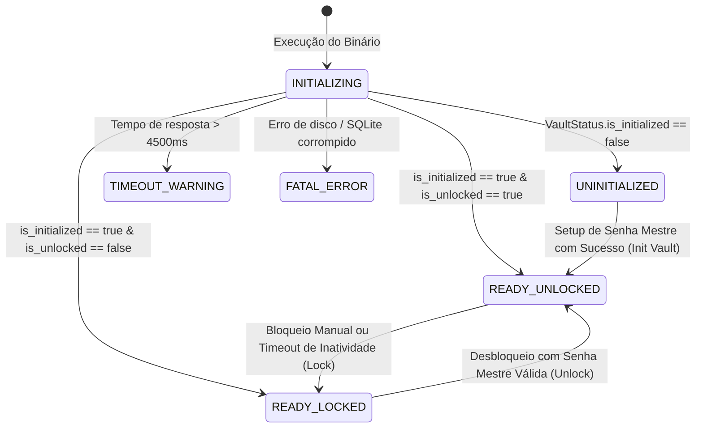

# 🏛️ Auditoria da Primeira Experiência do Usuário (Onboarding & Boot)
## Sequência de Inicialização Real, Estados do Cofre e Análise de Lacunas

**Data:** 05/11/2026  
**Auditor:** ASPPIBRA DevOS Engine  
**Referência:** Fases 3 e 11 da Ordem 5.3  

---

## 1. Mapeamento da Sequência de Inicialização Real (Código Comprovado)

A auditoria dos arquivos de inicialização identificou a exata sequência executada pelo DevOS Desktop desde o clique no binário:

```text
[1. Executável Rust (src-tauri/src/main.rs)]
        │
        ▼
[2. Setup Tauri Core (src-tauri/src/lib.rs)]
        │   • Resolve app_data_dir (~/.local/share/br.aspp.devos.cockpit)
        │   • Executa MigrationManager::run_migrations no devos_vault.sqlite
        │   • Se for Cockpit: executa RealEstateMigrationManager no real_estate.sqlite
        │   • Registra estados compartilhados (LocalDatabase, VaultSession, RealEstateDatabase)
        │   • Abre a janela principal com index.html
        ▼
[3. Splash HTML Inicial (index.html)]
        │   • Renderiza layout base, spinner e mensagens de estágio de carregamento
        │   • Expõe window.__DEVOS_UPDATE_SPLASH_STAGE__ e window.__DEVOS_FINISH_SPLASH__
        ▼
[4. React Entry Point (src/main.tsx)]
        │   • Monta ReactDOM.createRoot
        │   • Inicializa ThemeProvider, RouterProvider e <AppBootstrapProvider>
        ▼
[5. Máquina de Estados de Bootstrap (src/app/bootstrap/app-bootstrap-provider.tsx)]
        │   • Consulta IPC nativo: VaultBridge.getVaultStatus()
        │   • Transiciona entre os 7 estados de bootstrap
        ▼
[6. Roteador Principal (src/app/router/app-router.tsx)]
        │
        ├── Se state == 'UNINITIALIZED' (Cofre não configurado no hardware):
        │   └── Exibe <JwtSignUpView isInitVault /> (Criação da Senha Mestre de 12+ caracteres)
        │
        ├── Se state == 'READY_LOCKED' (Cofre já existe mas está trancado):
        │   └── Exibe <JwtSignInView /> (Desbloqueio do Cofre local via Senha Mestre)
        │
        └── Se state == 'READY_UNLOCKED' (Cofre destrancado com chave na memória):
            └── Monta <DevOSLayout> com as rotas de currentEdition (@edition)
```

---

## 2. Diagrama de Transição de Estados do Cofre Nativo



---

## 3. Comparativo: Fluxo Desejado vs Implementação Real Atual

| Etapa do Fluxo Desejado | Existe Componente? | Existe Serviço Rust? | Persistência Funcional? | Status no Código | Lacuna Identificada |
|---|---|---|---|---|---|
| **1. Download & Instalação** | ❌ Não | 🟡 Tauri Build pronto | ❌ Não empacotado | `PARCIAL` | Não há pacote DEB/AppImage distribuído no sistema. |
| **2. Lançador da Área de Trabalho** | ❌ Não | — | — | `AGUARDANDO` | Depende da autorização da próxima ordem. |
| **3. Primeira Inicialização / Splash** | ✅ `SplashScreen` | ✅ Tauri window setup | ✅ Webview nativo | `CONCLUÍDO` | Totalmente implementado e funcional. |
| **4. Configuração do Workspace** | ❌ Não | ❌ Não | ❌ Não | `NÃO IMPLEMENTADO` | O app ainda não cria pastas automaticamente na Área de Trabalho. |
| **5. Criação do Cofre (Vault Setup)** | ✅ `JwtSignUpView` | ✅ `VaultBridge.init_vault` | ✅ `devos_vault.sqlite` | `CONCLUÍDO` | Grava canary envelope e cria tabelas. |
| **6. Geração da Wallet Genesis** | 🟡 `WalletsView` | ✅ `DerivationService` | ✅ Schema `wallets` | `PARCIAL` | Não é gerada automaticamente no boot; depende de clique do usuário. |
| **7. Identidade do Participante** | 🟡 `HostIntegrityCard` | ✅ `SystemBridge` | 🟡 Parcial | `PARCIAL` | Falta tela dedicada consolidando endereço e perfil. |
| **8. Emissão do Certificado `.dvcert`** | ❌ Não | ❌ Não | ❌ Não | `NÃO IMPLEMENTADO` | Emissão criptográfica ainda não desenvolvida. |
| **9. Associação de Perfil (Founder/Holder)**| 🟡 Subtítulo UI | ❌ Não | ❌ Não | `PARCIAL` | Selecionado por build estático, não por credencial do usuário. |
| **10. Abertura do Dashboard** | ✅ Cockpit / Node | ✅ Tauri IPC | ✅ Local SQLite | `CONCLUÍDO` | Roteamento por `@edition` funcional. |

---

## 4. Conclusão da Fase 11

A primeira experiência de inicialização básica (Boot -> Verificação de Cofre -> Setup de Senha Mestre -> Desbloqueio -> Dashboard) está **100% implementada e testada** no código.

As etapas de criação automática do Workspace local, auto-geração da Wallet Genesis no primeiro boot e emissão do certificado `.dvcert` constituem as **lacunas funcionais** que justificam a estratégia prudente da Ordem: preparar a estrutura da Área de Trabalho como uma base Beta 1.0 transparente, sem simular dados inexistentes.

