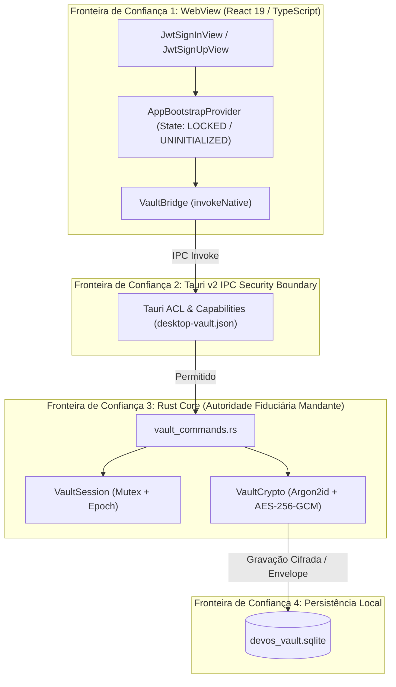

# Relatório de Auditoria Profunda e Sistemática
## Módulo de Credenciais, Autenticação, Login e Cofre Criptográfico
**Projeto:** ASPPIBRA-DAO DevOS Desktop  
**Versão do Software:** 1.0.0  
**Commit Auditado:** `d56d60238b0623bfc9155feedc1b175daecbfdd0` (Branch `main`)  
**Data da Auditoria:** 28 de Outubro de 2026  
**Modalidade:** Auditoria Técnica Somente Leitura (Sem modificações de código de produção)  
**Padrões de Referência:** OWASP ASVS v5.0, OWASP Password Storage Cheat Sheet, OWASP Session Management Cheat Sheet, Tauri v2 Security Architecture  

---

## A. Sumário Executivo

A presente auditoria avaliou a arquitetura, implementação e controles de segurança do subsistema de autenticação, credenciais e cofre criptográfico do **ASPPIBRA-DAO DevOS Desktop**.

### Principais Conclusões:
1. **Robustez do Núcleo Criptográfico:** A proteção das chaves privadas e sementes em disco implementa padrões modernos de alta segurança através de **Argon2id** (64 MiB, 3 iterações, 1 thread) e criptografia autenticada **AES-256-GCM** com nonces de 96 bits aleatórios e salts de 16 bytes exclusivos por envelope. O descarte de chaves sensíveis e buffers na RAM utiliza `Zeroize` e `ZeroizeOnDrop`.
2. **Defesa em Profundidade no Rust:** O núcleo nativo atua como a autoridade fiduciária mandante para comandos críticos (`export_authorized_secret`, `export_vault_backup`, `reveal_pending_mnemonic`, `confirm_and_save_wallets`), impedindo bypass visual a partir do WebView.
3. **Falhas Críticas Identificadas (Bloqueio Incompleto por Lacuna de ACL):**
   * **ACHADO-01 (CRÍTICA):** O comando `lock_vault` não foi registrado no manifesto de comandos do build (`src-tauri/build.rs`) nem na capability (`src-tauri/capabilities/desktop-vault.json`). Como consequência, qualquer chamada do frontend para trancar o cofre é rejeitada pelo runtime do Tauri v2 por erro de permissão. O frontend captura o erro e altera visualmente a tela para `READY_LOCKED`, porém a sessão no Rust permanece **desbloqueada em memória**.
4. **Desconexão Conceitual entre Nuvem e Cofre Local:**
   * **ACHADO-02 (ALTA):** Os fluxos de recuperação de senha (`/forgot-password`, `/reset-password`) e verificação OTP (`/verify`) utilizam serviços simulados e mockados que não possuem conexão matemática com a chave simétrica local do cofre. A redefinição de senha não recupera o cofre criptografado local e pode gerar inconsistência irreversível.
   * **ACHADO-03 (ALTA):** A autenticação Web3 (`signInWithWeb3`) não exige assinatura criptográfica de desafio (EIP-4361 / SiWE), aceitando qualquer endereço informado pela carteira sem validação de posse, além de não derivar chave para o cofre nativo.
5. **Exposição de Metadados Pessoais sem Verificação de Sessão:**
   * **ACHADO-04 (MÉDIA):** O comando IPC `list_stored_wallets` não valida se a sessão está desbloqueada (`session.is_unlocked()`), permitindo que metadados confidenciais (incluindo `client_doc`/CPF e endereços) sejam listados por qualquer contexto de janela com a capability.
6. **Ausência de Temporizador de Inatividade (Auto-Lock):**
   * **ACHADO-05 (MÉDIA):** Não há watchdog de inatividade no frontend ou no backend Rust. Uma vez desbloqueado, o cofre permanece aberto indefinidamente.

---

## B. Escopo e Metodologia

### 1. Metodologia de Inspeção:
* **Análise Estática de Código-Fonte:** Rastreamento do ciclo de vida das credenciais, buffers de memória, tipos e fluxos de exceção.
* **Inspeção de Contratos e Permissões Tauri v2:** Verificação da matriz de comandos em `lib.rs`, `build.rs` e arquivos JSON de `capabilities/`.
* **Auditoria Criptográfica:** Verificação de algoritmos, parâmetros de memória, geração de entropia e zeroização de memória.
* **Execução Controlada de Testes:** Execução das suítes automatizadas existentes (`cargo test`, `pnpm test`, `pnpm ts:check`, `pnpm lint`, `pnpm check:arch`) em ambiente isolado sem alteração de arquivos de produção.

### 2. Inventário de Arquivos Auditados:
* **Frontend React/TypeScript (17 arquivos):**
  * `src/app/providers/app-bootstrap-provider.tsx`
  * `src/app/router/index.tsx`
  * `src/routes/paths.ts`
  * `src/auth/view/jwt/jwt-sign-in-view.tsx`
  * `src/auth/view/jwt/jwt-sign-up-view.tsx`
  * `src/auth/view/jwt/jwt-reset-password-view.tsx`
  * `src/auth/view/jwt/jwt-update-password-view.tsx`
  * `src/auth/view/jwt/jwt-verify-view.tsx`
  * `src/auth/context/jwt.ts`
  * `src/auth/hooks.ts`
  * `src/auth/application/identity-session.service.ts`
  * `src/auth/components/form-head.tsx`
  * `src/auth/components/form-socials.tsx`
  * `src/auth/components/form-divider.tsx`
  * `src/layouts/auth-centered/layout.tsx`
  * `src/layouts/auth-centered/globe-background.tsx`
  * `src/platform/tauri/vault/vault-bridge.ts`
* **Backend Rust Core (7 arquivos):**
  * `src-tauri/src/lib.rs`
  * `src-tauri/src/build.rs`
  * `src-tauri/src/commands/vault_commands.rs`
  * `src-tauri/src/commands/wallet_commands.rs`
  * `src-tauri/src/vault/access_control.rs`
  * `src-tauri/src/vault/encryption.rs`
  * `src-tauri/src/storage/local_database.rs`
* **Configurações e Segurança Tauri (4 arquivos):**
  * `src-tauri/capabilities/desktop-vault.json`
  * `src-tauri/capabilities/cockpit-real-estate.json`
  * `src-tauri/capabilities/default.json`
  * `src-tauri/tauri.conf.json`

---

## C. Mapa Arquitetural Real e Fronteiras de Confiança



---

## D. Máquina de Estados e Tabela-Verdade Auditada

### 1. Estados Reais Implementados no Frontend (`AppBootstrapProvider`):
* `INITIALIZING`: Handshake e consulta IPC `get_vault_status` em andamento.
* `UNINITIALIZED`: Cofre não configurado (`is_initialized: false`). Roteia para `JwtSignUpView` com `isInitVault={true}`.
* `READY_LOCKED`: Cofre configurado porém trancado (`is_unlocked: false`). Roteia para `JwtSignInView`.
* `READY_UNLOCKED`: Cofre autenticado e aberto (`is_unlocked: true`). Roteia para Dashboard e módulos.
* `WEB_PREVIEW`: Ambiente sem Tauri nativo (simulação em navegador).
* `TIMEOUT_WARNING`: Resposta IPC excedeu 4.5s.
* `FATAL_ERROR`: Erro de I/O, banco corrompido ou anomalia lógica detectada.

### 2. Tabela-Verdade de Avaliação de Status:

| `is_initialized` | `is_unlocked` | Resposta IPC | Estado Frontend | Comportamento no Rust | Avaliação de Segurança |
| :--- | :--- | :--- | :--- | :--- | :--- |
| `false` | `false` | Válida | `UNINITIALIZED` | Exige `init_master_password` | ✅ Conforme |
| `false` | `true` | Válida | `FATAL_ERROR` | Anomalia detectada; Fail-Closed | ✅ Conforme (Invariante estrita) |
| `true` | `false` | Válida | `READY_LOCKED` | Bloqueado; exige senha mestre | ✅ Conforme |
| `true` | `true` | Válida | `READY_UNLOCKED` | Sessão aberta na RAM | ✅ Conforme |
| Qualquer | Qualquer | Timeout (>4.5s)| `TIMEOUT_WARNING`| Descarta resposta tardia via `attemptSeqRef` | ✅ Conforme |
| Qualquer | Qualquer | Exceção I/O | `FATAL_ERROR` | Não libera sessão; exibe erro sanitizado | ✅ Conforme |

---

## E. Inventário de Comandos IPC e Matriz de Permissões

| Comando IPC | Implementado no Rust | Listado no `build.rs` | Concedido em `desktop-vault.json` | Exige Cofre Desbloqueado | Status de Segurança |
| :--- | :---: | :---: | :---: | :---: | :--- |
| `get_vault_status` | Sim | Sim | Sim | Não | ✅ Conforme (Informativo) |
| `init_master_password` | Sim | Sim | Sim | Não (Apenas se cofre não existir) | ✅ Conforme (Protegido contra sobrescrita) |
| `unlock_vault` | Sim | Sim | Sim | Não (Valida senha no comando) | ✅ Conforme (Atomicidade por Epoch) |
| `lock_vault` | Sim | ❌ **NÃO** | ❌ **NÃO** | N/A | 🚨 **VULNERABILIDADE CRÍTICA (Bloqueado por ACL)** |
| `export_authorized_secret` | Sim | Sim | Sim | Sim (`session.is_unlocked()`) | ✅ Conforme (Dupla autorização) |
| `export_vault_backup` | Sim | Sim | Sim | Sim (`session.is_unlocked()`) | ✅ Conforme |
| `restore_vault_backup` | Sim | Sim | Sim | Não (Valida senha do backup) | ✅ Conforme |
| `generate_seed_and_preview` | Sim | Sim | Sim | Não (Memória isolada Staged) | ✅ Conforme |
| `reveal_pending_mnemonic` | Sim | Sim | Sim | Sim (`session.is_unlocked()`) | ✅ Conforme |
| `confirm_and_save_wallets` | Sim | Sim | Sim | Sim (`session.is_unlocked()`) | ✅ Conforme |
| `list_stored_wallets` | Sim | Sim | Sim | ❌ **NÃO** | ⚠️ **FALHA DE PRIVACIDADE (Expõe CPFs e Metadados)** |

---

## F. Inventário Criptográfico

* **Função de Derivação de Chaves (KDF):**
  * Algoritmo: **Argon2id** (RFC 9106)
  * Memória (`m_cost`): 64 MiB (65.536 KiB)
  * Iterações de Tempo (`t_cost`): 3
  * Paralelismo (`p_cost`): 1 thread
  * Comprimento da Chave de Saída: 256 bits (32 bytes)
  * Salt: 16 bytes obtidos de gerador criptográfico do sistema operacional via `rand::thread_rng()`.
* **Algoritmo de Cifra Simétrica:**
  * Algoritmo: **AES-256-GCM** (Criptografia Autenticada com Dados Associados - AEAD)
  * Tamanho do Nonce: 12 bytes (96 bits padrão NIST SP 800-38D) gerados unicamente por operação.
  * Tag de Autenticação: 128 bits (16 bytes), validada obrigatoriamente na decifração.
* **Validação de Senha Mestre (Canary Envelope):**
  * O sistema não armazena hash direto da senha. Em vez disso, cifra um texto canário constante (`ASPPIBRA_DEVOS_VAULT_CANARY_V1`). A validação consiste em decifrar com sucesso e conferir o texto original.
* **Gerenciamento de Memória Sensível:**
  * No Rust: Buffers de chave derivada implementam `Zeroize` e `ZeroizeOnDrop`.
  * `StagedMnemonic` utiliza `ZeroizeOnDrop` com reaper periódico em background (15 segundos) e expiração forçada após 5 minutos.
  * No Frontend: A senha trafega como string imutável no JavaScript, sem sanitização deliberada de formulários.

---

## G. Inventário de Persistência (SQLite)

* **Localização Física:** Resolvido nativamente via `app_data_dir().join("devos_vault/devos_vault.sqlite")`.
* **Modo de Journal:** `PRAGMA journal_mode = WAL;` com `PRAGMA foreign_keys = ON;`.
* **Tabelas do Banco do Cofre:**
  1. `schema_migrations`: Controle auditável de migrações (`version`, `applied_at`).
  2. `vault_header`: Tabela de linha única (`CHECK (id = 1)`) contendo o envelope canário do cofre. Protegida contra sobrescrita com transações `Immediate`.
  3. `wallets`: Metadados públicos das carteiras (`address`, `derivation_path`, `label`, `user_name`, `client_doc`).
  4. `vault_secrets`: Tabela confidencial contendo envelopes criptografados (`vault_id`, `envelope`, `created_at`). Segredos e frases mnemônicas nunca são persistidos em texto claro.
* **Segregação de Bancos:** `devos_vault.sqlite` é estritamente separado de `real_estate.sqlite`, garantindo que dados fiduciários do cofre não se misturem com dados operacionais ou cadastrais.

---

## H. Matriz de Avaliação de Ameaças (Ameaças A a L)

| Ameaça | Ativo Sob Risco | Controle Implementado | Status Auditado | Lacuna Restante |
| :--- | :--- | :--- | :--- | :--- |
| **A: Acesso aos arquivos locais** | Banco SQLite copiado | Cifra AES-256-GCM + KDF Argon2id | ✅ Eficaz | Dados cifrados protegidos; metadados de carteiras visíveis em disco. |
| **B: Frontend comprometido (XSS)** | Invocação indevida de IPC | Autorização mandatória no Rust | ⚠️ Parcial | `list_stored_wallets` acessível sem autenticação. |
| **C: IPC fora de sequência** | Sobrescrita de cofre | Transação `Immediate` no SQLite | ✅ Eficaz | Impossível sobrescrever cofre inicializado. |
| **D: Força bruta de senha** | Senha mestre | Argon2id pesado (64 MB, 3 rounds) | ⚠️ Parcial | Não há bloqueio/backoff progressivo no IPC online. |
| **E: Corrida de sessão** | `VaultSession` concorrente | Epoch atômico + Mutex Fail-Closed | ✅ Eficaz | Operações lentas abortam se cofre for trancado. |
| **F: Estado inconsistente** | Falha de energia no I/O | SQLite WAL + Migrações atômicas | ✅ Eficaz | Transações atômicas revertem gravações parciais. |
| **G: Credencial exposta em logs** | Senha mestre / Frases | `Zeroizing` no Rust e `IpcError` regex | ⚠️ Parcial | Falta limpeza explícita no React Hook Form (`reset()`). |
| **H: Reutilização de prova Web3** | Acesso ao operador | Mock no frontend (`return true`) | ❌ **Vulnerável** | Ausência de desafio assinado (EIP-4361 SiWE). |
| **I: Recuperação abusiva** | Redefinição de senha | Nenhuma relação com o cofre | ❌ **Incompatível** | Redefinição web não recupera cofre local soberano. |
| **J: Dependência comprometida** | Processo e memória | Crates oficiais auditados | ✅ Eficaz | Nenhuma vulnerabilidade conhecida nos crates criptográficos. |
| **K: Bloqueio incompleto** | Desbloqueio fantasma | N/A (ACL Tauri bloqueou o lock) | 🚨 **Vulnerável** | `lock_vault` rejeitado por permissão; cofre segue aberto no Rust. |
| **L: Divisão entre edições** | Acesso indevido a dados | Capabilities segregadas por edição | ✅ Eficaz | Edição Node exclui capability do banco cadastral. |

---

## I. Achados Técnicos Detalhados

### [ACHADO-01] Falha de Bloqueio Efetivo por Omissão de Permissão ACL no Tauri v2
* **Gravidade:** **CRÍTICA**
* **Confiança:** **ALTA** (Comprovado no código)
* **Categoria:** IPC / Controle de Acesso / Ciclo de Vida da Sessão
* **CWE:** CWE-284 (Improper Access Control), CWE-862 (Missing Authorization / Permissive State)
* **Arquivos Envolvidos:**
  * `src-tauri/build.rs:3-25`
  * `src-tauri/capabilities/desktop-vault.json:8-28`
  * `src/app/providers/app-bootstrap-provider.tsx:272-278`
* **Comportamento Observado:** O comando `lock_vault` está registrado em `src-tauri/src/lib.rs:68`, mas NÃO foi incluído na lista de comandos do `tauri_build::Attributes` em `build.rs`. Consequentemente, o Tauri não gerou a permissão `allow-lock-vault`, e ela não existe no arquivo `desktop-vault.json`. Quando o usuário aciona o bloqueio ou o frontend chama `VaultBridge.lock()`, o Tauri v2 rejeita a operação com erro de permissão IPC. No frontend, o bloco `try { await VaultBridge.lock(); } finally { setState('READY_LOCKED'); }` mascara o erro e atualiza o estado visual do React para bloqueado. No entanto, o método `session.lock()` no Rust NUNCA é executado.
* **Impacto:** O cofre permanece **desbloqueado no núcleo nativo Rust**, mantendo as chaves na memória RAM e aceitando comandos privilegiados. O usuário acredita que o sistema está seguro, mas o bloqueio é puramente cosmético.
* **Correção Recomendada:**
  1. Adicionar `"lock_vault"` à lista de comandos em `src-tauri/build.rs`.
  2. Adicionar `"allow-lock-vault"` ao array de permissões em `src-tauri/capabilities/desktop-vault.json`.
  3. No frontend, tratar falhas de bloqueio de forma explícita, impedindo transição de estado se o comando nativo falhar.

---

### [ACHADO-02] Incompatibilidade Arquitetural nos Fluxos de Recuperação de Senha
* **Gravidade:** **ALTA**
* **Confiança:** **ALTA**
* **Categoria:** Autenticação / Criptografia
* **CWE:** CWE-320 (Key Management Errors), CWE-640 (Weak Password Recovery Mechanism)
* **Arquivos Envolvidos:**
  * `src/auth/application/identity-session.service.ts:1-17`
  * `src/auth/view/jwt/jwt-reset-password-view.tsx:51-59`
  * `src/auth/view/jwt/jwt-update-password-view.tsx:76-85`
* **Comportamento Observado:** O serviço `IdentitySessionService` simula recuperação de senha por e-mail e OTP (`return true;`). Em uma aplicação desktop baseada em cofre criptográfico local (onde os dados são cifrados simetricamente pela chave derivada da senha mestre via Argon2id), é matematicamente impossível recuperar ou decifrar o cofre a partir de um e-mail sem a senha original ou a semente mnemônica de 12/24 palavras.
* **Impacto:** Caso um usuário altere a senha por esse fluxo, a nova senha não conseguirá abrir o cofre existente (`devos_vault.sqlite`), resultando em erro permanente de autenticação e perda irreversível de acesso às chaves caso não haja backup.
* **Correção Recomendada:**
  1. Separar formalmente a identidade de nuvem da soberania do cofre local.
  2. Renomear o fluxo de recuperação no desktop para **Recuperação de Cofre por Frase Mnemônica (BIP-39)** ou **Restauração de Arquivo de Backup (`.devosbackup`)**.

---

### [ACHADO-03] Ausência de Validação Criptográfica na Autenticação Web3 (MetaMask)
* **Gravidade:** **ALTA**
* **Confiança:** **ALTA**
* **Categoria:** Autenticação Web3
* **CWE:** CWE-287 (Improper Authentication), CWE-345 (Insufficient Verification of Data Authenticity)
* **Arquivos Envolvidos:**
  * `src/auth/context/jwt.ts:33-38`
  * `src/auth/view/jwt/jwt-sign-in-view.tsx:99-127`
* **Comportamento Observado:** O método `signInWithWeb3(address)` apenas verifica se a string do endereço não está vazia e retorna `true`. Nenhuma assinatura digital (desafio de posse de chave privada via `personal_sign` ou padrão EIP-4361 SiWE) é solicitada ou verificada no backend nativo. Além disso, a autenticação Web3 não desbloqueia o cofre local SQLite, mantendo o usuário em estado de bloqueio funcional na máquina de estados.
* **Impacto:** Qualquer usuário que forneça um endereço público EVM qualquer consegue passar pela verificação da função de autenticação simulada.
* **Correção Recomendada:**
  1. Implementar o padrão EIP-4361 (Sign-In with Ethereum) com desafio criptográfico baseado em nonce descartável gerado pelo Rust.
  2. Documentar que o login Web3 atua como autenticação de identidade remota, mas não substitui a senha mestre para decifração física do cofre de custódia local.

---

### [ACHADO-04] Exposição de Metadados Pessoais e Cadastrais sem Verificação de Sessão
* **Gravidade:** **MÉDIA**
* **Confiança:** **ALTA**
* **Categoria:** Controle de Acesso / Privacidade
* **CWE:** CWE-200 (Exposure of Sensitive Information to an Unauthorized Actor)
* **Arquivos Envolvidos:**
  * `src-tauri/src/commands/wallet_commands.rs:242-245`
  * `src-tauri/src/storage/local_database.rs:147-177`
* **Comportamento Observado:** O comando nativo `list_stored_wallets` consulta diretamente o banco de dados e retorna a lista completa de carteiras com nome do operador, rótulos, endereços e o documento cadastral do cliente (`client_doc`, que contém CPF), **sem verificar se o cofre está desbloqueado** (`session.is_unlocked()`).
* **Impacto:** Scripts ou extensões que executem no contexto da janela podem listar todos os dados cadastrais e o histórico de associados sem que a senha mestre tenha sido digitada.
* **Correção Recomendada:** Incluir a validação mandatória de autorização no Rust:
  ```rust
  if !session.is_unlocked() {
      return Err("Acesso negado: o cofre precisa estar desbloqueado.".to_string());
  }
  ```

---

### [ACHADO-05] Ausência de Temporizador de Inatividade (Auto-Lock)
* **Gravidade:** **MÉDIA**
* **Confiança:** **ALTA**
* **Categoria:** Gestão de Sessão
* **CWE:** CWE-613 (Insufficient Session Expiration)
* **Arquivos Envolvidos:**
  * `src/app/providers/app-bootstrap-provider.tsx`
  * `src-tauri/src/vault/access_control.rs`
* **Comportamento Observado:** Não existe nenhum mecanismo de watchdog ou timer de inatividade configurado no frontend ou no Rust Core. Uma vez desbloqueado com sucesso, o cofre permanece indefinidamente acessível até o encerramento do processo.
* **Impacto:** Deixar a estação de trabalho desacompanhada expõe todas as operações de exportação e assinatura sem exigência de reautenticação.
* **Correção Recomendada:** Implementar um temporizador de inatividade configurável (ex.: 15 minutos), monitorando eventos de mouse/teclado no frontend ou disparando o bloqueio seguro nativo no Rust.

---

## J. Cobertura e Resultados dos Testes Auditados

| Suíte de Testes | Comando Executado | Resultado Real | Cobertura do Escopo de Segurança |
| :--- | :--- | :--- | :--- |
| **Rust Core Unit & Integration** | `cargo test` | ✅ **69 aprovados**, 4 ignorados | Excelente em KDF, derivação e persistência atômica. Lacuna: Não testou a ACL do comando `lock_vault`. |
| **TypeScript Type Checking** | `pnpm ts:check` | ✅ **0 erros** | Contratos de tipos estritos validados. |
| **Frontend Unit & Integration** | `pnpm test` (`vitest run`) | ✅ **58/58 aprovados** | Testes de bootstrap e invariantes aprovados, porém com mock total do IPC. |
| **Linting & Code Style** | `pnpm lint` | ✅ **0 erros, 0 avisos** | Código sem desvios de formatação. |
| **Validação de Arquitetura** | `pnpm check:arch` | ✅ **0 violações** (525 módulos) | Clean Architecture preservada sem ciclos circulares. |
| **Integridade de Diffs** | `git diff --check` | ✅ **Limpo** | Sem espaços em branco ou conflitos pendentes. |

---

## K. Plano de Remediação Priorizado

### Prioridade P0 — Urgente (Bloqueio de Segurança Crítico)
1. **Ativar o comando `lock_vault` na ACL do Tauri v2:**
   * Arquivo: `src-tauri/build.rs` ➔ Adicionar `"lock_vault"` à lista `commands`.
   * Arquivo: `src-tauri/capabilities/desktop-vault.json` ➔ Adicionar `"allow-lock-vault"`.
   * Teste de Regressão: Criar teste de integração em Rust validando que a capability contém `allow-lock-vault`.

### Prioridade P1 — Alta Prioridade (Integridade de Acesso e Metadados)
2. **Proteger o comando `list_stored_wallets`:**
   * Arquivo: `src-tauri/src/commands/wallet_commands.rs` ➔ Exigir `session.is_unlocked()`.
3. **Reestruturar o Fluxo de Recuperação e Autenticação Web3:**
   * Desacoplar `/forgot-password` de serviços simulados e implementar recuperação nativa via semente de 12/24 palavras BIP-39 (`restore_vault_backup` / derivação mnemônica).
   * Implementar desafio de assinatura criptográfica EIP-4361 no login Web3.

### Prioridade P2 — Prioridade Normal (Robustez e Gestão de Sessão)
4. **Implementar Temporizador de Inatividade (Auto-Lock):**
   * Configurar watchdog de 15 minutos de inatividade para invocar automaticamente o `lock_vault`.
5. **Rate-Limiting e Backoff no `unlock_vault`:**
   * Adicionar limitação progressiva contra força bruta online em chamadas IPC sucessivas de senha incorreta.

### Prioridade P3 — Melhoria e Higiene de Memória
6. **Limpeza Explícita de Formulários:**
   * Invocar `methods.reset({ password: '' })` após a submissão dos formulários de login e criação de cofre.

---

## L. Parecer Final da Auditoria

**Classificação Oficial:** **Aprovado com Ressalvas Críticas**

* **Justificativa:** O núcleo criptográfico do cofre (`Argon2id + AES-256-GCM + Zeroize`) e a segregação de bancos SQLite possuem excelente qualidade de implementação e rigor matemático. Entretanto, a aplicação apresenta uma **falha impeditiva na fronteira de controle de acesso do Tauri v2 (ACHADO-01)**, em que a operação de bloqueio do cofre é rejeitada pelo runtime por omissão na lista de permissões, mantendo o backend vulnerável mesmo quando a interface aparenta estar bloqueada. A correção do ACHADO-01 e do ACHADO-04 é mandatória antes da liberação final do módulo para produção.
